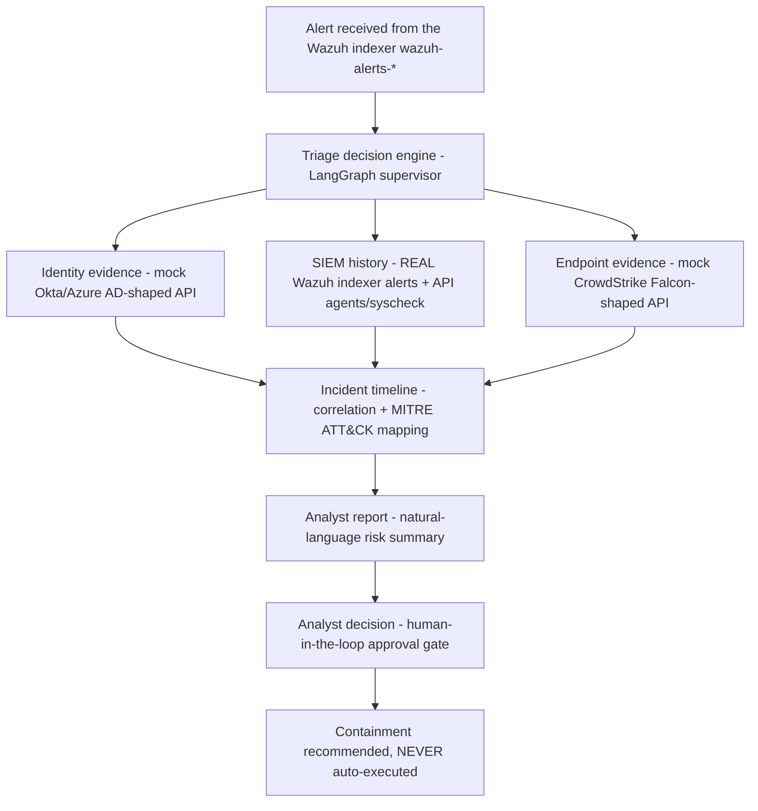

# Project Design Document — AI-Agentic SOC Triage & Investigation Engine

> **DAE 6-Month Project · Design Documentation**
>
> **Author:** Kyrell Green  ·  **Version:** DRAFT  ·  **Date:** 11/20/2026
>
> Based on: EDU_DOC Project Design Document Template v2

---

*This document follows the **EDU_DOC Resource — Project Design Document Template v2** (last updated November 3rd, 2025). Prompts from the template have been replaced with the actual design of the **AI-Agentic SOC Triage & Investigation Engine**, the active capstone in the DAE 6-Month Project Files workspace.*

## Contents

1. [Project Title & Version Control](#1-project-title--version-control)
2. [Project Summary](#2-project-summary-23-sentences)
3. [Problem Statement / Use Case](#3-problem-statement--use-case)
4. [Goals and Objectives](#4-goals-and-objectives)
5. [Roles and Responsibilities](#5-roles-and-responsibilities-if-team-based-project)
6. [Key Features / Functions](#6-key-features--functions)
7. [Tech Stack and Tools](#7-tech-stack-and-tools)
8. [Architecture / Workflow Diagram](#8-architecture--workflow-diagram)
9. [Timeline / Weekly Milestones](#9-timeline--weekly-milestones)
10. [Risks and Risk Mitigation](#10-risks-and-risk-mitigation)
11. [Evaluation Criteria](#11-evaluation-criteria)
12. [Future Considerations](#12-future-considerations)

---

## 1. Project Title & Version Control

**Project Title:** AI-Agentic SOC Triage & Investigation Engine

*A clear, relevant name describing an LLM-orchestrated agent that triages security alerts from a real Wazuh SIEM, correlates supporting evidence, and produces a MITRE-mapped analyst report.*

### Version Control

| Field | Value |
|---|---|
| Version | **DRAFT** — v0.3 (adopted architecture updates) |
| Date | 11/20/2026 |
| Change Log | See below |

**Change Log:**

- **v0.1** — Initial design: mock SIEM/identity/EDR pillars, LangGraph pull model.
- **v0.2** — Added LLM tool-calling agent and evidence-correlation design.
- **v0.3** — Real Wazuh 4.14.7 replaces mock SIEM (see `ARCHITECTURE.md`); continuous background triage agent, deterministic correlation with burst delineation, HTML reports, evaluation dataset, and FastAPI/Streamlit control plane documented.

---

## 2. Project Summary (2–3 sentences)

This project builds an autonomous triage agent that watches a live Wazuh SIEM, gathers identity and endpoint evidence, correlates it into a reproducible timeline, and writes a natural-language incident report mapped to MITRE ATT&CK. It matters because SOC teams are flooded with alerts that arrive at all hours, and an agent that performs the first-pass investigation before a human opens the queue can cut triage time while keeping containment authority with a person. The system is deliberately built so code owns the facts (counts, timestamps, techniques) and the LLM only writes the prose, with a hard approval gate that makes automated containment impossible by design.

---

## 3. Problem Statement / Use Case

### Real-world problem

Security operations centers face high alert volume and constant context-switching. Each detection requires an analyst to manually pivot across the SIEM, identity provider and EDR, correlate events by user/host/source IP, decide whether activity is benign, and write a report — work that is slow, repetitive, and difficult to perform consistently at 03:00 when attacks actually happen. A second problem is trust: handing an LLM raw alerts and asking it to "investigate" invites hallucinated numbers and unsafe automated actions.

### Who would use this

- **SOC analysts / tier-1 triage** — open a pre-investigated case instead of raw alerts, with a timeline and draft report.
- **SOC leads / incident responders** — review MITRE-mapped evidence, approve or reject recommendations, and audit how a conclusion was reached.
- **Security engineering / portfolio reviewers** — evaluate API integration, deterministic correlation and evaluation methodology against a real lab SIEM.

> **Use case in one line:** "Alert arrives from Wazuh → the agent triages it with three evidence pillars → an analyst reviews a DRAFT report and decides what, if anything, to contain."

---

## 4. Goals and Objectives

1. **Autonomous first-pass triage against a real SIEM.** Build a continuously running LangGraph agent that polls the Wazuh indexer, waits for Wazuh correlation rules to settle, and investigates qualifying alerts (level ≥ 10) without analyst prompting.
2. **Reproducible, auditable evidence correlation.** Implement deterministic Python correlation (relations, attack phases, bursts, timeline, MITRE mapping) so every number in a report can be re-derived from the indexer, and the LLM is restricted to narrative sections.
3. **Safe human-in-the-loop output.** Produce stamped DRAFT Markdown + HTML reports with full provenance and an approval gate that records analyst decisions but never executes containment.

*Supporting objective: demonstrate measurable results with a deterministic 50-case labeled evaluation dataset (ground truth assigned by code, never the LLM) replayed through the real agent graph.*

---

## 5. Roles and Responsibilities (If team based project)

This is an individual capstone. All roles below are held by **Kyrell Green**, who designed, implemented, tested and documented the system end to end. The roles are listed explicitly to show the functional areas covered and where mock external services stand in for real vendors.

| Role | Responsibilities in this project |
|---|---|
| Project owner / lead developer | Scope, architecture decisions, change log, and final submission. |
| SOC engineer / SIEM integrator | Wazuh 4.14.7 lab, REST API + indexer clients, JWT auth, alert normalizer, live agent inventory. |
| AI / agent engineer | LangGraph supervisor pipeline, deterministic correlation, LLM narrative step, model fallback chain. |
| Backend / API engineer | FastAPI triage control plane, job queue, case and decision endpoints; SQLite operational state. |
| Frontend engineer | Streamlit dashboard for alert queue, case review, reports and the approval gate. |
| QA / evaluation engineer | 99 passing unit + integration tests, 50-case labeled dataset, PostgreSQL `eval` schema, evaluation harness. |
| Technical writer | Architecture, technical documentation, demo script, portfolio case study, and this design document. |
| External services (mocks) | Identity service is Okta/Azure AD–shaped; EDR service is CrowdStrike Falcon–shaped; both are schema-matched mocks swappable for real vendors later. |

---

## 6. Key Features / Functions

- **Continuous background watcher** — polls the Wazuh indexer (`wazuh-alerts-*`) with a cursor and seen-ID set; read-only.
- **Settle window** — waits `AGENT_SETTLE_SECONDS` (25 s) so Wazuh's own correlation rules fire before a trigger is chosen.
- **Three evidence pillars** — real Wazuh SIEM alerts + agent inventory; mock Okta-shaped identity; mock Falcon-shaped EDR telemetry.
- **Deterministic correlation** — groups events by endpoint, source IP, account and rule family; splits separate attacks into bursts so "attack duration" is not inflated.
- **MITRE ATT&CK mapping & timeline** — phases, techniques and chronological event list computed in Python.
- **LLM narrative with hard guardrails** — model receives a deterministic evidence pack and returns JSON prose; a model chain and wall-clock budget bound failures; reports ship deterministic-only if needed.
- **Auditable reports** — Markdown + self-contained HTML reports with provenance (run ID, evidence/prompt hashes, token use, query count, exact window).
- **Desktop notification** — banner, sound, and clickable dialog that opens the HTML report.
- **Control plane & dashboard** — FastAPI endpoints to queue investigations, poll jobs, list cases, serve reports and record analyst decisions; Streamlit UI for review.
- **Evaluation harness** — 50 labeled cases across five categories, replayed through the real agent graph with accuracy and timing reports.
- **Human-in-the-loop safety** — reports are stamped `DRAFT — requires analyst review`; no containment node exists in the graph.

---

## 7. Tech Stack and Tools

| Category | Tool / Technology | Purpose |
|---|---|---|
| SIEM + alert source | Wazuh 4.14.7 (real, Docker) | Live detections, correlated alerts and historical security-event queries. |
| SIEM connectivity | `httpx` with JWT auth + HTTP Basic (indexer) | Wazuh API for agents/syscheck; OpenSearch indexer for `wazuh-alerts-*` reads. |
| Identity evidence | FastAPI mock (Okta / Azure AD–shaped) | Synthetic user identity and login history. |
| EDR evidence | FastAPI mock (CrowdStrike Falcon–shaped) | Synthetic endpoint process / network / file telemetry. |
| Agent orchestration | LangGraph (LangChain) | Supervisor, evidence tools, correlation, synthesis, native HITL pause/resume. |
| LLM | NVIDIA Nemotron 3 Ultra 550B `nvidia/nemotron-3-ultra-550b-a55b:free` via OpenRouter, with Lightning fallback | Analyst narrative JSON; free-tier model chain bounds cost and failure. |
| Data models | Pydantic schemas | Tool-agnostic internal alert/identity/EDR/SIEM models; vendor-shape isolation. |
| Database | SQLite (MVP, `DATABASE_URL` swappable) + PostgreSQL `eval` schema | Investigation state and labeled ground truth, kept separate. |
| Control plane | FastAPI | Queue investigations, serve jobs/cases/reports, record analyst decisions (loopback only). |
| Dashboard | Streamlit | Alert queue, case review, report viewer, approval gate. |
| Evaluation | Deterministic generator + JSONL + PostgreSQL | 50-case held-out dataset, scoring, accuracy and timing reports. |
| Lab environment | UTM VMs (Kali / Ubuntu / Windows agents), Suricata + EveBox, TheHive 5.2.16, Wireshark | Real endpoints, network detections, case management and packet evidence feeding Wazuh. |
| Language / tests | Python 3.9, pytest, `venv` | 99 passing unit + end-to-end integration tests. |

---

## 8. Architecture / Workflow Diagram

### Algorithm / flow of the investigation pipeline

```
Wazuh alert (indexer) → watch + settle → supervisor (plan pillars) → identity / EDR / SIEM
    → deterministic timeline → LLM narrative → DRAFT report + notify → human approval gate
```

*Containment is recommended as advisory text only — the graph has no containment node.*



### Runtime architecture (as built)

```
Wazuh 4.14.7 (real, Docker)
  indexer :9200 ── wazuh-alerts-* ──► watch (cursor + seen IDs)
  API     :55000 ── /agents ─────────► siem enrichment
         │
         ▼
agent/ — LangGraph supervisor
  watch → settle(25s) → supervisor → identity (mock Okta-shaped)
                                    → edr (mock Falcon-shaped)
                                    → siem (REAL indexer correlation)
         → timeline (relations, phases, bursts)
         → reason (Nemotron via OpenRouter, JSON prose)
         → report (Markdown + HTML, provenance)
         → notify (banner + sound + clickable dialog)
         │
         ▼
Outputs
  reports/SOC-YYYYMMDD-NNN.{md,html} + LATEST.{md,html}
  FastAPI :8080 (queue / jobs / cases / decisions) → Streamlit :8501
  SQLite operational state  |  PostgreSQL eval schema (ground truth)
```

### Key design rules

- **Code owns the facts, LLM owns the prose.** Counts, timestamps, relations, phases, bursts and timeline order are computed in Python from indexed alerts; the model may only narrate them.
- **Attempt volume is the maximum `rule.firedtimes`** counter, never the sum across rules — a cumulative-counter trap documented in the architecture.
- **Settle window** prevents triggering on a level-5 PAM failure before the level-12 brute-force verdict arrives.
- **Burst delineation** uses a 120 s silence gap so unrelated history does not inflate attack duration.
- **Read-only evidence access** to the indexer; no Wazuh write endpoints are ever called.

---

## 9. Timeline / Weekly Milestones

*The template's four-week table is expanded to the 12-week capstone build recorded in the project README, followed by the remaining consolidation work.*

| Week | Outcome |
|---|---|
| Week 1 | Project scoping, lab setup; Wazuh 4.14.7 single-node Docker stack live with agent enrollments. |
| Week 2 | Internal alert schema + Wazuh alert normalizer; indexer query client and JWT API client. |
| Week 3 | Identity mock API (Okta-shaped) and EDR mock API (Falcon-shaped) implemented and seeded. |
| Week 4 | End-to-end evidence gathering across all three pillars; stack integrated and tested. |
| Week 5 | LangGraph supervisor and tool-calling node design; evidence pack schema defined. |
| Week 6 | Alert-to-evidence pipeline wired; agent tools call identity / EDR / Wazuh SIEM. |
| Week 7 | Deterministic correlation, attack phases and MITRE ATT&CK mapping implemented. |
| Week 8 | Continuous background triage agent (watch → settle → supervisor → … → report); first live reports. |
| Week 9 | Report synthesis: Markdown + self-contained HTML with provenance; desktop notification. |
| Week 10 | Hardening: burst delineation, trigger floor, model chain, timeouts/budget; 80+ tests passing. |
| Week 11 | FastAPI triage control plane + Streamlit dashboard; analyst decision recording; 85 tests. |
| Week 12 | 50-case labeled evaluation dataset, PostgreSQL `eval` schema, evaluation harness (45/50 completed), full technical documentation, 99 tests passing. |
| Post-build | Dedicated timeline/MITRE dashboard views, wiring decisions to an action layer (TheHive / approved executor), portfolio case study and demo video. |

---

## 10. Risks and Risk Mitigation

| Risk | Category | Mitigation |
|---|---|---|
| LLM hallucinates counts, timestamps or MITRE techniques | Integrity | Code owns all facts; model returns structured JSON prose only; reports carry evidence hashes so numbers are re-derivable; deterministic-only fallback when unavailable. |
| LLM made unavailable or unparsable | Technical | JSON repair re-ask, ordered model chain (Nemotron Ultra primary / Lightning fallback), wall-clock budget; report still ships with deterministic half and explicit "narrative engine unavailable" note. |
| Free-tier rate limits / model retirement | Operational / cost | Fallback models, token/time budgets, pre-filtering in Python before any LLM call; retired routes swapped by config, not code rewrites. |
| Wazuh API credentials exposed | Security | Credentials from environment variables only; `.env` gitignored; JWT tokens cached in memory with expiry; never committed. |
| Wazuh version API drift | Technical | All Wazuh calls isolated in the `siem/` client + normalizer; internal schema stays stable; alerts from indexer are a documented 4.x constraint. |
| Triggering on individual events before correlation | Accuracy | Settle window (25 s) waits for Wazuh level-12 verdict; trigger floor level 10 keeps benign level-5 noise out of the queue. |
| Attack duration inflated by unrelated history | Accuracy | Burst delineation on a 120 s silence gap; out-of-burst events marked `context`. |
| Over-querying live SIEM / high query cost | Operational / cost | `limit`/`offset` caps, time-window filters, cached lookups; read-only calls to the indexer. |
| Daemon stalls on a slow model stream | Operational | Hard `AGENT_LLM_BUDGET` deadline plus per-attempt WARNING logs (HTTP timeouts are per-read, not total). |
| Unsafe containment | Safety | No containment node exists; recommendations are advisory; reports stamped DRAFT; analyst decisions recorded separately; no credential path to response systems. |
| Dashboard / API exposed on network | Security | Bound to loopback only (`127.0.0.1`); documented requirement for an authenticated proxy before any broader exposure (no built-in auth). |
| Python 3.9 incompatibilities | Technical | Use `Optional[...]`, no `X \| None`; hand-written `httpx` REST client for OpenRouter (official SDK needs ≥3.10). |

---

## 11. Evaluation Criteria

Measures of success for the delivered system:

1. **Functional completeness.** All pipeline stages run end to end against the real Wazuh lab: alert arrival → investigation → timeline → ATT&CK mapping → AI report → analyst approval. Live SSH brute-force detections (e.g. rule `100002`, level 12, MITRE `T1110`) produce a correct, correlated report; 99 tests pass.
2. **Measured accuracy on held-out ground truth.** The 50-case labeled dataset (10 each: credential stuffing, brute force, phishing, ransomware precursor, benign) is replayed through the real agent graph. Latest run: **45/50 completed**, ATT&CK correct **43/50 (86.0%)**, recommendation lenient **40/50 (80.0%)**; 5 cases blocked by free-tier limits were scored incorrect, not silently passed.
3. **Guardrail integrity.** 100% of reports remain DRAFT with provenance; zero auto-executed containment actions; deterministic numbers match the indexer on re-derivation.
4. **Measured time savings.** MTTD and triage latency captured per run (e.g. MTTD ~15 s, triage ~80 s versus manual multi-tool investigation), with processing-time reports by label.
5. **Auditability and documentation quality.** Architecture change log, technical documentation, demo script and this design document allow an independent reviewer to reproduce the build and every reported number.

---

## 12. Future Considerations

- **Action layer integration** — wire recorded analyst approvals into TheHive or an approved executor so decisions close the case; containment remains human-authorized.
- **Dedicated timeline / MITRE dashboard views** — richer visual exploration of correlated events and technique coverage in Streamlit.
- **Real vendor connectors** — replace the identity and EDR mocks with real Okta / CrowdStrike APIs; schemas are already swappable, no agent rebuild needed.
- **Durable job queue & authentication** — replace the single in-process worker with a persistent queue and add auth to the API/dashboard before any non-loopback deployment.
- **Evaluation expansion** — more cases per label, additional attack families, paid-tier or self-hosted LLM for full 50/50 completion, and tuning to improve exact ATT&CK and recommendation accuracy.
- **Detection engineering feedback loop** — feed identified lab gaps (e.g. password spraying undetectable by same-source rules, unactioned flood warnings) back into Wazuh rule tuning.
- **Ongoing maintenance** — track Wazuh API drift, rotate lab credentials (including any exposed in earlier history), verify Suricata log rotation handling, and keep the portfolio case study and demo video current.

> **End of document.** Prepared for the DAE 6-Month Project using the EDU_DOC Project Design Document Template v2 (updated November 3rd, 2025).

---

*Version DRAFT | Copyright © 2026 DAE | Kyrell Green*
