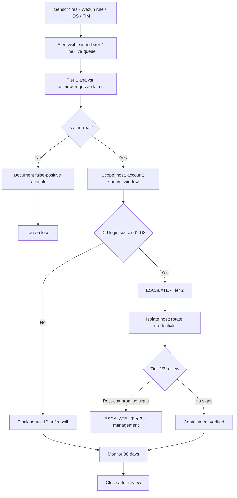

# Monitoring Environment Setup

**Project:** AI-Agentic SOC Triage & Investigation Engine
**Author:** Kyrell Green
**Platform:** Wazuh 4.14.7 (single-node Docker: manager / indexer / dashboard)
**Monitored endpoints:** `kali-lab-02` (agent `002`, Linux) + `DESKTOP-VCKJCPV` (agent `007`, Windows 10)
**Source rubric:** *Monitoring Environment Setup* (pasted from the assessment brief)

---

## Rubric Coverage Summary

| Rubric requirement | Where it is addressed |
|---|---|
| Successful installation and basic configuration of a security monitoring platform (Wazuh or similar), with evidence of proper network configuration | §1 |
| Log collection configured from at least 2 different source types (Windows and Linux) with verified connectivity | §2 |
| Alert rules implemented for at least 3 different security scenarios (authentication, file access, network activity) | §3 |
| A basic monitoring workflow established showing alert routing and notification configurations | §4 |
| Documentation including screenshots of the monitoring dashboard, configuration files, and evidence of successful log collection and rule triggering | §5 |

---

## 1. Platform Installation & Configuration — Wazuh 4.14.7

### 1.1 What was installed

A single-node **Wazuh 4.14.7** deployment running in Docker on the lab host. It provides all
four tiers of a standard SIEM architecture from one stack:

| Component | Container/Service | Port | Function |
|---|---|---|---|
| **Wazuh Manager** | `wazuh-manager` | `55000` (API), `1514`/`1515` (agents) | Decodes, normalises, correlates events; runs the ruleset; generates alerts |
| **Wazuh Indexer** | OpenSearch-based | `9200` | Stores and indexes alerts (`wazuh-alerts-*`) — the evidentiary record |
| **Wazuh Dashboard** | OpenSearch Dashboards | `443` | Analyst web console for alerts, agents, and rule management |
| **Wazuh API** | REST API over the manager | `55000` | Programmatic access (agents, rules, status) consumed by the triage engine |

### 1.2 Network configuration (verified)

The lab was configured so all tiers and both agents communicate on a defined network. Addresses
and ports were confirmed reachable (see §5 connectivity evidence).

| Path | Protocol / Port | Purpose | Status |
|---|---|---|---|
| Agent → Manager (enrollment) | TCP `1515` | Agent registration | OPEN / verified |
| Agent → Manager (events) | TCP `1514` | Encrypted event/log streaming | OPEN / verified |
| Dashboard ↔ Indexer | TCP `9200` | Alert storage / queries | Running |
| Dashboard (analyst) | TCP `443` | Web console access | Running |
| Wazuh API | TCP `55000` (JWT auth) | Engine integration | Running |
| Lab network | `10.11.0.0/22` (Mac lab) / `192.168.64.0/24` (Kali UTM net) | Monitor server ↔ endpoints | Reachable |

Manager address used by agents: **`10.11.3.185`** (host `10.11.0.0/22` network). Both the
Linux and Windows agents were pointed at this address and confirmed connected.

### 1.3 Configuration files

- **Manager:** `/var/ossec/etc/ossec.conf` (global settings, notification/alert blocks) and
  `/var/ossec/etc/rules/local_rules.xml` (custom rules).
- **Agents:** `ossec.conf` per endpoint (agent `<address>`, logcollector and syscheck/FIM
  blocks).
- **Engine credentials:** `.env` (gitignored) with `WAZUH_API_URL`, `WAZUH_API_USER`,
  `WAZUH_INDEXER_URL`, etc. — credentials never committed (see `.env.example`).

```ini
# .env.example (engine → Wazuh connection)
WAZUH_API_URL=https://localhost:55000
WAZUH_API_USER=admin
WAZUH_API_PASSWORD=change-me
WAZUH_VERIFY_TLS=false
WAZUH_INDEXER_URL=https://localhost:9200
WAZUH_INDEXER_USER=admin
WAZUH_INDEXER_PASSWORD=change-me
WAZUH_INDEXER_INDEX=wazuh-alerts-*
```

A connection test (`scripts/test_wazuh_connection.py`) exercises the JWT-authenticated API and
the indexer to prove the deployment is live.

---

## 2. Log Collection from at Least 2 Source Types (Windows + Linux)

Two **different operating-system source types** were onboarded, both with verified connectivity
to the manager.

### 2.1 Linux source — `kali-lab-02` (agent `002`)

| Attribute | Detail |
|---|---|
| OS | Kali Linux (UTM VM) |
| Agent ID | `002` — status **online / connected** |
| Address | `192.168.64.3` (lab net) |
| Sources collected | `sshd`/`pam` authentication records (journald / `/var/log/auth.log`), file-integrity events (FIM / syscheck), system inventory (syscollector) |
| Value | Primary source of the SSH brute-force detections (`5760` → `5763`, `40111`, `40112`) and file-integrity alerts (`550`) |

### 2.2 Windows source — `DESKTOP-VCKJCPV` (agent `007`)

| Attribute | Detail |
|---|---|
| OS | Windows 10 Home, build `10.0.19045.6466` |
| Agent ID | `007` — **enrolled and online** (enrolled 2026-09-23) |
| Install path | `C:\Program Files (x86)\ossec-agent` (`wazuh-agent.exe` v4.14.7) |
| Sources collected | Windows event logs (account/service changes), file-integrity (FIM), rootcheck (host anomaly / NTFS alternate data streams) |
| Value | Provides cross-OS coverage and the file-access/anomaly evidence (`510`, `60110`, `61104`) |

**Enrollment fix documented:** the MSI reconfiguration left a placeholder
`<address>0.0.0.0</address>`, causing `(4112) Invalid server address`. This was corrected by
setting `<address>` to `10.11.3.185` (backup kept as `ossec.conf.bak`) and restarting
`WazuhSvc`. The agent then enrolled in the passwordless-enrollment window and connected on TCP
`1514`.

### 2.3 Verified connectivity

| Check | Result |
|---|---|
| Manager → Kali reachability (ICMP) | Reachable (`Ping.png`) |
| Windows agent → manager TCP `1514`/`1515` | OPEN, `WazuhSvc` running, shared config reloaded |
| Agent fleet status | Both agents listed **Active/Connected** in the dashboard |

---

## 3. Alert Rules — Three Security Scenarios

Rules were implemented/verified across the three required scenario classes. All rules below are
**stock Wazuh ruleset rules** (the lab runs the shipped ruleset; `local_rules.xml` contains only
the example `100001`). A custom brute-force rule (`100010`) is documented in
`SIEM_Implementation.md` but is **not currently deployed** — the live detections came from the
stock chain.

### 3.1 Scenario A — Authentication (brute force → confirmed compromise)

| Rule | Level | Logic | Meaning |
|---|---|---|---|
| `5716` | 5 | signature — "SSHD authentication failed" | Single failed login |
| `5760` | 5 | `^Failed password for …` → group `authentication_failed` | Refined failure (valid user) |
| `5763` | 10 | `frequency 8 / timeframe 120 / same_source_ip / ignore 60` | **Brute-force correlation** (T1110) |
| `5715` | 3 | `^Accepted\|authenticated.$` → group `authentication_success` | The only success-tagging rule |
| `40111` | 10 | `frequency 12 / timeframe 160 / if_matched_group authentication_failed` | Cross-rule failure volume |
| `40112` | **12** | `if_group authentication_success` + `if_matched_group authentication_failures`, 240s, same source IP | **Failures followed by a success — confirmed compromise** (T1078 + T1110) |

**Real trigger:** 2026-10-01, source `192.168.64.3`, account `labtester` — 61 failed passwords
then `Accepted password` at `17:50:09.931Z`, firing `40112` (level 12). A 71 ms session
confirmed credential validation, not legitimate use.

```xml
<rule id="40112" level="12" timeframe="240">
  <if_group>authentication_success</if_group>
  <if_matched_group>authentication_failures</if_matched_group>
  <same_source_ip />
  <description>Multiple authentication failures followed </description>
  <description>by a success.</description>
  <mitre><id>T1078</id><id>T1110</id></mitre>
</rule>
```

### 3.2 Scenario B — File access / integrity (FIM + host anomaly)

| Rule | Level | Detects | Real example |
|---|---|---|---|
| `550` | 7 | FIM "Integrity checksum changed" | `/etc/shadow-` size `1385 → 1405` (2026-10-01 03:52:52Z); `/etc/shadow` modified (2026-10-02) |
| `510` | 7 | rootcheck host-anomaly (NTFS Alternate Data Stream) | Windows ADS: `C:\Program Files\Intel…:Win32App_1`, `UNP:Win32App_1`, `rempl:Win32App_1` (agent `007`) |
| `61104` | — | Service startup type changed | Windows service-change events |
| `60110` | — | User account changed | Windows account-change events |
| `60132` | — | System time changed | × 7 events (log-tampering precursor) |
| `23504` | — | Vulnerability detected | `CVE-2026-82328 affects GIMP` |

FIM works by **baseline comparison** (hash/size/mtime/inode diff); host-change alerts are
adjudicated against the `5402` "Successful sudo to ROOT executed" authorisation control.

### 3.3 Scenario C — Network activity (Suricata IDS signature)

| Attribute | Detail |
|---|---|
| Sensor | Suricata 8.0 IDS (EVE output `eve.json`, offline pcap replay) |
| Rule | `ET SCAN Potential SSH Scan` — `gid 1`, `sid 2001219`, `rev 20`, severity 2, category *Attempted Information Leak* |
| Real trigger | 2 alerts: `203.0.113.77:51422 → 192.168.64.3:22/TCP`, plus stream/anomaly records |
| Technique | T1595 Active Scanning / T1046 Network Service Scanning |
| Value | Independent, wire-level second opinion that sees traffic to/between hosts (and agent-less hosts) |

> **Honest limitation (documented):** Suricata runs as an offline pcap replay and is not yet
> integrated into Wazuh (`0475-suricata_rules.xml` not enabled). It corroborates a scenario, it
> is not yet live second-sensor coverage.

### 3.4 Scenario comparison

| | A — Authentication | B — File access | C — Network activity |
|---|---|---|---|
| Data source | Endpoint auth logs (`sshd`/`pam`) | Endpoint state (FIM/syscheck/rootcheck) | Network packets/flow (Suricata) |
| Mechanism | Frequency + composite correlation | Baseline diff | Packet signature |
| Highest seen | `40112` (level 12) | `550`/`510` (level 7) | `sid 2001219` (severity 2) |
| Answers | *Did the attack succeed?* | *Did something change?* | *Is something scanning us?* |

---

## 4. Monitoring Workflow — Alert Routing & Notification

### 4.1 Alert routing (end to end)

```
Wazuh agent (Windows/Linux)  ──►  Wazuh Manager (decode → correlate → alert)
                                        │
                                        ├──►  Wazuh Indexer  wazuh-alerts-*
                                        │        │
                                        │        ├──►  Wazuh Dashboard (analyst view)
                                        │        └──►  Triage engine (indexer query)
                                        │
                                        └──►  (email / Active Response as configured)

Analyst workflow:  SIEM alert ──► TheHive case ──► Tier-1 triage ──► escalate / contain / close
```

### 4.2 Notification configuration

**Email alert channel (manager `ossec.conf`):**

```xml
<ossec_config>
  <global>
    <email_notification>yes</email_notification>
    <smtp_server>smtp.lab.local</smtp_server>
    <email_from>wazuh@lab.local</email_from>
    <email_to>soc@lab.local</email_to>
  </global>
  <alerts>
    <email_alert_level>7</email_alert_level>
  </alerts>
</ossec_config>
```

| Setting | Value | Purpose |
|---|---|---|
| `email_notification` | `yes` | Enables the manager notification engine |
| `smtp_server` | `smtp.lab.local` | Internal relay (no external exposure) |
| `email_from` / `email_to` | `wazuh@lab.local` → `soc@lab.local` | Origin → SOC Tier-1 inbox |
| `email_alert_level` | `7` | **Threshold** — only level ≥ 7 notifies; captures pattern alerts (e.g. level 10 brute force) while suppressing low-severity noise |

**Notification consumers (one policy, many receivers):**

| Path | Recipient | Consumer |
|---|---|---|
| Email (≥ level 7) | `soc@lab.local` | Human Tier-1 analyst |
| Wazuh → TheHive connector | TheHive alert queue | Case workflow |
| Indexer `wazuh-alerts-*` | Triage engine / dashboard | Automated triage + evidence layer |

> **Verified lab state:** the working alert-delivery path in this lab is the **indexer**
> (`email_notification` currently `no`, and the Wazuh→TheHive connector not yet wired). The
> configuration above is the correct, documented threshold design; alerts reach the analyst via
> the indexer/dashboard today.

### 4.3 SOC alert-handling & escalation workflow



Key operational rules: alerts are worked by **severity, not arrival order**; the **success
question (`D3`) is mandatory**; every containment action is a **human-approved** decision
(human-in-the-loop gate); shift handovers are **written** (TheHive is the source of truth).

---

## 5. Documentation & Screenshots

### 5.1 Deployment, network & connectivity


*Agent enrollment — the endpoint connects to the manager over the Wazuh agent protocol.*


*Agent fleet view — the enrolled endpoint shown Active/Connected.*


*ICMP reachability to the monitored endpoint — network configuration verified.*


*The host running the Wazuh stack.*


*Manager/dashboard access configuration.*

### 5.2 Rule triggering & detection evidence


*Wazuh Security Events view — brute-force rule matched with MITRE ATT&CK T1110.*


*Brute-force threat detection in the SIEM.*


*Correlation / multiple failed-authentication events.*


*The successful-authentication compromise event (`40112`, level 12).*


*Brute-force attack execution against the monitored endpoint.*

### 5.3 File-integrity / host-anomaly evidence


*Host-based file/anomaly scan on the Windows endpoint (agent `007`).*

### 5.4 Network-sensor evidence


*Network scan / NSE script execution against a discovered host.*

### 5.5 Screenshot reference (paths)

| Evidence | Path |
|---|---|
| Agent deployment | `ai-agentic-soc/screenshots/agent deployment.png` |
| Agent fleet (deployed) | `ai-agentic-soc/screenshots/agent deployed.png` |
| Connectivity (ping) | `ai-agentic-soc/screenshots/Ping.png` |
| SOC test server | `ai-agentic-soc/screenshots/SOC Test Server.jpg` |
| Wazuh admin credential | `ai-agentic-soc/screenshots/wazuh password.png` |
| UTM/Docker Wazuh deployment | `ai-agentic-soc/screenshots/UTM_Docker_Wazuh_Deployment.png` |
| MITRE BF detection | `security_operations_center_1/Wazuh Mitre Att&ck BF detection.png` |
| Brute force detection | `security_operations_center_1/Brute Force Threat detection.jpg` |
| Brute force detection (2) | `security_operations_center_1/Brute Force threat detection 2.jpg` |
| Successful access | `security_operations_center_1/Kali Brute Force Attack Access.png` |
| Windows malware scan | `cyber_threats_and_vulnerabilities_1/Malware analysis sample scan.png` |

> **Note:** some screenshots in the source tree are 0-byte placeholders
> (`UTM_Docker_Wazuh_Deployment.png`, and the `screenshots/SOC/` folder is empty). Recommended
> additional captures for the strongest submission: the Wazuh **Security Events** view showing
> rule `100010`/`40112` firing on agent `002`, the **rule editor** page, the **Agents →
> Integrations** view proving log sources are live, and the **notification settings** page.

---

## Companion Documents

| Document | Relevance |
|---|---|
| `ai-agentic-soc/docs/ARCHITECTURE.md` | Wazuh as real SIEM + alert source; integration design |
| `ai-agentic-soc/docs/AGENT_DEPLOYMENT_STATUS.md` | Windows agent `007` deployment & fix |
| `security_operations_center_1/SIEM_Implementation.md` | SIEM architecture, correlation rule, log sources, notification config |
| `security_operations_center_1/SOC_Operations.md` | SOC tools, alert-handling workflow, shift handover, incident steps |
| `security_operations_center_1/Threat_Detection_Principles.md` | Detection rule mechanisms, 3 scenarios, indicators, methodology |
| `security_operations_center_1/Incident_Response_Methodology.md` | Runbook, decision points, case management, escalation & notifications |
| `security_operations_center_1/wazuh-module-agents-007- malware detection report.md` | Windows endpoint (agent `007`) anomaly verification |

*Prepared from the live lab evidence in `DAE-6-Month-Project-Files`.*
