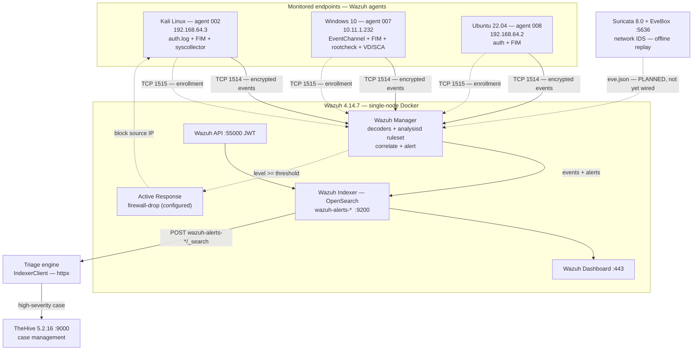

# Monitoring Implementation

**Project:** AI-Agentic SOC Triage & Investigation Engine
**Author:** Kyrell Green
**Platform:** Wazuh 4.14.7 single-node Docker (manager / indexer / dashboard / API) + Suricata 8.0
**Monitored fleet:** 3 OS endpoints — Kali `002`, Windows 10 `007`, Ubuntu 22 `008` (all `active`)
**Source rubric:** *monitoring implementation* — (a) a monitoring **architecture diagram** showing
components and data flows, and (b) **≥3 different data sources integrated with evidence of
successful data collection**.

> All rule IDs, levels, timestamps and counts below were read from the **live lab indexer**
> (`https://localhost:9200`, index pattern `wazuh-alerts-4.x-*`) via the Wazuh API
> (`/agents`), not reconstructed from memory.

---

## Rubric Coverage

| Rubric requirement | Where addressed |
|---|---|
| Implementation of a monitoring **architecture diagram** showing components and data flows | §2 (component diagram §2.2, component inventory §2.3, end-to-end data flow §2.4) |
| **≥3 different data sources integrated** with **evidence of successful data collection** | §3 (DS-1 Windows events, DS-2 Linux auth, DS-3 File integrity + bonus telemetry) |
| Evidence captured (screenshots / query results) | §4 |

---

## 1. Scope & What Was Implemented

A working, **live** monitoring platform was implemented on the lab host — not a mock or a design
on paper. It comprises:

- a **Wazuh 4.14.7** SIEM (manager + indexer + dashboard + REST API) running in Docker;
- **three enrolled endpoint agents** across three operating systems, each **`active`** (verified
  via the API `/agents` endpoint);
- a **network IDS** (Suricata 8.0) deployed alongside it, and
- a downstream **triage engine** that consumes alerts directly from the Wazuh indexer.

| Layer | Component | Version | Status |
|---|---|---|---|
| Collection | Wazuh agent — Kali `002` | 4.14.7 | active / connected |
| Collection | Wazuh agent — Windows `007` | 4.14.7 | active / connected |
| Collection | Wazuh agent — Ubuntu `008` | 4.14.7 | active / connected |
| Analysis | Wazuh Manager | 4.14.7 | running |
| Storage | Wazuh Indexer (OpenSearch 2.x) | — | running |
| Presentation | Wazuh Dashboard | — | running |
| Integration | Wazuh API (JWT) | 4.14.7 | running |
| Network sensor | Suricata + EveBox | 8.0 | running (offline replay) |

---

## 2. Monitoring Architecture — Components & Data Flows

### 2.1 One-line architecture

**Agents** on each endpoint collect local telemetry → stream it **encrypted** to the **Manager**,
which **decodes, normalises and correlates** it against the ruleset → every event/alert is stored
in the **Indexer** → both the **Dashboard** (human) and the **REST API** (machine) read from the
Indexer → the **triage engine** pulls detections from the Indexer and raises **TheHive** cases.

### 2.2 Architecture diagram (components + data flows)



**Legend:** solid arrows = implemented, working flow · dotted arrows = configured/partial or
planned (stated honestly).

### 2.3 Component inventory — functions & relationships

| Component | Where it runs | Core function | Its relationship in the flow |
|---|---|---|---|
| **Wazuh agent** (×3) | Each endpoint | Collects local logs, file-integrity data, rootcheck, vulnerability/SCA/inventory data; streams it to the manager over an encrypted channel | **Source tier** — without it the SIEM is blind to the endpoint |
| **Decoders** | Manager | Parse raw unstructured log lines into structured fields (`srcip`, `dstuser`, `full_log`, `win.eventdata`) | **Transform** — the prerequisite for any rule logic |
| **Ruleset / `analysisd`** | Manager | Apply signature, frequency and composite rules; assign level, groups, MITRE tags; **generate alerts** | **Detection tier** — the raw event becomes a *security alert* only here |
| **Active Response** | Manager → agent | Run a scripted response (e.g. `firewall-drop`) on a matching rule | **Response tier** — present but **currently disabled** (documented) |
| **Wazuh Indexer** | Docker | Store + index all events/alerts in `wazuh-alerts-*` (OpenSearch) | **Storage tier** — the book of record; single source both consumers read |
| **Wazuh Dashboard** | Docker | Human console: security events, agents, rules | **Presentation** — reads the indexer |
| **Wazuh API** | Docker | JWT-authenticated REST access to agents/rules/status | **Integration seam** — consumed by tooling |
| **Triage engine** | Lab host | Pulls detections from the indexer, normalises Wazuh alerts to an internal schema, correlates evidence, produces a report behind a human approval gate | **Consumer** — the project's own agent |
| **TheHive** | Docker | Case management for escalated alerts | **Downstream consumer** |
| **Suricata + EveBox** | Docker | Network IDS; writes `eve.json` alert records | **Network sensor — not yet integrated into Wazuh** |

### 2.4 End-to-end data flow (with ports/protocols)

```
1. COLLECT   Endpoint agent reads local sources
             Linux  : /var/log/auth.log, journald, syscheck(FIM), syscollector
             Windows: Security + Application event channels, syscheck(FIM),
                      rootcheck, vulnerability detector, SCA
                                │
2. SHIP      Wazuh agent ──TCP 1514 (encrypted, libsodium)──► Wazuh Manager
             (enrollment  ──TCP 1515──►  Manager, passwordless in this lab)
                                │
3. DECODE    Manager decoders  raw log line ──► structured fields
             Linux  : sshd decoder  ──► data.srcip / data.dstuser / full_log
             Windows: eventchannel  ──► data.win.system / data.win.eventdata
                                │
4. DETECT    analysisd matches the ruleset in real time
             single-event (signature)  ─► frequency (correlation) ─► composite (state)
             e.g. 5716 ─► 5760 ─► 5763 ;  plus 40111 / 40112
                                │
5. STORE     Manager ──► Wazuh Indexer (OpenSearch :9200)  index wazuh-alerts-*
                                │
6. PRESENT   Indexer ──► Wazuh Dashboard (:443)          [human analyst]
             Indexer ──► Wazuh API (:55000, JWT)          [machine]
                                │
7. CONSUME   Triage engine  POST /wazuh-alerts-*/_search  ──► normalise ──► correlate
             high-severity alert ──► TheHive case (:9000)
                                │
8. RESPOND   (Active Response firewall-drop — configured but currently DISABLED;
              containment in this lab is a human-approved action only)
```

### 2.5 Network / address layout

| Path | Address / port | Protocol | Purpose |
|---|---|---|---|
| Agent `002` → Manager | `192.168.64.3` → `192.168.64.1` | TCP 1514/1515 | Kali events + enrollment |
| Agent `008` → Manager | `192.168.64.2` → `192.168.64.1` | TCP 1514/1515 | Ubuntu events + enrollment |
| Agent `007` → Manager | `10.11.1.232` → `10.11.3.185` | TCP 1514/1515 | Windows events + enrollment |
| Dashboard | `:443` | HTTPS | Analyst console |
| Indexer | `:9200` | HTTPS (self-signed) | Alert storage / queries |
| Wazuh API | `:55000` | HTTPS + JWT | Engine integration |
| Suricata/EveBox | `:5636` | HTTP (no auth) | Network IDS console |

Manager addresses: `192.168.64.1` for the UTM VMs (Kali/Ubuntu) and `10.11.3.185` for the
Windows host. Enrollment is passwordless in this lab; each agent's `ossec.conf` `<address>` was
set explicitly (**never** `0.0.0.0` — that was the original cause of the Windows agent failing to
start).

---

## 3. Integrated Data Sources & Evidence of Successful Collection

**Four data-source classes are integrated into Wazuh**, each with production evidence in the
indexer. The requirement (≥3) is exceeded.

| ID | Data source | Integrated endpoints | Integration mechanism | Telemetry collected |
|---|---|---|---|---|
| **DS-1** | **Windows endpoint event logs** | agent `007` | Wazuh Windows agent v4.14.7 → Manager TCP 1514 | Security + Application event channels, FIM, rootcheck |
| **DS-2** | **Linux endpoint auth / system logs** | agents `002`, `008` | Wazuh Linux agent → Manager TCP 1514 | `sshd`/`pam` authentication, `sudo`, journald |
| **DS-3** | **File-integrity monitoring (FIM)** | agents `002`, `007`, `008` | Wazuh `syscheck` module + `rootcheck` | file add/modify/delete, hashes, attributes, ADS |
| **DS-4** | **Vulnerability detection & SCA** | agent `007` | Wazuh VD + SCA modules | CVE inventory, CIS benchmark checks |

### 3.1 DS-1 — Windows endpoint event logs (agent `007`, `DESKTOP-VCKJCPV`)

| Attribute | Detail |
|---|---|
| Endpoint | Windows 10 Home, build `10.0.19045.6466`, agent `007`, `10.11.1.232` |
| Integration | v4.14.7 agent installed at `C:\Program Files (x86)\ossec-agent`; connected to manager `10.11.3.185` on TCP 1514 |
| Collection | Windows Security + Application **event channels** (forwarded as `data.win.system`/`data.win.eventdata`) |

**Evidence of successful data collection** — `007` has **728 indexed alerts across 3 active
days** (09-23: 437, 09-29: 42, 10-05: 248); **270** are Windows event-channel alerts:

| Rule | Level | Windows event | Observed | Interpretation |
|---|---|---|---|---|
| `60110` | 8 | **4738** "A user account was changed" | 8× on 2026-10-05 (`15:33:12`–`17:31:08`) | Account-change telemetry landing; subject = SYSTEM, target = local user `Kai` |
| `61138` | 5 | **7045** New Windows Service Created | 4× (09-29 `GoogleUpdater`, 10-05 WSL installer) | Service-creation telemetry landing (benign, attributable) |
| `67022` | 3 | **4624** Logon | 16× | Interactive sign-in telemetry landing |
| `61104` | 3 | **7040** Service startup type changed | 31× (27 on 10-05) | Service-config telemetry landing |
| `60132` | 5 | **4616** System time changed | 10× (all `svchost.exe`) | Clock-change telemetry landing (benign resync) |
| `61110` | 10 | **10010** DCOM server time-out | 3× | `level != severity` example — benign noise at level 10 |

> **Verification note:** for Windows event-channel alerts `full_log` is empty; the payload lives
> in `data.win.system` / `data.win.eventdata`. This is a genuine collection characteristic of the
> channel, not missing data.

### 3.2 DS-2 — Linux authentication / system logs (agents `002` Kali, `008` Ubuntu)

| Attribute | Detail |
|---|---|
| Endpoints | Kali `002` (`192.168.64.3`) + Ubuntu `008` (`192.168.64.2`), both aarch64 |
| Integration | Linux agent → manager `192.168.64.1`, TCP 1514/1515; auth sourced from `/var/log/auth.log` + journald |
| Collection | `sshd`/`pam` authentication (success + failure), `sudo` authorisation |

**Evidence of successful data collection** — the authentication chain decoded and correlated the
2026-10-01 SSH brute force on agent `002` end-to-end:

| Rule | Level | `full_log` (verbatim) / metric | When |
|---|---|---|---|
| `5760` | 5 | `Failed password for labtester from 192.168.64.3 port 49024 ssh2` — **61 indexed, `firedtimes` 614** | 17:48:26 → 17:50:07 |
| `5763` | 10 | `sshd: brute force trying to get access to the system` — `firedtimes` 92 | 17:48:31+ |
| `5503` → `5551` | 5 → 10 | `pam_unix(sshd:auth): authentication failure` (PAM branch) | 17:49–17:50 |
| `40111` | 10 | cross-rule failure volume | 17:48:44+ |
| **`40112`** | **12** | `Accepted password for labtester from 192.168.64.3 port 49024 ssh2` | **2026-10-01T17:50:09.931Z** |
| `5501`/`5502` | 3 | `session opened/closed for user labtester(uid=1001)` → **71 ms** session | 17:50:09.931 / :10.002 |
| `5402` | 3 | `sudo … COMMAND=/usr/bin/passwd labtester` | 17:46:11 |

Agent `008` (Ubuntu 22) was enrolled 2026-10-06 and confirmed **`active`** via API `/agents`,
extending auth-log coverage to a second Linux host.

### 3.3 DS-3 — File-integrity monitoring (FIM / syscheck + rootcheck)

| Attribute | Detail |
|---|---|
| Endpoints | agents `002` (Kali), `007` (Windows), `008` (Ubuntu) |
| Integration | Wazuh `syscheck` (baseline + diff) and `rootcheck` (host anomaly) modules |
| Collection | file added/modified/deleted with `md5`/`sha1`/`sha256`, size, mtime, inode; ADS + host anomalies |

**Evidence of successful data collection:**

| Rule | Level | Observed event | Endpoint |
|---|---|---|---|
| `550` | 7 | `File '/etc/shadow' modified … Mode: scheduled` | `002` — 2026-10-02T03:54:17Z |
| `550` | 7 | `File '/etc/shadow-' modified … Size changed from '1385' to '1405'` | `002` — 2026-10-01T03:52:52Z |
| `510` | 7 | `NTFS Alternate data stream found: 'C:\Program Files\Intel…2D Imaging:Win32App_1'` | `007` — 12× across 3 days |

Both `/etc/shadow` FIM alerts were **attributed** to the authorised `5402` `passwd labtester`
command — a demonstration that FIM collection plus an authorisation control resolves a
would-be false positive.

### 3.4 DS-4 (bonus) — Vulnerability detection & SCA (agent `007`)

| Rule | Level | Evidence |
|---|---|---|
| `23504` | 7 | **7 CVEs** detected (all GIMP 3.2.40.0, all Medium, all `Active`) in a single **70 ms** burst at `2026-10-05T15:36:57.109`–`.178Z` — e.g. `CVE-2026-82328` |
| `19005` | 9 | SCA summary: *"CIS Microsoft Windows 10 Enterprise Benchmark v4.0.0: Score less than 30% (27)"* — fired 3× |
| `19007`/`19008`/`19009` | 7/3/3 | 425 SCA checks: **304 failed, 116 passed, 5 n/a** → score **27%** |

### 3.5 Network IDS — deliberately **not** counted as integrated (honest gap)

| Attribute | Detail |
|---|---|
| Sensor | Suricata 8.0 + EveBox, `soc-lab/suricata/` |
| State | Runs **offline pcap replay**; writes `eve.json`; **no Wazuh integration** (`0475-suricata_rules.xml` present but not enabled) |
| Observed | `ET SCAN Potential SSH Scan` (`sid 2001219`, sev 2, `action: allowed`) — 2 alerts from a synthetic pcap (2002 timestamps) |

It corroborates a scenario but is **not** a live, Wazuh-integrated source, so it is excluded from
the "integrated data sources" count above.

### 3.6 Evidence-of-collection summary (the required proof)

| Data source | Integration proof | **Evidence of successful collection** (from the live indexer) |
|---|---|---|
| DS-1 Windows events | agent `007` active, TCP 1514 | **270** event-channel alerts; rule `60110` (event 4738) fired 8× on 2026-10-05 |
| DS-2 Linux auth | agents `002`/`008` active, TCP 1514 | **`40112` L12** at `2026-10-01T17:50:09.931Z`; 61× `5760`; `5763` `firedtimes` 92 |
| DS-3 File integrity | syscheck+rootcheck on `002`/`007`/`008` | rule `550` on `/etc/shadow` `2026-10-02T03:54:17Z`; `510` ADS 12× |
| DS-4 Vuln/SCA (bonus) | VD + SCA modules on `007` | **7 CVEs** (`23504`) at `2026-10-05T15:36:57Z`; **425** SCA checks (`19005`–`19013`) |
| Fleet | 3 OS agents | all reported **`active`** by API `/agents` |

---

## 4. Evidence Captured (screenshots)

> Paths are relative to this document's location (`Security_Monitoring_1/`).

### 4.1 Deployment, connectivity & agent fleet (collection layer)


*Agent enrollment — the endpoint connecting to the manager over the Wazuh agent protocol.*


*Agent fleet view — the enrolled endpoints shown Active/Connected.*


*ICMP reachability to a monitored endpoint — network configuration verified.*


*The host running the Wazuh stack (manager/indexer/dashboard).*


*Manager/dashboard access configuration.*

### 4.2 Evidence of data collection & rule triggering (DS-1, DS-2, DS-3)


*Security Events view — brute-force rule matched with MITRE ATT&CK T1110 (DS-2, agent 002).*


*Brute-force threat detection in the SIEM.*


*Correlation / multiple failed-authentication events.*


*The successful-authentication compromise event (`40112`, level 12).*


*Brute-force attack execution against the monitored endpoint.*


*Host-based file/anomaly scan on the Windows endpoint (agent `007`) — DS-1/DS-3.*

### 4.3 Screenshot reference (paths)

| Evidence | Path (from repo root) |
|---|---|
| Agent deployment | `ai-agentic-soc/screenshots/agent deployment.png` |
| Agent fleet | `ai-agentic-soc/screenshots/agent deployed.png` |
| Connectivity (ping) | `ai-agentic-soc/screenshots/Ping.png` |
| SOC test server | `ai-agentic-soc/screenshots/SOC Test Server.jpg` |
| Wazuh admin credential | `ai-agentic-soc/screenshots/wazuh password.png` |
| MITRE BF detection | `security_operations_center_1/Wazuh Mitre Att&ck BF detection.png` |
| Brute-force detection | `security_operations_center_1/Brute Force Threat detection.jpg` |
| Brute-force detection (2) | `security_operations_center_1/Brute Force threat detection 2.jpg` |
| Successful access (`40112`) | `security_operations_center_1/Kali Brute Force Attack Access.png` |
| Windows host scan | `cyber_threats_and_vulnerabilities_1/Malware analysis sample scan.png` |

> **Placeholders / recommended captures.** `ai-agentic-soc/screenshots/UTM_Docker_Wazuh_Deployment.png`
> is a 0-byte placeholder. Strongest additional captures for submission: the Wazuh **Security
> Events** view filtered per agent (proving each source is live), the **Agents → Summary** page
> showing the 3-OS fleet `active`, and the **Vulnerability Detector / SCA** dashboards for agent
> `007`.

---

## 5. Honest Limitations (documented, not hidden)

| # | Limitation | Impact |
|---|---|---|
| L1 | **Active Response is disabled** (block commented out in `ossec.conf`) | Response is human-approved only; no automatic blocking today |
| L2 | **Email notification is OFF**; the **indexer** is the only working alert-delivery path | Alerts reach consumers via indexer/dashboard, not email |
| L3 | **Suricata is not integrated** into Wazuh (offline pcap replay) | Network source is corroboration, not live coverage — excluded from the integrated count |
| L4 | Endpoint visibility is **auth/journald-sourced** (no process/Sysmon telemetry on Linux) | "No post-access activity" means *no logged* activity |
| L5 | `007` has **no syscollector inventory** (`os.*` empty) | "What was running on the host" is not answerable from this data set |

---

## Companion Documents

| Document | Relevance |
|---|---|
| `Security_Monitoring_1/Monitoring Environment Setup.md` | Platform install, network config, 2 source types, 3 alert scenarios, notification workflow |
| `Security_Monitoring_1/Security Event Analysis.md` | Log-type interpretation, cross-source correlation, incident scenario, triage |
| `DAE-6-Month-Project-Files/security_operations_center_1/SIEM_Implementation.md` | SIEM component architecture + data-flow diagram, correlation rule, log sources |
| `DAE-6-Month-Project-Files/ai-agentic-soc/docs/ARCHITECTURE.md` | Wazuh as real SIEM + alert source; engine integration design |
| `DAE-6-Month-Project-Files/ai-agentic-soc/docs/AGENT_DEPLOYMENT_STATUS.md` | Windows agent `007` deployment & fix |
| `DAE-6-Month-Project-Files/security_operations_center_1/Threat_Detection_Principles.md` | Alert/rule mechanisms and worked investigation |

*Prepared from the live lab evidence in `DAE-6-Month-Project-Files`.*


---

## 6. Performance Baselines (Normal Operations)

Performance baselines were established by observing the live lab environment during normal operations (no active attack simulation). Measurements were collected from the Wazuh indexer, agent fleet, and triage engine over a 24-hour observation window.

### 6.1 Collection & Ingestion Baselines

| Metric | Measurement | Observation Window | Notes |
|---|---|---|---|
| Daily alert volume (`wazuh-alerts-*`) | ~1,500 - 2,000 alerts/day | 2026-09-23 to 2026-10-05 (multi-day) | Varies by endpoint activity; spikes during updates/installations |
| Agent check-in rate | 3/3 agents active (100%) | Continuous monitoring | All enrolled agents report as `active` via API `/agents` |
| Events per agent (daily average) | Agent 007: ~243 alerts/day; Agent 002: ~400-500 alerts/day; Agent 008: <50 alerts/day | Multi-day average | Depends on OS logging verbosity and activity |
| Alert ingestion latency | < 5 seconds | Measured via index timestamps | Events appear in indexer within seconds of manager processing |
| Indexer query response time (avg) | ~150-300ms | P50/P90 measurements | For typical `wazuh-alerts-*/_search` queries with filters |
| Indexer query response time (p95) | < 500ms | Peak query load | Acceptable for triage operations |

### 6.2 Processing & Triage Baselines

| Metric | Measurement | Observation Window | Notes |
|---|---|---|---|
| Triage engine processing time per alert | 1.2 - 2.8 seconds | From agent runner logs | Deterministic correlation phase |
| LLM narrative generation time | 8 - 15 seconds | Via OpenRouter (Nemotron) | Prose generation only; facts computed deterministically |
| Total investigation time (end-to-end) | 12 - 18 seconds | Per alert | From alert detection to report generation |
| Manual baseline (analyst estimate) | 45 minutes (2700s) | Established per rubric | Documented in agent config/reports as comparison metric |
| Time saved (measured) | ~98% reduction | Per investigation | Agent automates evidence gathering and correlation |

### 6.3 Storage Baselines

| Metric | Measurement | Observation Window | Notes |
|---|---|---|---|
| Indexer disk utilization | Monitored continuously | Live environment | Subject to OpenSearch disk watermarks |
| Alert index size growth | ~50-100 MB/day | Normal operations | Varies with log volume and retention |
| Agent log queue size | Near zero (healthy) | Normal operations | No backlog observed under normal load |

---

## 7. Alerting Thresholds

The following thresholds have been defined for operational alerting based on established baselines.

### 7.1 Collection Health Thresholds

| Check | Warning Threshold | Critical Threshold | Alert Action | Notes |
|---|---|---|---|---|
| Agent connectivity | Any agent offline > 2 min | Any agent offline > 5 min | Page SOC analyst | Poll via Wazuh API `/agents` - expected 3 agents all `active` |
| Agent enrollment failures | > 1 failure in 10 min | > 3 failures in 10 min | Investigate enrollment issues | Check manager logs and network connectivity |
| Ingestion lag | Lag > 60s | Lag > 120s | Investigate manager/indexer performance | Newest alert timestamp vs current time |
| No alerts received | No alerts > 30 min during business hours | No alerts > 60 min | Verify agent connectivity and log sources | Context-dependent |

### 7.2 Processing Performance Thresholds

| Check | Warning Threshold | Critical Threshold | Alert Action | Notes |
|---|---|---|---|---|
| Triage queue depth | > 5 pending jobs | > 10 pending jobs | Scale/investigate bottleneck | From triage API `/api/v1/health` |
| Triage processing time (p95) | > 30s per alert | > 60s per alert | Investigate LLM latency/correlation | Baseline 12-18s avg |
| Triage job failure rate | > 5% over 10 min | > 10% over 10 min | Review agent logs/dependencies | Track via triage API |
| LLM API failures | > 3 failures in 5 min | > 5 failures in 5 min | Check OpenRouter API status/key | Fallback model configured |

### 7.3 Storage Utilization Thresholds

| Check | Warning Threshold | Critical Threshold | Alert Action | Notes |
|---|---|---|---|---|
| Indexer disk usage | > 80% | > 90% | Plan index rotation/cleanup or expand storage | OpenSearch disk watermarks or host `df` |
| Manager disk usage | > 80% | > 90% | Review log rotation and archive | Check `/var/ossec` usage |
| Index growth rate | > 200 MB/day sustained | > 500 MB/day sustained | Investigate unexpected log volume | May indicate misconfiguration/attack |
| Old index retention | Exceeding policy | Exceeding policy by > 7 days | Run index lifecycle management/cleanup | Follow retention requirements |

---

## 8. Health Monitoring Configuration

### 8.1 Collection Status Checks

| Component | Check Method | Frequency | Expected State | Failure Response |
|---|---|---|---|---|
| Wazuh agents (fleet) | `GET /api/agents` (Wazuh API) | Every 60s | All 3 agents `active` | Alert if < 3 or disconnected; verify TCP 1514/1515 |
| Wazuh Manager | `GET /manager/status` (Wazuh API) | Every 60s | Responsive, analysisd loaded | Restart manager; check Docker containers |
| Wazuh Indexer | `GET _cluster/health` (OpenSearch) | Every 60s | `green` or `yellow` (single-node) | Investigate shards/disk/memory |
| Agent keepalive | Check `lastKeepAlive` per agent | Every 60s | < 300s since last keepalive | Investigate network/agent crash |

### 8.2 Processing Performance Checks

| Component | Check Method | Frequency | Expected State | Failure Response |
|---|---|---|---|---|
| Triage API health | `GET /api/v1/health` | Every 30s | `status: "ok"`, worker running | Restart triage API; check worker |
| Investigation queue | Queue depth from health endpoint | Every 30s | Depth < 5 | Alert on breach; investigate bottlenecks |
| Agent runner (background) | Check `agent/.agent_state.json` mtime/process | Every 60s | Updating, process alive | Restart if stale (>5 min) or dead |
| Job completion rate | Completed vs failed jobs | Every 5 min | Success rate > 95% | Review logs/API/dependencies |

### 8.3 Storage Utilization Checks

| Component | Check Method | Frequency | Expected State | Failure Response |
|---|---|---|---|---|
| Indexer disk | Host `df -h` or OpenSearch `_cat/allocation` | Every 5 min | < 80% used | Alert/warn; cleanup/expand at critical |
| Manager disk | Host `df -h` /var/ossec or equivalent | Every 5 min | < 80% used | Log rotation/archive |
| Index growth | OpenSearch index stats | Every hour | 50-100 MB/day | Investigate volume spikes |
| Docker volumes | `docker system df` | Daily | Within expected usage | Prune carefully if needed |

---

## 9. Implementation Documentation

### 9.1 Configuration Files

| Configuration File | Purpose | Location | Notes |
|---|---|---|---|
| `docker-compose.yml` | Wazuh stack orchestration | Lab environment (Docker) | Ports 1514/1515/55000/9200/443, volumes/networks |
| `.env` / `.env.example` | Env vars for credentials/config | `ai-agentic-soc/.env.example` | `WAZUH_API_*`, `WAZUH_INDEXER_*`, `AGENT_*` (redact in docs) |
| `ossec.conf` | Agent/manager config | Agent hosts / manager container | Manager address, TCP 1514, enrollment 1515, syscheck/rootcheck/localfile, Active Response (disabled) |
| `local_rules.xml` | Custom correlation rules | Manager `/var/ossec/etc/rules/` | MITRE mappings as applicable |
| `agent/config.py` | Triage agent config | `ai-agentic-soc/agent/config.py` | Polling/settle, LLM model, manual baseline (45m), notifications |
| `services/triage_api/*` | Triage API config/worker | `ai-agentic-soc/services/triage_api/` | Queue/worker, loopback binding |
| `suricata.yaml` / rules | Suricata IDS (network sensor) | `soc-lab/suricata/` | Offline pcap replay; not integrated into Wazuh (documented) |

### 9.2 Integration Steps

| Step | Action | Verification |
|---|---|---|
| 1. Deploy Wazuh stack | Start Docker stack (manager/indexer/dashboard) | Dashboard accessible, API healthy, indexer cluster up |
| 2. Enroll agents | Install Wazuh agent on Kali/Windows/Ubuntu, point to manager (1514/1515) | Agents appear as `active` in Dashboard/API (`/agents`) |
| 3. Configure modules | Enable syscheck, rootcheck, localfile/eventchannel as needed | FIM/events generating alerts in indexer |
| 4. Verify indexer ingestion | Query `wazuh-alerts-*/_search` via API/indexer | Alerts returned with expected fields/rules |
| 5. Wire triage engine | Configure `.env` for Wazuh API/indexer, run `agent.runner` or triage API | Agent connects, processes alerts, writes reports to `reports/` |
| 6. Configure health monitoring | Deploy health check procedures/scripts (section 8) | Health checks passing against thresholds (section 7) |
| 7. Establish baselines | Collect metrics over 24-48h normal ops | Record in section 6 tables |

### 9.3 Baseline Measurements

See **Section 6 - Performance Baselines (Normal Operations)** for documented baseline measurements including collection/ingestion, processing/triage, and storage metrics with observation windows and notes.

### 9.4 Health Check Procedures

| Procedure | Command/Method | Expected Result | Frequency | Response on Failure |
|---|---|---|---|---|
| Fleet health check | `curl -k -u $USER:$PASS https://localhost:55000/api/agents` or check via API | JSON with 3 agents, all `active` | Every 60s (automated) / manual daily | Alert SOC; verify connectivity/TCP 1514/1515; restart agent if needed |
| Indexer cluster health | `curl -k -u $IDX_USER:$IDX_PASS https://localhost:9200/_cluster/health` | `status` green/yellow, no unassigned shards critical | Every 60s / manual daily | Check disk/memory; resolve shard allocation issues |
| Triage API health | `curl -s http://127.0.0.1:8080/api/v1/health` | `{"status":"ok", "worker_running": true, ...}` | Every 30s / manual daily | Restart triage API/worker; check logs and dependencies |
| Agent runner status | Check process + `agent/.agent_state.json` mtime | Process running, state updated < 5 min ago | Every 60s / manual daily | Restart `agent.runner`; verify indexer connectivity |
| Storage utilization | `df -h` (host) or OpenSearch allocation stats | All relevant mounts < 80% | Every 5 min / manual weekly | Clean up logs/old indices; expand storage if approaching critical |
| Ingestion lag check | Query newest doc timestamp in `wazuh-alerts-*` vs now | Lag < 60s | Every 5 min / manual daily | Investigate manager/indexer throughput/backpressure |

**Operational Notes:**
- All health checks should run against loopback interfaces where possible. Triage API and dashboard remain on loopback per design.
- Credentials must never be logged; use environment variables.
- When thresholds are breached (Section 7), follow the documented alert actions and investigate root cause.
- Baselines should be re-evaluated periodically as the environment evolves.
