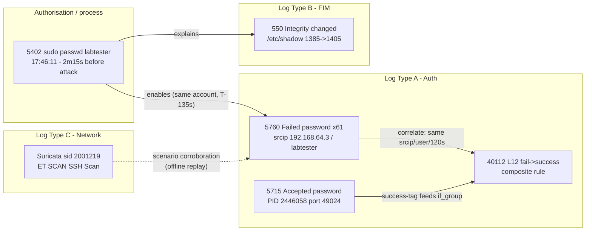
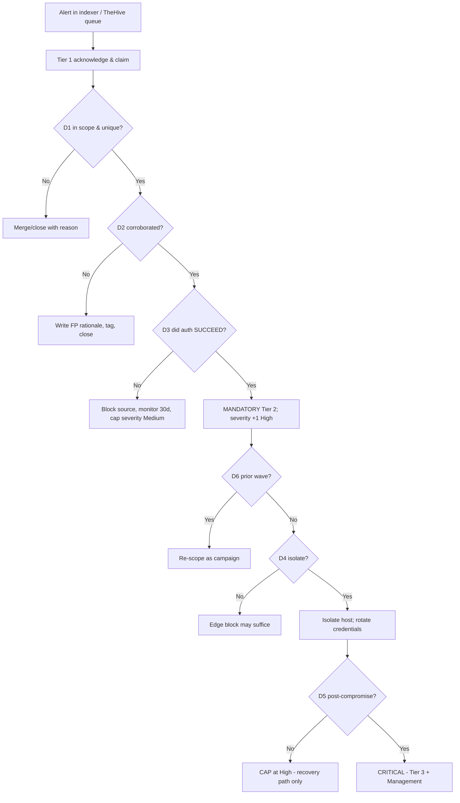
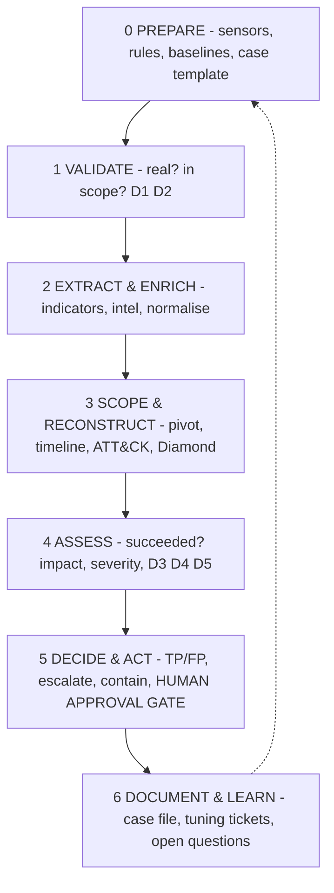

# Security Event Analysis

**Project:** AI-Agentic SOC Triage & Investigation Engine
**Author:** Kyrell Green
**Platform:** Wazuh 4.14.7 (SIEM) + Suricata 8.0 (network IDS), TheHive 5.2.16 (case management)
**Monitored endpoints:** `kali-lab-02` (agent `002`, Linux) + `DESKTOP-VCKJCPV` (agent `007`, Windows 10)
**Case reference:** `SOC-CASE-2026-0142` / exercise case `SOC-CASE-2026-0143`
**Evidence basis:** All rule IDs, levels, timestamps, counts and `full_log` values below were read from the **live lab indexer** (`https://localhost:9200`, index pattern `wazuh-alerts-4.x-*`), not reconstructed from memory.

---

## Rubric Coverage

| Rubric requirement | Where addressed |
|---|---|
| Analysis of at least **3 types of security logs** with clear explanations of **interpretation methodology** | §1 — Linux auth (`sshd`/`pam`), file-integrity (FIM/syscheck/rootcheck), network IDS (Suricata), Windows Event/rootcheck |
| Basic **correlation between at least 2 different log sources** showing related security events | §2 — cross-source correlation table, keyed on `(srcip, dstuser, host, time)` |
| A **complete incident detection scenario** showing event **timeline, correlation and conclusions** | §3 — consolidated master timeline + findings |
| **Alert triage process** — severity assessment, **false positive identification** and **escalation criteria** | §4 — severity matrix, false-positive register, D1–D7 + tiers |
| **Analysis documentation** — properly **annotated log excerpts**, interpretation of findings and **investigation methodology** | §5 — annotated excerpts, 7-phase method, reproduction queries |

---

## 1. Security Log Types & Interpretation Methodology

> **How to read this section.** For each log type the same five questions are answered: what it is → how it is collected/decoded → key fields → what normal vs. suspicious looks like → the interpretation method (the rule of thumb an analyst applies). The point is that the *detection logic changes with the data source*, but the reasoning discipline does not.

### 1.1 Log Type A — Linux authentication logs (`sshd` / `pam`)

| Attribute | Detail |
|---|---|
| **What it is** | System authentication journal: SSH login success/failure, PAM session open/close, `sudo`/`su` events |
| **Collected by** | Wazuh agent `002` `logcollector` (`<log_format>syslog</log_format>`, `/var/log/auth.log` and journald) |
| **Decoders** | `sshd` and `pam` — **two different grammars describing the same attack** |
| **Key fields** | `data.srcip`, `data.srcport`, `data.dstuser`, `full_log`, `rule.id`, `rule.level` |
| **Signature value** | Primary evidence of credential-based attacks — brute force (T1110), credential stuffing, password spraying |

**Interpretation methodology**

| Step | What to do | Why |
|---|---|---|
| 1 | Read `full_log` **verbatim** — never work from the rule description alone | A description like *"authentication success"* hides that it was a **password** login for a **valid** account |
| 2 | Separate **success** events (rule `5715`, `^Accepted`) from **failure** events (`5760`, `5716`) | Volume proves an *attack*; only a success event proves an *outcome* |
| 3 | Correlate failures by `(srcip, dstuser, time-window)` | 8 failures from one source = brute force; 8 from anywhere = noise |
| 4 | Bound any session with the `5501` (open) → `5502` (close) pair | A 71 ms session and a 71-minute session are the same log line and completely different incidents |
| 5 | Count volume with `rule.firedtimes`, **not** the hit count | Alert compression + `ignore="60"` make document count ≠ attempt count |

**What "normal" vs "suspicious" looks like**

| Normal | Suspicious |
|---|---|
| 1–2 `Failed password` then `Accepted` on the same PID/port | 8+ failures in 120 s from one IP, then `Accepted` (fail→success) |
| Interactive session lasting minutes | Session lasting milliseconds (automated credential *validation*, not use) |
| Failures against a **non-existent** user (`5710`/`5712` branch) | Failures against a **valid** account (`5760`/`5763` branch) |

### 1.2 Log Type B — File-integrity monitoring (FIM / syscheck / rootcheck)

| Attribute | Detail |
|---|---|
| **What it is** | Baseline + change events for monitored files/dirs: *file_added*, *file_modified*, *file_deleted*, with `md5`/`sha1`/`sha256`/size/mtime/inode; plus rootcheck host-anomaly events |
| **Collected by** | Wazuh agent FIM module (syscheck) and rootcheck on agents `002` (Kali) and `007` (Windows) |
| **Detecting rules** | `550` "Integrity checksum changed" (L7), `510` rootcheck host anomaly (L7), `60110` account changed, `61104` service startup type changed, `60132` system time changed |
| **Signature value** | Detects what **changed on a host** — malware drops, ransomware bulk-rename (T1486), persistence installs, hidden content |

**Interpretation methodology**

| Step | What to do | Why |
|---|---|---|
| 1 | Identify the **delta**: which attribute changed (hash/size/mode/mtime)? | Tells you *how* the file changed, which narrows intent |
| 2 | **Check the change against an authorisation baseline** | A host indicator is only a *finding* if no authorisation event explains it. `/etc/shadow` changing because `passwd labtester` ran via `sudo` (rule `5402`) is **explained, not tampering** |
| 3 | Treat **hidden content** differently from edits | An NTFS ADS (`510`) is a *concealment* indicator, not a config change |
| 4 | Note scheduled vs. real-time scans | A `550` from a scheduled scan appears hours after the underlying change made it |
| 5 | Attribute before escalating | Unattributed FIM alerts create false tampering findings |

**Lab examples (real):**

| Event | Rule | Interpretation |
|---|---|---|
| `/etc/shadow-` size `1385 → 1405` (2026-10-01 03:52:52Z) | `550` L7 | Explained — `passwd labtester` via `sudo` |
| `/etc/shadow` modified, Mode: scheduled (2026-10-02 03:54:17Z) | `550` L7 | Explained — scheduled scan of the credential change |
| NTFS ADS `C:\Program Files\Intel…2D Imaging:Win32App_1` | `510` L7 | Investigated — installer artefact, **not confirmed malware** |
| Service startup type changed ×20 | `61104` | Windows service changes (patch/update candidate) |

### 1.3 Log Type C — Network IDS logs (Suricata)

| Attribute | Detail |
|---|---|
| **What it is** | Network intrusion-detection events: signature matches on live/replayed traffic (recon, exploits, C2 beacons, brute-force patterns) |
| **Collected by** | Suricata 8.0 EVE output (`eve.json`); Emerging Threats Open ruleset |
| **Detecting signature** | `ET SCAN Potential SSH Scan` — `sid 2001219`, `rev 20`, severity 2, category *Attempted Information Leak* |
| **Signature value** | The independent, **wire-level second opinion** — sees traffic *to*/*between* hosts (lateral movement, T1021) and hosts with no agent |

**Interpretation methodology**

| Step | What to do | Why |
|---|---|---|
| 1 | Read `alert.action` first — `allowed` vs `blocked` | `allowed` means the traffic completed; the exposure is real and the perimeter did not stop it |
| 2 | Read `category` and `signature_severity` | The ET category ("Attempted Information Leak") is itself the technique statement |
| 3 | **Normalise the severity scale** | Suricata `severity 2` ≠ Wazuh `level 12` — different scales; normalise before prioritising |
| 4 | Check the flow direction and fan-out | One source → many ports = scanning; many sources → one port = botnet/credential-stuffing |
| 5 | Verify the packet timestamps are real | ⚠ In this lab the pcap was **synthetic** — timestamps read `2002-08-28` while the run occurred 2026-09-30 |

> **Honest limitation:** Suricata runs as an **offline pcap replay** and is **not integrated** into Wazuh (`0475-suricata_rules.xml` not enabled). It corroborates the *scenario*, not a live event.

### 1.4 Log Type D — Windows event & anomaly logs (agent `007`)

| Attribute | Detail |
|---|---|
| **What it is** | Windows Security/System event logs (account/service/time changes), Sysmon-style telemetry, rootcheck anomaly events, NTFS metadata |
| **Collected by** | Wazuh agent `007` on `DESKTOP-VCKJCPV` (Windows 10, build `10.0.19045.6466`) |
| **Detecting rules** | `510` rootcheck (NTFS ADS), `60110` user account changed ×4, `61104` service startup type changed ×20, `60132` system time changed ×7, `23504` vulnerability detected |
| **Signature value** | Cross-OS coverage; detects hidden content, unauthorised account/service changes, and clock tampering |

**Interpretation methodology**

| Step | What to do | Why |
|---|---|---|
| 1 | Group by change type: account, service, time, file | Each maps to a different technique (T1098, T1543, log-tampering) |
| 2 | Treat **`60132` system time changed** as a log-tampering precursor | An analyst who changes the clock usually does it to make a timestamp lie |
| 3 | For **ADS (`510`)**, verify with `Get-Item -LiteralPath <path> -Stream *` before verdict | ADS is legitimate for many installers; the alert is an anomaly, not proof of malware |
| 4 | Check for a matching Microsoft/installer signature | Installers and archivers legitimately produce ADS |

### 1.5 Cross-type comparison

| Log type | Source layer | Mechanism | Answers | Blind to |
|---|---|---|---|---|
| Auth (`sshd`/`pam`) | Host | Signature → frequency → composite | *Is this host under credential attack, and did it succeed?* | Low-and-slow guessing below threshold; encrypted content |
| FIM / rootcheck | Host | Baseline diff / heuristic | *Did something change on disk?* | Changes on unmonitored paths |
| Suricata IDS | Network | Packet signature | *Is something enumerating us?* | Traffic inside TLS; allow-listed sources |
| Windows events | Host | Baseline diff | *Did accounts/services/time change?* | Changes on unmonitored keys |

**The lesson:** an alert is *strongest* when auth + file + network evidence **agree**. Treating all four mechanisms as "an alert" — rather than as *what* vs. *how much* vs. *did it succeed* vs. *did the baseline move* — is the most common reason analysts mis-prioritise.

---

## 2. Correlation Between Log Sources

Correlation is demonstrated by linking events from **different sources** that share a **correlation key**. In this lab the key is `(srcip, dstuser, host, time-window)`.

### 2.1 Correlation diagram



### 2.2 Cross-source correlation table

| # | Source 1 | Source 2 | Shared key | Related events | What the correlation proves |
|---|---|---|---|---|---|
| **C1** | Auth `sshd` (`5760` failures) | Auth `pam` (`5503`/`5551` failures) | same `srcip` + time window | Two decoders fired on the same brute force (`5763` ×92 and `5551` in the same window) | **Multi-decoder agreement** — independent confirmation the attack is real, at zero cost |
| **C2** | Authorisation log (`5402` sudo) | FIM (`550`) | host + account + time | `sudo passwd labtester` at 17:46:11 → `/etc/shadow` FIM `550` | An apparently suspicious **file change is explained by an authorised command** → false positive resolved |
| **C3** | Auth (`5760`/`5715`) | Auth composite (`40112`) | same `srcip`/`dstuser` + 240s | 61 failures then `Accepted password` on the same PID/port | **Fail→success** — the decisive correlation; converts an *attempt* into a *confirmed compromise* |
| **C4** | Host agent (`5763`) | Network IDS (Suricata `sid 2001219`) | same target `192.168.64.3:22` | Host brute-force alert + `ET SCAN Potential SSH Scan` | **Multi-sensor agreement** (approach + attempt). ⚠ Suricata is replay-only — corroboration for the scenario, not live coverage |
| **C5** | Volume anomaly (`rule 11`) | Auth (`5763`/`40112`) | host + time | `"average… 561. We reached 1812"` at 17:38:44 → first failure 10 min later | **Statistical baseline deviation precedes** the attack — an early-warning correlation of a different mechanism |

### 2.3 The strongest correlation in the lab (C3, worked)

The single most valuable correlation links **three events on one connection**:

| Time | Source | Event |
|---|---|---|
| 17:50:02 | Auth `5760` | `Failed password for labtester … port 49024` (PID 2446058) |
| 17:50:05 | Auth `5760` | `Failed password for labtester … port 49024` (PID 2446058) |
| 17:50:07 | Auth `5760` | `Failed password for labtester … port 49024` (PID 2446058) |
| **17:50:09.931** | Auth `40112` | `Accepted password for labtester … port 49024` (PID 2446058) |

**Same PID + same source port across three failures and one success = one connection, fourth attempt accepted.** This removes any need to infer intent from volume and lets the analyst state the **exact attempt on which the credential fell**.

> **Key-scoping caveat (documented finding F5):** the attack `srcip` (`192.168.64.3`) equals the host's **own** address (`agent.ip`). Source-keyed indicators are therefore **self-referential**; the correlation remains valid on `(dstuser, time-window)` but would differ for a genuinely remote source.

---

## 3. Complete Incident Detection Scenario

**Scenario:** SSH brute-force attack against a valid local account (`labtester`, uid 1001), escalating to **confirmed valid-account compromise**. Case `SOC-CASE-2026-0142` (exercise `#143`).

### 3.1 Consolidated master timeline (all sources merged)

| Time (UTC) | Source | Rule / signal | Raw event (condensed) | Interpretation |
|---|---|---|---|---|
| 2026-10-01 16:22:17 | Authorisation | `5402` L3 | `sudo … COMMAND=/usr/bin/passwd labtester` | Password change #1 |
| 16:23:32–16:25:00 | Auth | `5763`/`5758`/`40111`/`5551` | Brute force wave 1 | **No success** |
| 17:03:06 | Authorisation | `5402` L3 | `sudo … passwd labtester` | Password change #2 |
| 17:05:52–17:08:31 | Auth | `5763`/`40111`/`5551` | Brute force wave 2 | **No success** |
| **17:38:44.429** | Statistical | `11` L4 (`stats`) | *"average… 561. We reached 1812"* | **Volume anomaly — 10 min before success, not actioned** |
| **17:46:11** | Authorisation | `5402` L3 | `sudo … passwd labtester` | Password change #3 — **2 m 15 s before the successful login** |
| 17:48:28 | Auth | `5760` ×61 | First `Failed password for labtester` of wave 3 (4 parallel connections) | Attack begins |
| 17:48:31.798 | Auth | `5763` **L10** | sshd brute force (freq 8/120s, same source IP) | T1110 confirmed |
| 17:48:44 | Auth | `5758` L8 ×3, `2502` L10 | `maximum authentication attempts exceeded [preauth]` | Parallel connections aborted |
| 17:49:13.854 | Auth | `5551` **L10** | PAM frequency rule (8/180s, same source IP) | Multi-decoder agreement |
| 17:50:02 | Auth | `5760` ft 605 | `Failed password … port 49024` (PID 2446058) | **Attempt 1 on winning connection** |
| 17:50:05 | Auth | `5760` ft 610 | `Failed password … port 49024` | **Attempt 2** |
| 17:50:07.930 | Auth | `5760` ft 612 | `Failed password … port 49024` | **Attempt 3** |
| **17:50:09.931** | Auth | **`40112` L12** | `Accepted password for labtester … port 49024` | **THE INCIDENT — confirmed compromise (T1078)** |
| 17:50:09.931 | Auth | `5501` L3 | `session opened for user labtester(uid=1001)` | Session established |
| **17:50:10.002** | Auth | `5502` L3 | `session closed for user labtester` | **Session = 71 ms** — validated, not used |
| 17:50:11–17:50:13 | Auth | `5760` ×4, `2502` ×3 | Further failures on other connections | Attack continued ~2 s after success |
| 18:00:45 | Auth | `5501` ×3 | `lightdm` greeter sessions | Unrelated to the attack |
| 2026-10-02 03:54:17 | FIM | `550` L7 | `/etc/shadow` modified — scheduled | **Explained** by `passwd labtester` (not tampering) |
| 2026-10-01→10-05 | Auth/FIM | — | **No post-access activity** | No persistence / C2 / lateral movement |

### 3.2 Correlation conclusions (findings)

| ID | Finding | Evidence | Confidence |
|---|---|---|---|
| F1 | Password-guessing (T1110.001) executed against valid account `labtester` | 61 `5760` records, 3 batches × 4 parallel connections | High |
| F2 | **The attack succeeded** at 17:50:09.931; session opened for uid 1001 | `40112` L12; `Accepted password`; `5501` | High |
| F3 | Success was the **4th attempt on one connection** (PID 2446058, port 49024) | 3 preceding `5760` on same PID/port | High |
| F4 | Session **71 ms**, non-interactive → credential **validation**, not use | `5501` → `5502` pair | High |
| F5 | Source IP = target's own IP → source-keyed indicators self-referential | `data.srcip` == `agent.ip` | High |
| F6 | **No post-access activity** within stated scope | 4-day query, 8 benign docs only | Medium (scope-bounded) |
| F7 | Attacker knew a valid username → valid-user branch (`5760`/`5763`) | Account exists (uid 1001) | High |
| F8 | Credential set **2 m 15 s before** the attack | `5402` at 17:46:11 | High |
| F9 | Same attack on 2026-09-30 was **blocked** (123 failures, 0 successes) | Control-case comparison | High |

**Control-case comparison — same attack, different outcome:**

| | Run 1 (2026-09-30) | Run 2 (2026-10-01) |
|---|---|---|
| `5760` indexed failures | **123** | **61** |
| `5763` max `firedtimes` | 14 | **92** |
| Successful auth | **0** | **1 (`40112` L12)** |
| Outcome | **Blocked** | **Compromised** |

> **Critical conclusion:** the two runs are **indistinguishable by volume** — the run that *got in* had *fewer indexed failures*. **No rate or volume threshold separates them.** The single distinguishing event is the composite rule `40112` (fail→success). This is the empirical justification for making *"did any authentication succeed?"* a mandatory triage question.

---

## 4. Alert Triage Process

### 4.1 Severity assessment (Impact × Scope × Urgency)

Severity = **highest factor** (not the sum), then override rules applied. Worked from the real case:

| Factor | Score | Justification |
|---|---|---|
| **Impact** | 2 (Medium) | Authenticated as `labtester` uid 1001 — **non-privileged**; 71 ms session; no data access, no escalation, no destruction |
| **Scope** | 1 (Low) | One host (agent `002`), one account, one source IP |
| **Urgency** | 2 (Medium) | Active during triage, not spreading |
| **Base** | **Medium** | Highest factor wins |
| **Override** | **+1 → High** | `D3` = YES (confirmed valid-account auth after brute force) → mandatory Tier 2 |
| **Cap** | **Not Critical** | `D5` = NO (no persistence/C2/lateral movement) — *the cap is as important as the raise* |

> **Principle:** *severity is scored and capped, not felt* — the arithmetic goes in the case file so it can be challenged and audited.

> **Scale caveat:** severity numbers are **not comparable across sensors**. Suricata `severity 2` and Wazuh `level 12` are different scales. Normalise to one internal scale before prioritising, or "the loudest sensor wins the queue."

### 4.2 False-positive identification (register with worked examples)

| # | Event | Naive reading | Investigation method | Determination |
|---|---|---|---|---|
| FP1 | `5710`/`5712` "Invalid user" failures | "We're being attacked" | Check: does the account **exist** on the host? | If not → **noise/enumeration** (branch B). In this case the attacker used the **valid** account, so it hit `5760`/`5763`, not this branch |
| FP2 | `5758` L8 "max auth attempts exceeded" ×8 | "8 separate incidents" | Check: same source/host/time as a bigger pattern? | **True positive, not separate** — per-connection colour of the *same* brute force |
| FP3 | `550` `/etc/shadow` FIM change | "File tampering!" | Attribute against `5402` `sudo` records | **Explained** by `passwd labtester` → close, tag "authorised admin action" |
| FP4 | `510` NTFS ADS on installer files | "Hidden malware!" | `Get-Item -Stream *`; check signatures | **Anomaly, not confirmed malware** — installer artefact |
| FP5 | `60132` system time changed ×7 | "Log tampering in progress" | Compare against NTP/timezone/VM snapshot events | **Benign** — NTP/timezone correction |
| FP6 | `11` L4 volume anomaly | "Low severity, ignore" | Check if it precedes an attack | **Missed true signal** — it fired **10 min before** the compromise |
| FP7 | `203.0.113.77` (Suricata) | "External attacker IP" | Check source: pcap replay, documentation-range address | **Scenario artefact** — must not be reported as an external attacker |

**Rules of thumb:**
1. A false-positive closure **with a written rationale** is a *result*; a closure without one is an unverified assumption someone re-opens in three months.
2. **Attribute every FIM alert before escalating it.**
3. **Never drop a low-severity signal** just because higher-severity work is open (FP6).

### 4.3 Escalation criteria (decision points)

| ID | Question | Objective criterion | If NO | If YES |
|---|---|---|---|---|
| **D1** | In scope & unique? | Asset in scope, not already owned by an open case | Merge/close with reason | → D2 |
| **D2** | Real attack or false positive? | Second source agrees **AND** target account is real | Document rationale, tag, close | → D3 |
| **D3** | **Did any authentication succeed?** | `authentication_success` / `Accepted` / session-open in window | Block source, monitor, **cap severity Medium** | **Mandatory Tier 2**, severity +1 |
| **D4** | Isolate the host? | Confirmed success **and** edge block insufficient | Edge block may suffice (record reason) | Isolate endpoint |
| **D5** | Post-compromise activity? | Command exec / persistence / C2 / lateral movement | Cap severity; recovery path | **Critical**, Tier 3 + management |
| **D6** | Prior/parallel wave? | Any earlier related event (even closed) | Proceed | Re-scope as a **campaign** |
| **D7** | Personal data involved? | Logs/IPs/session records constituting personal data? | Record "assessed, not notifiable" | **Notification clock starts (GDPR 72 h)** |

**Escalation tiers**

| Tier | Who | Triggered when | Owns |
|---|---|---|---|
| Tier 1 — Triage | First-line analyst | Every new alert | Validate, scope, block source, open/close |
| Tier 2 — Investigation | Senior analyst | **`D3` = YES**, High severity, host access needed | Isolation, credential rotation, forensics init |
| Tier 3 — Advanced IR | IR lead / forensics | **`D5` = YES** (Critical) | Forensics, eradication, rebuild |
| Management | SOC manager | Critical / personal data / notification | Authorisation, external comms |
| **SLA over-run** | — | Any milestone missed (e.g. `D3` unanswered at T+30) | **Automatic escalation one tier** |

### 4.4 Triage workflow



---

## 5. Analysis Documentation

### 5.1 Annotated log excerpts

**Excerpt 1 — Linux auth log, the successful connection (`sshd` + `pam`)**

```text
Oct 01 17:50:02 kali sshd[2446058]: Failed password for labtester from 192.168.64.3 port 49024 ssh2
#   ^ rule 5760 (L5) signature match. Attempt 1 of 4 on PID 2446058 / port 49024.
#     Counts toward 5763 (brute force) and 40111 (volume). feeds the composite 40112.

Oct 01 17:50:05 kali sshd[2446058]: Failed password for labtester from 192.168.64.3 port 49024 ssh2
#   ^ rule 5760. Attempt 2 - SAME pid, SAME srcport => same connection, attacking a password list.

Oct 01 17:50:07 kali sshd[2446058]: Failed password for labtester from 192.168.64.3 port 49024 ssh2
#   ^ rule 5760. Attempt 3.

Oct 01 17:50:09 kali sshd[2446058]: Accepted password for labtester from 192.168.64.3 port 49024 ssh2
#   ^ rule 5715 (L3, regex ^Accepted) -> tags group "authentication_success".
#     THIS IS THE PIVOT: the success tag satisfies 40112's if_group.
#     "password" = credential guessing (not key); "labtester" = a VALID account.

Oct 01 17:50:09 kali ... pam_unix(sshd:session): session opened for user labtester(uid=1001) by (uid=0)
#   ^ rule 5501 (L3). uid 1001 = NON-privileged. Session boundary start.

Oct 01 17:50:10 kali ... pam_unix(sshd:session): session closed for user labtester
#   ^ rule 5502 (L3). 17:50:10.002 - 17:50:09.931 = 71 ms.
#     A human cannot log in and out in 71 ms => automated credential VALIDATION, not use.
```

**Resulting alert (the decisive record):**

```text
rule.id      40112
rule.level   12            # critical band
rule.description  "Multiple authentication failures followed by a success."
rule.mitre   T1078, T1110
timestamp    2026-10-01T17:50:09.931+0000
agent        002 / Kali / 192.168.64.3
data         srcip 192.168.64.3, srcport 49024, dstuser labtester
index        wazuh-alerts-4.x-2026.10.01
full_log     Oct 01 17:50:09 kali sshd[2446058]: Accepted password for labtester from 192.168.64.3 port 49024 ssh2
```

**Excerpt 2 — Authorisation log (the enabling condition)**

```text
Oct 01 17:46:11 kali sudo: kali : TTY=pts/7 ; PWD=/home/kali ; USER=root ; COMMAND=/usr/bin/passwd labtester
#   ^ rule 5402 (L3). The account password was CHANGED 2 min 15 s before the successful login.
#     Interpreting this as benign admin activity would miss that it is the enabling condition (E.5).
#     Correlate 5402 events with authentication-failure clusters => tuning finding I.9.
```

**Excerpt 3 — File-integrity (FIM) excerpt**

```text
2026-10-01T03:52:52Z  rule 550 (L7)  File '/etc/shadow-' modified  Size changed from '1385' to '1405'
#   ^ FIM baseline diff. Scheduled scan. ATTRIBUTE before escalating:
#     explained by the 5402 passwd command => authorised, NOT tampering (FP3).

2026-10-02T03:54:17Z  rule 550 (L7)  File '/etc/shadow' modified  Mode: scheduled
#   ^ Change of the FIM scan mode + attributes (inode,mtime,md5,sha1,sha256).
#     Same attribution. Recording it prevents a later false "tampering" finding (I.11).
```

**Excerpt 4 — Windows rootcheck (agent 007)**

```text
2026-10-05  rule 510 (L7)  rootcheck: NTFS Alternate data stream found:
  'C:\Program Files\Intel...2D Imaging:Win32App_1'. Possible hidden content.
#   ^ ADS = concealment indicator (attackers hide payloads inside legit files),
#     BUT many installers create ADS legitimately. VERIFY before verdict (FP4):
#       Get-Item -LiteralPath 'C:\Program Files\Intel 2D Imaging' -Stream *
#   ^ Also seen: 60110 user account changed x4, 61104 service startup type x20, 60132 time changed x7.
#     Multiple 60132 events = classic log-tampering precursor; here benign (NTP/timezone).
```

**Excerpt 5 — Suricata network IDS (EVE JSON)**

```json
{
  "event_type": "alert",
  "src_ip": "203.0.113.77", "src_port": 51422,
  "dest_ip": "192.168.64.3", "dest_port": 22,
  "proto": "TCP",
  "alert": {
    "signature": "ET SCAN Potential SSH Scan",
    "signature_id": 2001219, "rev": 20,
    "severity": 2, "category": "Attempted Information Leak",
    "action": "allowed"
  }
}
// ^ action:allowed => the scan COMPLETED; the exposure is real (triage discriminator).
// ^ category "Attempted Information Leak" IS the technique statement (recon / T1595 / T1046).
// ^ WARNING: this is OFFLINE pcap REPLAY with synthetic timestamps (2002-08-28) and a
//   documentation-range source IP. Corroborates the scenario, NOT a live event. Do not
//   report 203.0.113.77 as a real attacker.
```

### 5.2 Interpretation of findings

| Finding | Raw observation | Interpretation (inference) | Confidence |
|---|---|---|---|
| F1 | 61 `Failed password` from `192.168.64.3` | Automated password guessing (T1110.001) | High |
| F2 | `Accepted password` + `5501` session open | Confirmed unauthorised access (T1078) | High |
| F4 | `5501`→`5502` = 71 ms | Credential **validation**, not credential **use** | High |
| F6 | Post-window query returns only benign events | No post-compromise activity **within telemetry bounds** | Medium |
| — | No process/command execution logged after login | **"No post-access activity was *logged*"** ≠ "none occurred" — a silent process is invisible | Stated as a limitation |

**Engineering the interpretation discipline (four habits):**

| Habit | Meaning | Application |
|---|---|---|
| **Hypothesis-driven** | Write H1/H2/H3 before querying | "This is a brute force" / "it succeeded" / "post-access followed" |
| **Disprove-first** | Try to break your own hypothesis | The query that found the compromise *tried to refute* "it succeeded" |
| **Artefact-then-behaviour, judge on behaviour** | Extract IoCs; conclude on behaviour | IoCs were self-referential; the conclusion rested on fail→success |
| **Separate observation from inference** | State raw data apart from meaning | "61 `Failed password` records" vs. "credential guessing, high confidence" |

### 5.3 Investigation methodology (7 phases)

Built from **NIST SP 800-61** (lifecycle), **MITRE ATT&CK** (technique vocabulary), the **Diamond Model** (Adversary/Capability/Infrastructure/Victim), and the lab's own standard (decision points D1–D7, severity scoring, approval gate).



| Phase | Goal | Exit criterion |
|---|---|---|
| 0 Prepare | Make detection possible | A new alert would arrive, store, and be visible to a human |
| 1 Validate | Genuine, well-formed, in scope | Original alert preserved unaltered; D1/D2 answered |
| 2 Extract & enrich | Turn the alert into investigable indicators | Every indicator has source field, normal form, enrichment result |
| 3 Scope & reconstruct | Rebuild what happened across the estate | Timeline + entity map + ATT&CK + Diamond; D3 answerable |
| 4 Assess | Convert findings into a defensible judgement | Severity scored; confidence stated with its limits |
| 5 Decide & act | Right action, with authority | Every action documented with named approver |
| 6 Document & learn | Improve incident **and detection** | Case file + tuning tickets + owned open questions |

**Evidence-handling rules:** preserve the original alert unaltered; record provenance (`rule` + `full_log` + `@timestamp` + `agent.id` + index) for every artefact; **never infer absence from a query you did not write**; cite don't paraphrase; anonymise in reports, not in the case file.

**Stop conditions:** the investigation stops when further work cannot change the decision — the objective question is answered, scope is bounded, every entity is explained or marked unexplained, and remaining unknowns are recorded as open questions **with owners**.

### 5.4 Reproduction (key indexer queries)

```jsonc
// The decisive alert
{"size":1,"query":{"bool":{"must":[{"term":{"rule.id":"40112"}}]}},
 "_source":["@timestamp","rule.id","rule.level","rule.mitre","agent.id","data.srcip","data.dstuser","full_log"]}

// Proof sequence: 3 failures then success on one connection (PID 2446058 / port 49024)
{"size":30,"query":{"bool":{"must":[{"term":{"agent.id":"002"}},
  {"range":{"@timestamp":{"gte":"2026-10-01T17:49:55Z","lte":"2026-10-01T17:50:10Z"}}}]}},
 "_source":["@timestamp","rule.id","rule.firedtimes","full_log"],"sort":[{"@timestamp":"asc"}]}

// True attack volume (firedtimes, not hit count)
{"size":1,"query":{"term":{"rule.id":"5760"}},"_source":["rule.firedtimes"],
 "sort":[{"rule.firedtimes":{"order":"desc"}}]}          // -> 614

// Post-access absence query (scope stated with the result)
{"size":0,"query":{"bool":{"must":[{"term":{"agent.id":"002"}},
  {"range":{"@timestamp":{"gte":"2026-10-01T17:50:14Z","lte":"2026-10-05T23:59:59Z"}}}]}},
 "aggs":{"r":{"terms":{"field":"rule.id","size":60}}}}    // -> 8 benign docs only

// Prove the source IP is the host's own address (caveat F5)
{"size":1,"query":{"term":{"agent.id":"002"}},"_source":["agent","agent.ip"]}  // -> 192.168.64.3
```

---

## Companion Documents

| Document | Relevance |
|---|---|
| `security_operations_center_1/Threat_Detection_Principles.md` | Detection rule mechanisms, scenarios, indicators, methodology, worked investigation |
| `security_operations_center_1/Incident_Response_Methodology.md` | Full case `SOC-CASE-2026-0142`, runbook, D1–D7, case management, closed `§6` template |
| `security_operations_center_1/SIEM_Implementation.md` | SIEM architecture, log sources, notification config |
| `security_operations_center_1/SOC_Operations.md` | SOC tools, alert-handling workflow, shift handover |
| `security_operations_center_1/wazuh-module-agents-007- malware detection report.md` | Windows endpoint (agent `007`) anomaly verification |
| `THREAT_DETECTION_PRINCIPLES` §5.8–§5.9 · `Incident_Response_Methodology` §6–§8 | Full findings register (F/G/I), reproduction appendix, corrections |

*Prepared from the live lab evidence in `DAE-6-Month-Project-Files`.*
