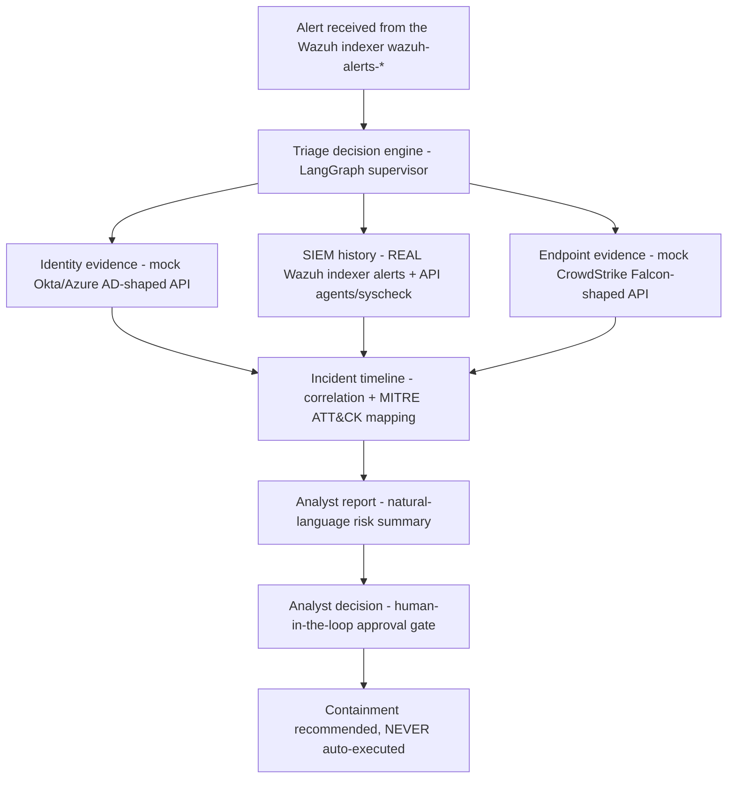
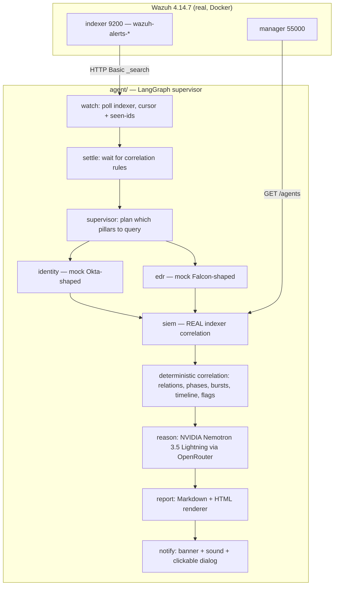

# Architecture Update — Real Wazuh as SIEM & Alert Source

**Project:** AI-Agentic SOC Triage & Investigation Engine
**Author:** Kyrell Green
**Status:** Adopted — supersedes the "mock SIEM" pillar in the Project Design Documentation v0.2
**Applies to:** 12-week build (weeks 1–12), evaluation criteria, and risk register

---

## 1. Change Summary

The SIEM pillar is no longer a locally simulated Splunk/FastAPI mock. It is replaced by
**the real Wazuh 4.14.7 single-node deployment already running in this project's SOC lab**
(Docker, hosted on the development Mac).

Wazuh is now **both** the alert source (where detections originate) **and** the historical
evidence pillar (SIEM history queries). Alert ingestion switches from a hand-fed
Splunk-ES-shaped JSON file to live pulls from the Wazuh API.

| Pillar | v0.2 Design (DRAFT) | Adopted Change |
|---|---|---|
| Alert ingestion | Static JSON alert modeled on Splunk ES / Sigma output | **Live from the Wazuh indexer** (`POST wazuh-alerts-*/_search`), normalized to the internal schema |
| SIEM history | Mock FastAPI service or local Splunk Free | **Real Wazuh API** — real correlated alerts, real agents, real MITRE-tagged rules |
| Identity evidence | Mock FastAPI service (Okta/Azure AD-shaped) | **Unchanged** — remains a schema-matched mock |
| EDR telemetry | Mock FastAPI service (CrowdStrike Falcon-shaped) | **Unchanged** — remains a schema-matched mock (supplemented by Wazuh syscheck/agent data where available) |
| Correlation → report → approval gate | LangGraph orchestration | **Unchanged** |

## 2. Why This Change

1. **The lab is already real.** The Wazuh stack (manager/indexer/dashboard), a monitored
   endpoint (Kali Linux in UTM with the Wazuh agent enrolled), and a working
   firewall/IDS/IPS pipeline (detect → decide → respond) already exist. Standing up a
   *second, fake* SIEM would duplicate infra and hide the lab's strongest asset.
2. **Stronger evaluation story.** Ground-truth evaluation no longer rests only on synthetic
   alerts — the agent can be exercised against **real detections** (e.g. the SSH brute-force
   rule `100010` / MITRE `T1110` already demonstrated in the lab) reproducing their content
   through the API.
3. **More portfolio-relevant skill surface.** Wazuh API integration shows: the REST API with
   JWT bearer auth, `q`-expression query filtering, pagination, agent/syscheck access, and
   schema normalisation between a real vendor format and an internal data model — exactly the
   kind of integration work a SOC engineering role does.
4. **Connector stays upgradeable.** The normalizer isolates Wazuh's shape from the agent's
   internal alert schema. Swapping Wazuh for a real Splunk/Elastic later (or adding them as a
   second source) is a new connector, not a rebuild — same property the v0.2 design claimed
   for swapping mocks to real APIs.

## 3. Revised Architecture

### 3.1 The lab (already live)

```
┌─────────────────────────── macOS (Docker Desktop) ───────────────────────────┐
│                                                                              │
│   Wazuh Manager 4.14.7   ────────────►   Wazuh Indexer (9200)                │
│        │  API :55000                                                         │
│        │  1514/1515 (agents)          Wazuh Dashboard (443)                  │
│        │                                                                     │
│        └── agent enrollment/events                                            │
│                                                                              │
└───────────────────────┬──────────────────────────────────────────────────────┘
                        │ TCP 1514/1515
               ┌────────▼────────┐
               │ Kali Linux (UTM) │  Wazuh agent enrolled
               │ 10.11.0.0/22     │  monitored endpoint
               └─────────────────┘
```

### 3.2 Investigation pipeline (revised)



Note the framing is unchanged from v0.2 Section 7: a SOC investigation workflow first,
an AI system second. Only the *evidence source wiring* of pillar C2 changed.

### 3.3 Data flow through the agent

1. Supervisors pulls an active detection from the Wazuh indexer (`POST wazuh-alerts-*/_search`).
2. The Wazuh alert is normalized into the internal, tool-agnostic `Alert` schema
   (`schemas/alert.py`). MITRE mappings embedded in the Wazuh rule are preserved.
3. The triage decision engine chooses which evidence pillars this alert needs.
4. Identity and EDR lookups go to the mock services; SIEM history goes back to the Wazuh
   indexer (filters on `data.srcip`, `data.dstuser`, `agent.id`, `rule.id`, or a time
   window), while agent/host state comes from the Wazuh API.
5. All evidence is correlated into a timeline, mapped to MITRE ATT&CK, summarized in
   natural language, and routed to the analyst approval gate.

## 4. Wazuh Integration Details

| Item | Value |
|---|---|
| Version | Wazuh 4.14.7 (manager/indexer/dashboard, single-node Docker) |
| API base URL | `https://localhost:55000` (mapped from container port `55000`) |
| Auth flow | `POST /security/user/authenticate` (Basic auth) → JWT → `Authorization: Bearer` on all calls |
| Alert query endpoint | **Indexer** `POST https://localhost:9200/wazuh-alerts-*/_search` (HTTP Basic). Wazuh 4.x has **no** `/security-events` route — that was 3.x — so alerts are only reachable from the indexer, which is also what the dashboard reads |
| Semantic queries | `GET /agents` (list/enrollment), `GET /agents/{id}/summary`, `GET /syscheck/{id}` (file integrity where used), `GET /manager/status`, `POST /logtest` |
| Indexer base URL | `https://localhost:9200` (OpenSearch 2.x, self-signed TLS) |
| Indexer auth | HTTP Basic on every call (`WAZUH_INDEXER_USER`, `WAZUH_INDEXER_PASSWORD`); no JWT/refresh |
| TLS verification | off by default for localhost; controlled by `WAZUH_VERIFY_TLS` |
| Credentials | environment variables only (`WAZUH_API_USER`, `WAZUH_API_PASSWORD`, `WAZUH_INDEXER_USER`, `WAZUH_INDEXER_PASSWORD`), never committed |

### 4.1 Normalizer mapping (Wazuh alert → internal `Alert`)

| Internal field | Source (Wazuh API alert) |
|---|---|
| `rule_id`, `rule_name`, `rule_level` | `rule.id`, `rule.description`, `rule.level` |
| `groups` | `rule.groups` |
| `mitre` | `rule.mitre.id[]` / `rule.mitre.tactic[]` (per-technique) |
| `source_ip` | `data.srcip` (fallback: `data.src_ip`, log parse of `full_log`) |
| `dst_user` | `data.dstuser` (fallback: `data.user`) |
| `agent_id`, `agent_name`, `agent_ip` | `agent.*` |
| `raw_message` | `full_log` |
| `event_time` | `timestamp` (ISO-8601) |
| `source` | fixed: `wazuh` |

## 5. Tech-Stack Table (updated — SIEM row replaced)

| Category | Tool | Purpose |
|---|---|---|
| SIEM + alert source | **Wazuh 4.14.7 (real, Docker)** | Live detections + historical security-event queries via the REST API |
| Wazuh connectivity | `httpx` client with JWT auth and token caching | All agent-to-Wazuh calls |
| Identity evidence | FastAPI service, Okta/Azure AD-shaped (mock) | Synthetic user identity + login history |
| EDR evidence | FastAPI service, CrowdStrike Falcon-shaped (mock) | Synthetic endpoint process/network telemetry |
| Agent orchestration | LangGraph (LangChain) | Supervisor, correlation, synthesis; native HITL pause/resume |
| LLM | Anthropic Claude API (OpenAI fallback) | Planning, reasoning, natural-language reporting |
| Background agent LLM | **NVIDIA Nemotron 3 Ultra 550B via OpenRouter** (`nvidia/nemotron-3-ultra-550b-a55b:free`, fallback `nvidia/nemotron-3.5-lightning:free`) | Analyst narrative for the continuously running triage agent (§9–16) |
| Database | SQLite (MVP; `DATABASE_URL` swappable to Postgres) | Investigation state, reasoning-chain logs, evaluation results |
| Ground truth | Atomic Red Team mappings + labeled test set | Defensible MITRE labels for the test set |
| Dashboard | Streamlit | Alert queue, investigation reports, reasoning chain, approval UI |
| Observability | LangSmith | Step-by-step replay of agent decisions |

## 6. Risk-Register Additions (from Wazuh integration)

| Risk | Category | Mitigation |
|---|---|---|
| Wazuh API credentials/token exposed in logs or code | Security | Credentials from env only; tokens cached in memory with expiry; `.env` gitignored |
| Wazuh version API drift (endpoints change between 4.x minors) | Technical | All Wazuh calls isolated in `siem/`; single client module easy to bump; normalizer keeps internal schema stable |
| Real alert volume/query cost vs. LLM token budget | Technical / cost | Pre-filter and aggregate in Python before any LLM call; tiered model use; query limits server-side |
| Over-querying the live SIEM during demos (performance) | Ops | `limit`/`offset` caps, time-window filters, cached lookups per session |
| Localhost TLS self-signed cert warnings | Ops | `WAZUH_VERIFY_TLS=false` default for local; verify on for any remote deployment |

## 7. Impact on Evaluation Criteria

The v0.2 evaluation criteria stand, with one strengthening: **Functional completeness**
and **Measured accuracy** can now be demonstrated against a genuinely live SIEM
(real Wazuh alerts, e.g. MITRE `T1110` brute force), in addition to the synthetic
ground-truth test set of 20–50 alerts. Everything else (guardrail integrity 100%,
measured time savings, live VPS demo) is unchanged.

## 8. Explicitly Unchanged / Out of Scope

- Real Okta / Azure AD and CrowdStrike tenants remain **out of scope** for the 12-week MVP
  (identity + EDR stay mocks; connectors stay schema-compatible and swappable).
- Any automatic (non-approved) execution of containment actions remains impossible by design.
- The v0.2 goals (LLM tool-calling agent, safe self-contained environment, defensible
  measured outcome) are unchanged.

---

# Architecture Update — Background Triage Agent (delivered 2026-10-21)

This section documents the second half of the capstone: the **continuously running**
triage agent (`agent/`) that watches the real Wazuh indexer, correlates logs, builds a
timeline, writes Markdown + HTML incident reports and fires a clickable desktop notification.

## 9. Why the agent exists

The weeks 1–7 design was a *pull* model: an analyst opened a queue and asked the agent
to investigate one alert. Real SOC work is a *push* model — alerts arrive at 03:00 and
somebody has to notice. The background agent closes that gap and is the piece that
produces the measured "time saved" number.

## 10. Runtime architecture



Graph nodes: `watch → supervisor → identity → edr → siem → timeline → reason → report → notify`.

## 11. Design rule: code owns the facts, the LLM owns the prose

This is the single most important design decision in the agent, and it is enforced
structurally rather than by prompt instruction alone.

| Concern | Owner | Why |
|---|---|---|
| Event counting, relations, phases, burst delineation, timeline ordering | **Python** (`agent/correlation.py`) | Reproducible, testable, auditable. A prompt cannot be trusted to count to 18. |
| Attempt volume | **Python** | `rule.firedtimes` is a *cumulative per-rule counter*, so the attempt count is the **maximum** counter value, never the sum across rules. The report states this explicitly. |
| Severity, confidence, narrative, ATT&CK reasoning, recommendations | **LLM** (`nvidia/nemotron-3-ultra-550b-a55b:free`) | Interpretation is what a language model is for. |
| Containment | **Never executed** | The LLM emits recommendations; a human approves. The graph has no containment node and no credential path. |

The LLM receives a *deterministic evidence pack* (the correlation dict, serialised) and
must return a single JSON object. If it invents an event, a timestamp or a technique,
that invention is a free-text string in a section a human reads — never a number in a
table that another system consumes.

## 12. The settle window (why the agent does not trigger on the first alert)

Wazuh's correlation rules fire **after** the individual events they aggregate. In a live
test on 2026-10-21, a 12-attempt SSH brute force produced this sequence:

| Time (UTC) | Rule | Level | Meaning |
|---|---|---|---|
| 18:44:20 | `5503` | 5 | PAM: user login failed |
| 18:44:36 | `100002` | **12** | Verified SSH brute force: multiple failed logins |
| 18:44:38 | `5551` | 10 | PAM: multiple failed logins in a small period |

Triggering on the first event produced a report about a level-5 PAM failure. Triggering
after a **settle window** (`AGENT_SETTLE_SECONDS`, default 25 s) produced the correct
report about the level-12 brute-force verdict, with the full burst correlated
(**8 → 65 events**, and the burst duration correctly reported as 24 s rather than the
28 minutes the raw correlation window spans).

The settle window also gives Wazuh's own `timeframe`/`frequency` rules time to fire, so
the agent's trigger agrees with the SIEM's verdict instead of racing it.

## 13. Burst delineation

A 30-minute lookback window can contain several *separate* attacks. Events are split
into bursts on a silence gap (`AGENT_BURST_GAP_SECONDS`, default 120 s). The report
gives the duration of the burst the trigger belongs to, and marks every other event
`context` in the timeline, so "attack duration" is never inflated by unrelated history.

## 14. Human-in-the-loop and safety

- The agent **never** executes containment. Recommendations are advisory text only.
- The report is stamped `DRAFT — requires analyst review before any response action`.
- Every report carries a provenance block: agent run id, evidence-pack SHA-256, prompt
  SHA-256, token usage, indexer query count, and the exact investigation window — so a
  reviewer can re-derive every number from the indexer.
- The indexer is queried **read-only**; no Wazuh write endpoints are called.

## 15. Configuration

All settings are environment-driven (`ai-agentic-soc/.env`, see `.env.example`).

| Variable | Default | Purpose |
|---|---|---|
| `OPENROUTER_API_KEY` | — | Required for the narrative. Without it the agent runs deterministic-only and says so in the report. |
| `OPENROUTER_MODEL` | `nvidia/nemotron-3-ultra-550b-a55b:free` | Primary reasoning model |
| `OPENROUTER_FALLBACK_MODELS` | `nvidia/nemotron-3.5-lightning:free` | Models tried in order if the primary fails or returns unparsable JSON |
| `AGENT_POLL_INTERVAL` | `5.0` | Seconds between indexer polls |
| `AGENT_SETTLE_SECONDS` | `25.0` | Wait for Wazuh correlation rules before triggering |
| `AGENT_LLM_TIMEOUT` | `150` | Per-request timeout when calling OpenRouter |
| `AGENT_LLM_MAX_RETRIES` | `1` | Retries per request (1 = no retry; the model chain is the fallback) |
| `AGENT_LLM_BUDGET` | `600` | Hard wall-clock budget for the narrative step; over budget the report ships deterministic-only |
| `AGENT_MIN_LEVEL` | `4` | Minimum rule level collected as correlation context |
| `AGENT_TRIGGER_MIN_LEVEL` | `10` | Minimum rule level allowed to start an investigation (keeps benign level-5 noise out of the report queue) |
| `AGENT_LOOKBACK_MINUTES` | `30` | Correlation window before the trigger |
| `AGENT_POST_WINDOW_MINUTES` | `15` | Correlation window after the trigger |
| `AGENT_BURST_GAP_SECONDS` | `120.0` | Silence gap that separates two bursts |
| `AGENT_DEDUPE_WINDOW_MINUTES` | `2` | Suppress duplicate incidents for the same source (lowered to 2 min so repeated demo attacks each produce a fresh report) |
| `AGENT_NOTIFY` / `_SOUND` / `_OPEN_REPORT` | `true` | Desktop notification layers |

## 16. Running it

```bash
cd ai-agentic-soc
venv/bin/python -m agent.runner                 # background daemon
venv/bin/python -m agent.runner --once          # single watch cycle
venv/bin/python -m agent.runner --no-llm        # deterministic only, no API calls
venv/bin/python -m agent.runner --investigate <alert-id>   # triage one existing alert
venv/bin/python -m agent.runner --status        # show persisted state
```

Output: `reports/SOC-YYYYMMDD-NNN.md` + a styled sibling `reports/SOC-YYYYMMDD-NNN.html`
(self-contained, browser-friendly; the notification dialog opens the HTML), plus `LATEST.md`
and `LATEST.html`.
State: `data/agent_state.json` (cursor, seen ids, incident counter, dedupe keys).
