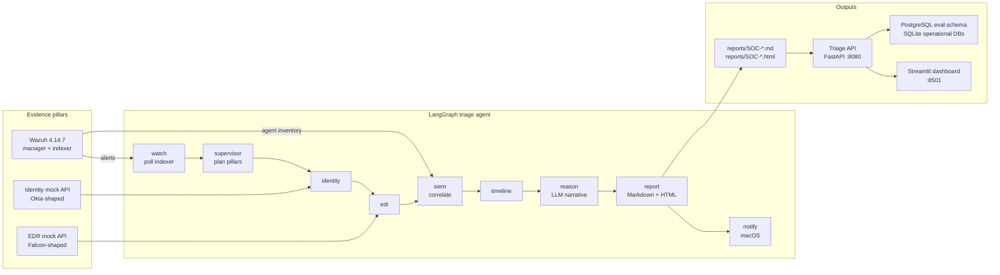
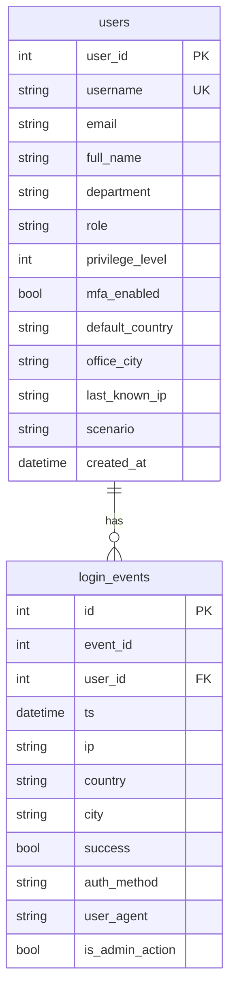
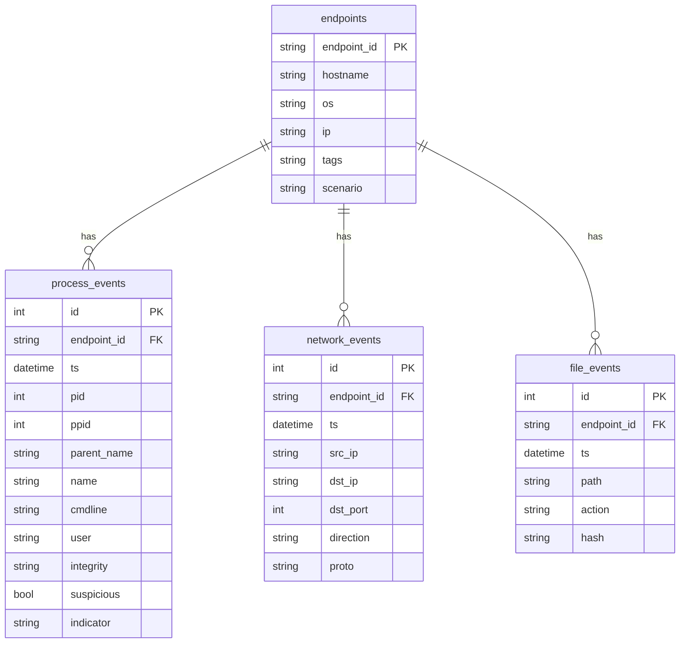
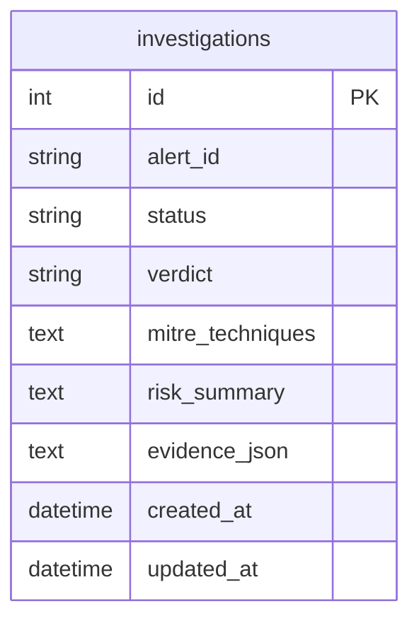
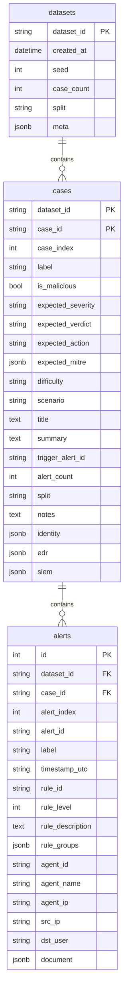

# AI-Agentic SOC — Technical Documentation

This is the developer-facing reference for the **AI-Agentic SOC Triage & Investigation
Engine**. It covers the project overview, architecture, folder layout, installation,
configuration, runtime instructions, HTTP APIs, database schema, report artifacts,
testing, and known gotchas.

For the design rationale and change history, see:

- [`docs/ARCHITECTURE.md`](ARCHITECTURE.md) — architecture updates and the background-agent design
- [`docs/AGENT_DEPLOYMENT_STATUS.md`](AGENT_DEPLOYMENT_STATUS.md) — Wazuh agent enrollment status
- [`../README.md`](../README.md) — quick-start entry point

---

## 1. Project Overview

### 1.1 What it is

An LLM-orchestrated investigation agent that autonomously triages security alerts **before**
a human analyst opens them. It collects evidence from three pillars, correlates the events
into a timeline, maps observed behaviour to MITRE ATT&CK, and writes a natural-language
incident report. A hard human-in-the-loop approval gate keeps authority over any
containment action.

### 1.2 Evidence pillars

| Pillar | Implementation | What it provides |
|---|---|---|
| **SIEM** | **Real Wazuh 4.14.7** in Docker | Alerts, rule metadata, agent inventory, correlation history |
| **Identity** | Mock FastAPI service, Okta/Azure AD-shaped | User profile, login history, risk factors |
| **EDR** | Mock FastAPI service, CrowdStrike Falcon-shaped | Endpoint inventory, process/network/file telemetry |

Wazuh is the real SIEM **and** the alert source. Wazuh 4.x removed the 3.x
`/security-events` route, so alerts are read from the OpenSearch indexer
(`wazuh-alerts-*`). The Wazuh REST API is used for agent inventory (the investigation
engine enriches reports with the active agent list). Identity and EDR are schema-matched
mocks that can later be swapped for real Okta and CrowdStrike integrations.

### 1.3 Capabilities

- Continuous background watcher over the Wazuh indexer
- Deterministic alert correlation by endpoint, source IP, account and rule family
- Attack-phase classification and MITRE ATT&CK mapping
- Burst delineation so "attack duration" is not inflated across unrelated activity
- LLM-written executive summary, attack narrative, findings and recommendations
- Markdown **and** self-contained HTML incident reports
- macOS desktop notification with a clickable "Open Report" dialog
- FastAPI control plane for queueing investigations and reviewing cases
- Streamlit dashboard for case review and the approval gate
- Deterministic 50-case labeled evaluation dataset with PostgreSQL ground truth
- Live evaluation harness that replays cases through the real agent graph

### 1.4 Design principles

1. **Code owns the facts, the LLM owns the prose.**
   Counts, timestamps, rule IDs, relations, phases, bursts and timelines are computed in
   Python from indexed alerts. The model receives those facts and may only narrate them.
2. **The LLM cannot invent evidence.**
   If the model is unavailable or returns unparsable JSON, the report still ships with the
   deterministic half and an explicit "narrative engine unavailable" note.
3. **The agent never executes containment.**
   Recommendations are advisory. The report is stamped `DRAFT — requires analyst review`,
   and analyst decisions are recorded separately from the report.
4. **Every investigation is auditable.**
   The report carries the trigger alert, the correlation window, evidence hashes, the model
   used, token usage, query counts and the full timeline.
5. **Read-only against production evidence.**
   The watcher reads the Wazuh index and mock APIs. It does not write to `wazuh-alerts-*`.

### 1.5 Non-goals

- Replacing a full SOAR platform or auto-remediating endpoints
- Real Okta / CrowdStrike connectors (the mocks are intentionally swappable)
- Multi-tenant authentication and authorization
- A production-grade durable job queue (the API uses one in-process worker)

---

## 2. Architecture

### 2.1 High-level diagram



### 2.2 Runtime components

| Component | Entry point | Purpose |
|---|---|---|
| Background agent | `python -m agent.runner` | Continuous watch → investigate → report → notify |
| Triage API | `python -m services.triage_api` | HTTP control plane over the agent |
| Streamlit dashboard | `streamlit run frontend/app.py` | Analyst case review and approval gate |
| Identity mock | `uvicorn apis.identity.app:app --port 8001` | Synthetic identity evidence |
| EDR mock | `uvicorn apis.edr.app:app --port 8002` | Synthetic endpoint evidence |
| Evaluation CLI | `python -m evals` | Generate and store the labeled dataset |
| Evaluation runner | `python -m evals.run_eval` | Replay cases through the real agent graph |

### 2.3 Agent pipeline

One graph invocation is one full agent cycle. The compiled graph is defined in
`agent/graph.py`.

```text
START
  │
  ▼
watch ──(no trigger)──► END
  │
  ▼ (trigger selected)
supervisor
  │
  ▼
identity ──► edr ──► siem ──► timeline ──► reason ──► report ──► notify ──► END
```

#### `watch`

- Polls `IndexerClient.query_alerts(since=cursor, limit=200)`.
- Converts each Wazuh alert into a canonical event dict via `event_from_wazuh()`.
- Drops already-seen alert IDs and advances the cursor with a 5-second safety margin.
- Collects all events at or above `AGENT_MIN_LEVEL` as correlation context.
- Selects a trigger only from events at or above
  `max(AGENT_MIN_LEVEL, AGENT_TRIGGER_MIN_LEVEL)`.
- Applies the **settle window** (`AGENT_SETTLE_SECONDS`) so Wazuh aggregate rules fire
  before the trigger is locked in.
- Deduplicates incidents by `(agent_id, source_ip)` within
  `AGENT_DEDUPE_WINDOW_MINUTES`.
- Keeps the pending buffer bounded (last 500 events).

#### `supervisor`

Deterministic pillar planning (`plan_pillars`):

- **SIEM** is always required.
- **Identity** is required when the alert has a target user or an authentication/PAM/sudo
  group.
- **EDR** is required when the alert has an agent or an execution/integrity/persistence
  phase.

The plan is stored in graph state and shown in the report so the decision is auditable.

#### `identity`

Looks up the target user by username, fetches recent login history and computes risk
factors. Failures are captured as `{"available": false, "reason": ...}` and do not abort the
investigation.

#### `edr`

Matches the alert's agent name against mock endpoint hostnames/IDs, then fetches recent
process, network and file telemetry. Failures are non-fatal.

#### `siem`

- Builds a correlation window:
  `trigger_ts - AGENT_LOOKBACK_MINUTES` → `trigger_ts + AGENT_POST_WINDOW_MINUTES`.
- Queries the indexer by agent ID, source IP, target user and up to four rule groups.
- Correlates all collected events with `agent.correlation.correlate()`.
- Records relation counts (`SAME_AGENT`, `SAME_SOURCE_IP`, `SAME_USER`,
  `SAME_RULE_GROUP`, `PRIOR`, `POST`), phase counts, rule counts, source/user counts,
  first/last seen, duration, bursts and MITRE tags.
- Computes deterministic narrative flags: auth success observed, auth failures observed,
  failure counter, privilege change, FIM change, session activity, and
  `source_equals_agent_ip`.
- Fetches the Wazuh agent inventory (non-fatal if unavailable).

#### `timeline`

Finalises the timeline event count metric. The timeline itself is already built by
`correlate()`.

#### `reason`

- Builds the evidence prompt with `build_analysis_prompt()`.
- Calls OpenRouter with the primary model and then each fallback model.
- Enforces a hard wall-clock budget (`AGENT_LLM_BUDGET`).
- Records model attempts, token usage and a SHA-256 of the prompt.
- On total failure, returns `analysis = {}` and lets the report render deterministically.

#### `report`

- Computes triage and time-saved metrics.
- Generates an incident ID: `SOC-YYYYMMDD-NNN`.
- Renders `reports/SOC-YYYYMMDD-NNN.md` and `reports/SOC-YYYYMMDD-NNN.html`.
- Records the incident in the JSON state store.

#### `notify`

- Shows a macOS banner, plays a sound, and offers a clickable dialog that opens the HTML
  report.
- Notification failures are non-fatal.

### 2.4 Why the settle window exists

Wazuh correlation rules fire **after** the individual events. For example, an SSH brute
force produces many level-5 `5760` failures before the aggregate rule `100002` (level 12)
fires. Without the settle window the agent would trigger on the first level-5 event, report
the wrong rule, and correlate only part of the burst.

### 2.5 Why burst delineation exists

A correlation window can contain multiple separate attacks from the same source. Splitting
on a silence gap (`AGENT_BURST_GAP_SECONDS`) keeps the reported "attack duration" honest
instead of stretching it across unrelated activity.

### 2.6 Human-in-the-loop flow

```text
Agent writes report (DRAFT)
        │
        ▼
Triage API parses report metadata
        │
        ▼
Streamlit shows case + report
        │
        ▼
Analyst approves / rejects
        │
        ▼
data/triage_decisions.json
```

The report is immutable. Decisions live in a separate JSON file, so the original evidence
is never overwritten.

---

## 3. Folder Structure

```text
ai-agentic-soc/
├── agent/                      # Background triage agent
│   ├── config.py               # Environment-driven AgentConfig
│   ├── events.py               # Canonical event shape + phase classification
│   ├── correlation.py          # Deterministic correlation, bursts, flags
│   ├── graph.py                # LangGraph workflow
│   ├── llm.py                  # OpenRouter HTTP client + JSON repair
│   ├── report.py               # Markdown/HTML report renderers
│   ├── notifier.py             # macOS banner/sound/clickable dialog
│   ├── state.py                # JSON-backed watcher state
│   └── runner.py               # CLI entry point + daemon loop
├── apis/
│   ├── clients.py              # HTTP clients for the mock APIs
│   ├── identity/               # Mock identity service
│   │   ├── app.py
│   │   ├── db.py
│   │   └── data_generator.py
│   └── edr/                    # Mock EDR service
│       ├── app.py
│       ├── db.py
│       └── data_generator.py
├── database/
│   └── engine.py               # SQLAlchemy investigations table
├── evals/                      # Labeled evaluation dataset + runner
│   ├── generator.py            # Deterministic 50-case generator
│   ├── taxonomy.py             # Labels, MITRE mapping, forbidden terms
│   ├── models.py               # EvalCase and evidence models
│   ├── store.py                # PostgreSQL eval schema + JSONL I/O
│   ├── scoring.py              # Pure scoring helpers
│   ├── run_eval.py             # Live evaluation harness
│   ├── dataset/                # Generated JSONL dataset
│   └── results/                # Evaluation deliverables
├── frontend/
│   └── app.py                  # Streamlit dashboard
├── schemas/                    # Pydantic models
│   ├── alert.py                # Internal tool-agnostic Alert + MITRE
│   ├── identity.py             # Identity profile/login/risk models
│   ├── edr.py                  # Endpoint/process/network/file models
│   ├── siem.py                 # SIEM evidence models
│   └── wazuh.py                # Raw Wazuh alert/agent/rule models
├── services/
│   └── triage_api/             # FastAPI control plane
│       ├── app.py              # Routes
│       ├── schemas.py          # Request/response models
│       ├── cases.py            # Report-backed case repository
│       ├── decisions.py        # Persistent analyst decisions
│       ├── jobs.py             # Single-worker in-memory job queue
│       ├── executor.py         # Adapter to agent.runner.investigate_now
│       └── __main__.py         # Uvicorn runner
├── siem/
│   ├── client.py               # Wazuh REST API client (JWT)
│   ├── indexer_client.py       # Wazuh indexer client (HTTP Basic)
│   └── normalizer.py           # Wazuh alert → internal Alert
├── tests/                      # Unit + integration tests
├── scripts/
│   ├── run_agent_daemon.sh     # Restart-on-crash + caffeinate wrapper
│   └── test_wazuh_connection.py
├── docs/
│   ├── ARCHITECTURE.md
│   ├── AGENT_DEPLOYMENT_STATUS.md
│   └── TECHNICAL_DOCUMENTATION.md
├── reports/                    # Generated SOC-*.md/.html reports (runtime)
├── data/                       # SQLite DBs, state, decisions (gitignored)
├── .env.example                # Environment variable template
├── requirements.txt
├── pytest.ini
└── README.md
```

Runtime-only directories (`data/`, `reports/`) are created automatically. They contain
operational state and are not source code.

---

## 4. Installation Guide

### 4.1 Prerequisites

| Requirement | Notes |
|---|---|
| **Python 3.9.6** | The project pins Python 3.9. Do not use `X | None` unions or built-in generic annotations without `from __future__ import annotations`. FastAPI/Pydantic crash at runtime on 3.9 with `X | None`. |
| **Wazuh 4.14.7** | Real manager + indexer. Default ports: API `55000`, indexer `9200`, dashboard `443`. Docker Compose is the lab setup. |
| **PostgreSQL** | Optional. Required only for the labeled evaluation ground-truth schema. |
| **Docker Desktop** | Needed to run the lab Wazuh stack. |
| **macOS** | Required only for desktop notifications (`osascript`, `afplay`). The rest runs cross-platform. |

### 4.2 Create the environment

From the `ai-agentic-soc/` directory:

```bash
cd ai-agentic-soc
python3 -m venv venv
source venv/bin/activate
python -m pip install --upgrade pip
python -m pip install -r requirements.txt
```

> **Important:** use `venv/bin/python -m pip`, not `venv/bin/pip`. In this workspace the
> `pip` script may point at an older venv. The same rule applies to running Python:
> prefer `venv/bin/python`.

### 4.3 Configure environment variables

```bash
cp .env.example .env
```

Edit `.env` and fill in:

- `WAZUH_API_USER` / `WAZUH_API_PASSWORD`
- `WAZUH_INDEXER_USER` / `WAZUH_INDEXER_PASSWORD`
- `OPENROUTER_API_KEY` (only if you want LLM narratives)
- `EVAL_DATABASE_URL` (only if using PostgreSQL for evaluation)

Never commit `.env`. It is gitignored.

### 4.4 Verify Wazuh connectivity

```bash
cd ai-agentic-soc
venv/bin/python scripts/test_wazuh_connection.py
```

The script checks:

- Wazuh API authentication and `/agents`
- Indexer reachability
- A live alert sample
- The 30-day count for rules `5760` / `5763`

### 4.5 Seed the mock evidence APIs

The mock APIs auto-seed their SQLite databases on first startup. No manual seeding is
required. To recreate them, delete `data/identity.db` and `data/edr.db`, then restart the
services.

### 4.6 Run the test suite

```bash
cd ai-agentic-soc
PYTHONPATH=. venv/bin/python -m pytest
```

`pytest.ini` already sets `pythonpath = .` and `testpaths = tests`, so `venv/bin/python -m
pytest` from `ai-agentic-soc/` is sufficient.

### 4.7 Optional: PostgreSQL evaluation schema

```bash
createdb soc_triage_db
venv/bin/python -m evals
```

The `eval` schema and its tables are created automatically. If PostgreSQL is unavailable,
use `venv/bin/python -m evals --no-db` to write JSONL only.

---

## 5. How to Run

All commands assume the current directory is `ai-agentic-soc/`.

### 5.1 Start the mock evidence APIs

```bash
# Terminal 1
venv/bin/uvicorn apis.identity.app:app --host 127.0.0.1 --port 8001

# Terminal 2
venv/bin/uvicorn apis.edr.app:app --host 127.0.0.1 --port 8002
```

Both services expose `/health` and auto-seed synthetic data.

### 5.2 Run the background triage agent

```bash
# Continuous daemon (foreground)
venv/bin/python -m agent.runner

# Single watch cycle
venv/bin/python -m agent.runner --once

# Deterministic report only, no LLM calls
venv/bin/python -m agent.runner --no-llm

# Investigate one existing Wazuh alert by ID
venv/bin/python -m agent.runner --investigate 1792606605.46868

# Show persisted state
venv/bin/python -m agent.runner --status
```

Useful overrides:

```bash
venv/bin/python -m agent.runner --interval 2 --min-level 8 --settle 10
```

### 5.3 Run the agent unattended

`scripts/run_agent_daemon.sh` restarts the agent on crash and keeps the Mac awake with
`caffeinate`. The argument is a maximum run budget in seconds.

```bash
cd ai-agentic-soc
nohup bash scripts/run_agent_daemon.sh 14400 >/dev/null 2>&1 &
```

Supervisor log: `data/agent_supervisor.log`.

> **Do not run the daemon and the Triage API against the same state file at the same time.**
> Both use `data/agent_state.json`, which assumes a single writer.

### 5.4 Run the Triage API

```bash
cd ai-agentic-soc
venv/bin/python -m services.triage_api
```

Defaults: `http://127.0.0.1:8080`, one Uvicorn worker, loopback only. Override with
`TRIAGE_API_HOST` and `TRIAGE_API_PORT`.

Interactive docs: `http://127.0.0.1:8080/docs`.

### 5.5 Run the Streamlit dashboard

Start the Triage API first, then:

```bash
cd ai-agentic-soc
venv/bin/streamlit run frontend/app.py --server.address 127.0.0.1
```

The dashboard reads `TRIAGE_API_URL` (default `http://127.0.0.1:8080`). Always pass
`--server.address 127.0.0.1`; otherwise Streamlit may bind more broadly.

### 5.6 Generate the evaluation dataset

```bash
cd ai-agentic-soc
venv/bin/python -m evals              # validate, write JSONL, load PostgreSQL
venv/bin/python -m evals --check      # validate only, write nothing
venv/bin/python -m evals --no-db      # JSONL only
venv/bin/python -m evals --out /tmp/eval.jsonl
```

Default output: `evals/dataset/soc-eval-2026-11.jsonl`.

### 5.7 Run the evaluation

```bash
cd ai-agentic-soc
venv/bin/python -m evals.run_eval --workers 3     # 50 trigger alerts, live LLM
venv/bin/python -m evals.run_eval --no-llm        # deterministic baseline
venv/bin/python -m evals.run_eval --limit 5       # smoke test
venv/bin/python -m evals.run_eval --all-alerts    # every alert in every bundle
venv/bin/python -m evals.run_eval --resume        # retry incomplete investigations
venv/bin/python -m evals.run_eval --rescore       # re-score saved JSONL, no LLM calls
```

Results land in `evals/results/`:

- `<dataset>-cases-llm-EVALUATION.md`
- `<dataset>-cases-llm-PROCESSING_TIMES.md`
- `<dataset>-cases-llm-evaluation.jsonl` / `.csv`
- `<dataset>-cases-llm-processing-times.csv`
- `<dataset>-cases-llm-run-meta.json`
- `reports/` — per-case Markdown/HTML reports

### 5.8 Common workflow

```text
1. Start Wazuh (Docker) + agents
2. Start identity and EDR mocks
3. Start the background agent (or the Triage API)
4. Generate an alert (e.g. SSH brute force against a monitored host)
5. Agent correlates, reasons, writes reports/SOC-*.md + .html
6. Review the case in Streamlit
7. Approve/reject; decision is written to data/triage_decisions.json
```

---

## 6. API Documentation

### 6.1 Identity mock API

Base URL: `http://127.0.0.1:8001` (configurable with `IDENTITY_API_URL`).

No authentication. Synthetic data is seeded on first startup.

#### `GET /health`

```json
{"status": "ok"}
```

#### `GET /users`

Query: `username` (optional, exact match). Returns up to 200 users.

```json
[
  {
    "user_id": 1,
    "username": "aokonkwo",
    "email": "aokonkwo@example.com",
    "full_name": "Aisha Okonkwo",
    "department": "Engineering",
    "role": "Analyst",
    "privilege_level": 1,
    "mfa_enabled": true,
    "default_country": "GB",
    "office_city": "London",
    "last_known_ip": "10.11.20.11",
    "scenario": "normal",
    "created_at": "2026-10-01T08:00:00"
  }
]
```

#### `GET /users/{user_id}`

Returns one user or `404 {"detail": "user not found"}`.

#### `GET /users/{user_id}/login_history`

Query:

- `limit` — default `100`, max `500`
- `since` — ISO-8601 datetime

Returns login events newest first.

```json
[
  {
    "id": 42,
    "event_id": 0,
    "user_id": 1,
    "ts": "2026-10-01T09:12:00",
    "ip": "10.11.20.11",
    "country": "GB",
    "city": "London",
    "success": true,
    "auth_method": "password",
    "user_agent": "Mozilla/5.0",
    "is_admin_action": false
  }
]
```

#### `POST /users/{user_id}/login_events`

Creates a login event. Returns `201`.

Request body:

```json
{
  "ts": "2026-10-01T09:12:00",
  "ip": "10.11.20.11",
  "country": "GB",
  "city": "London",
  "success": true,
  "auth_method": "password",
  "user_agent": "Mozilla/5.0",
  "is_admin_action": false
}
```

Response:

```json
{"event_id": 0, "user_id": 1}
```

#### `GET /users/{user_id}/risk_factors`

Computes risk from the last 500 login events:

- `failed_logins_24h`
- `impossible_travel` (two successful logins in different countries within 2 hours)
- `after_hours_logins`
- `admin_without_mfa`

```json
{
  "user_id": 1,
  "risk_level": "medium",
  "factors": [
    {"name": "after_hours_logins", "level": "medium", "detail": "3 after-hours successful login(s)"}
  ]
}
```

### 6.2 EDR mock API

Base URL: `http://127.0.0.1:8002` (configurable with `EDR_API_URL`).

No authentication. Synthetic data is seeded on first startup.

#### `GET /health`

```json
{"status": "ok"}
```

#### `GET /endpoints`

Returns all endpoints.

```json
[
  {
    "endpoint_id": "kali-lab-02",
    "hostname": "kali-lab-02",
    "os": "Linux",
    "ip": "192.168.64.3",
    "tags": "lab,linux",
    "scenario": "normal"
  }
]
```

#### `GET /endpoints/{endpoint_id}`

Returns one endpoint or `404 {"detail": "endpoint not found"}`.

#### `GET /endpoints/{endpoint_id}/processes`

Query: `limit` (default `200`, max `1000`), `since` (ISO-8601).

Returns process events newest first.

```json
[
  {
    "id": 10,
    "endpoint_id": "kali-lab-02",
    "ts": "2026-10-01T09:10:00",
    "pid": 4242,
    "ppid": 1,
    "parent_name": "sshd",
    "name": "bash",
    "cmdline": "bash -i",
    "user": "labtester",
    "integrity": "medium",
    "suspicious": true,
    "indicator": "interactive_shell"
  }
]
```

#### `GET /endpoints/{endpoint_id}/network`

Query: `limit`, `since`. Returns network events newest first.

```json
[
  {
    "id": 7,
    "endpoint_id": "kali-lab-02",
    "ts": "2026-10-01T09:11:00",
    "src_ip": "192.168.64.3",
    "dst_ip": "10.11.3.185",
    "dst_port": 22,
    "direction": "outbound",
    "proto": "tcp"
  }
]
```

#### `GET /endpoints/{endpoint_id}/files`

Query: `limit`, `since`. Returns file events newest first.

```json
[
  {
    "id": 3,
    "endpoint_id": "kali-lab-02",
    "ts": "2026-10-01T09:13:00",
    "path": "/tmp/payload.sh",
    "action": "created",
    "hash": "d41d8cd98f00b204e9800998ecf8427e"
  }
]
```

### 6.3 Triage API

Base URL: `http://127.0.0.1:8080` (configurable with `TRIAGE_API_HOST` /
`TRIAGE_API_PORT`). API prefix: `/api/v1`.

No authentication. Keep it on loopback or put it behind an authenticated reverse proxy.

#### `GET /`

```json
{"service": "triage-api", "version": "0.1.0", "api": "/api/v1", "docs": "/docs"}
```

#### `GET /api/v1/health`

```json
{
  "status": "ok",
  "version": "0.1.0",
  "reports_dir": "/path/to/ai-agentic-soc/reports",
  "worker_alive": true,
  "queued_jobs": 0,
  "running_jobs": 0
}
```

`status` is `"degraded"` when the worker thread is not alive.

#### `POST /api/v1/investigations`

Queues an investigation for one alert ID. Returns `202 Accepted`.

Request:

```json
{"alert_id": "1792606605.46868", "force": false}
```

- `force=false` returns the existing queued/running job for the same alert instead of
  creating a duplicate.
- `force=true` always creates a new job.

Response:

```json
{
  "job_id": "3f2a...",
  "alert_id": "1792606605.46868",
  "status": "queued",
  "created_at": "2026-11-09T12:00:00+00:00",
  "started_at": null,
  "finished_at": null,
  "result": null,
  "error": null
}
```

#### `GET /api/v1/jobs`

Query: `limit` (default `50`, max `500`). Returns recent jobs, newest first.

#### `GET /api/v1/jobs/{job_id}`

Returns one job or `404 {"detail": "job not found"}`.

Job statuses: `queued`, `running`, `succeeded`, `failed`.

A succeeded job result contains:

```json
{
  "alert_id": "...",
  "incident_id": "SOC-20261109-001",
  "status": "report_ready",
  "report_path": ".../reports/SOC-20261109-001.md",
  "report_html_path": ".../reports/SOC-20261109-001.html",
  "severity": "High",
  "confidence": "High",
  "metrics": {"mttd_seconds": 15.1, "triage_seconds": 80.2},
  "errors": []
}
```

#### `GET /api/v1/cases`

Query:

- `limit` — default `100`, max `500`
- `severity` — optional case-insensitive filter

Returns cases parsed from `reports/SOC-*.md`. The report is the source of truth; there is no
separate case database.

```json
[
  {
    "incident_id": "SOC-20261109-001",
    "title": "Incident Report SOC-20261109-001",
    "severity": "High",
    "confidence": "High",
    "affected_host": "Kali (agent 002, ip 192.168.64.3)",
    "source_address": "192.168.64.3",
    "target_account": "labtester",
    "detection_rule": "100002 (level 12)",
    "generated_at": "2026-11-09 12:01:20.000Z",
    "report_path": ".../reports/SOC-20261109-001.md",
    "report_html_path": ".../reports/SOC-20261109-001.html",
    "summary": "…",
    "decision": null
  }
]
```

#### `GET /api/v1/cases/{incident_id}`

Returns the case summary plus:

- `report_status`
- `model`
- `correlated_events`
- `attack_duration`
- `markdown` (full report body)

#### `GET /api/v1/cases/{incident_id}/report`

Query: `format=markdown` (default) or `format=html`.

- Markdown: `text/markdown; charset=utf-8`
- HTML: `text/html` file response
- Missing HTML: `404 {"detail": "HTML report not available"}`

#### `POST /api/v1/cases/{incident_id}/decision`

Records the analyst decision separately from the report.

Request:

```json
{
  "decision": "approved",
  "analyst": "kyrell",
  "note": "Containment approved; isolate host."
}
```

`decision` must be `approved` or `rejected`.

Response:

```json
{
  "incident_id": "SOC-20261109-001",
  "decision": "approved",
  "analyst": "kyrell",
  "note": "Containment approved; isolate host.",
  "decided_at": "2026-11-09T12:05:00+00:00"
}
```

#### `GET /api/v1/metrics`

```json
{
  "generated_at": "2026-11-09T12:06:00+00:00",
  "total_cases": 9,
  "by_severity": {"High": 4, "Medium": 3, "Low": 2},
  "by_decision": {"pending": 7, "approved": 2},
  "jobs": {"queued": 0, "running": 0, "succeeded": 3, "failed": 0}
}
```

### 6.4 Internal Wazuh clients

These are Python classes, not HTTP services exposed by this project.

| Class | File | Purpose |
|---|---|---|
| `IndexerClient` | `siem/indexer_client.py` | Alert queries against `wazuh-alerts-*` (HTTP Basic) |
| `WazuhClient` | `siem/client.py` | Manager API: JWT auth and agent lookups |
| `IdentityClient` | `apis/clients.py` | Client for the identity mock |
| `EDRClient` | `apis/clients.py` | Client for the EDR mock |
| `OpenRouterClient` | `agent/llm.py` | Chat completions with JSON repair and retries |

> `WazuhClient.query_alerts()` / `get_alert()` are **deprecated** on Wazuh 4.x because
> `/security-events` no longer exists. Use `IndexerClient` for alerts.

---

## 7. Database Schema

The project uses SQLite for operational state and PostgreSQL for evaluation ground truth.
All runtime database files live under `data/` and are gitignored.

### 7.1 Operational SQLite databases

#### `data/identity.db` — identity mock



- `users.user_id` is the primary key.
- `users.username` is unique and indexed.
- `login_events.event_id` is a plain indexed integer, not a primary key.
- `login_events.user_id` references `users.user_id` logically (no DB-level FK).

#### `data/edr.db` — EDR mock



`endpoint_id` is the primary key on `endpoints` and an indexed column on each event table.

#### `data/investigations.db` — investigation records



This SQLAlchemy table (`database/engine.py`) is the legacy investigation store. The live
agent writes reports and JSON state; the Triage API parses reports directly.

### 7.2 Evaluation PostgreSQL schema

Database: `soc_triage_db` (override with `EVAL_DATABASE_URL`).
Schema: `eval`.



Key points:

- `eval.cases` has a composite primary key `(dataset_id, case_id)`.
- `eval.alerts` has a composite foreign key to `eval.cases`.
- `eval.cases.label` is the ground truth written by the generator. The agent never updates
  it.
- `eval.alerts.document` stores the full Wazuh-shaped alert JSON.
- The evaluation schema is deliberately separate from the live `wazuh-alerts-*` index and
  the operational SQLite databases.

### 7.3 JSON state files

| File | Owner | Purpose |
|---|---|---|
| `data/agent_state.json` | `agent/state.py` | Cursor, seen IDs, incident sequence, dedupe keys, last incident, run count |
| `data/triage_decisions.json` | `services/triage_api/decisions.py` | Analyst decisions keyed by incident ID |
| `data/agent_supervisor.log` | `scripts/run_agent_daemon.sh` | Supervised daemon log |

Both JSON stores write atomically via a temporary file and `replace()`. The agent state
assumes a **single writer**; do not run the daemon and the Triage API concurrently against
the same state file.

### 7.4 Report artifacts

| Path | Contents |
|---|---|
| `reports/SOC-YYYYMMDD-NNN.md` | Markdown incident report |
| `reports/SOC-YYYYMMDD-NNN.html` | Self-contained styled HTML report |
| `reports/LATEST.md` / `reports/LATEST.html` | Most recent report copies |

The Markdown report includes:

1. Executive Summary and metadata table
2. Detection Facts and raw trigger log
3. Key Findings
4. Log Correlation
5. Incident Timeline
6. Attack Narrative
7. MITRE ATT&CK Mapping
8. Risk Assessment
9. Recommended Actions (including containment advice)
10. Evidence Gaps and Caveats (including the false-positive assessment)
11. Detection and Triage Metrics (MTTD, burst latency, triage time, time saved)
12. Provenance and Audit Trail (queries, hashes, model usage)

---

## 8. Configuration Reference

Configuration is environment-driven through `agent/config.py` and `.env`.

### 8.1 Wazuh and indexer

| Variable | Default | Purpose |
|---|---|---|
| `WAZUH_API_URL` | `https://localhost:55000` | Wazuh manager API |
| `WAZUH_API_USER` | — | Manager API user |
| `WAZUH_API_PASSWORD` | — | Manager API password |
| `WAZUH_VERIFY_TLS` | `false` | Verify TLS for non-localhost deployments |
| `WAZUH_INDEXER_URL` | `https://localhost:9200` | OpenSearch indexer |
| `WAZUH_INDEXER_USER` | — | Indexer user |
| `WAZUH_INDEXER_PASSWORD` | — | Indexer password |
| `WAZUH_INDEXER_INDEX` | `wazuh-alerts-*` | Alert index pattern |

### 8.2 Evidence APIs and databases

| Variable | Default | Purpose |
|---|---|---|
| `IDENTITY_API_URL` | `http://localhost:8001` | Identity mock |
| `EDR_API_URL` | `http://localhost:8002` | EDR mock |
| `IDENTITY_DATABASE_URL` | `sqlite:///./data/identity.db` | Identity SQLite |
| `EDR_DATABASE_URL` | `sqlite:///./data/edr.db` | EDR SQLite |
| `DATABASE_URL` | `sqlite:///./data/investigations.db` | Investigation SQLite |
| `EVAL_DATABASE_URL` | `postgresql+psycopg2:///soc_triage_db` | Evaluation PostgreSQL |

### 8.3 LLM

| Variable | Default | Purpose |
|---|---|---|
| `OPENROUTER_API_KEY` | — | Required for LLM narratives |
| `OPENROUTER_MODEL` | `nvidia/nemotron-3-ultra-550b-a55b:free` | Primary model |
| `OPENROUTER_FALLBACK_MODELS` | `nvidia/nemotron-3.5-lightning:free` | Comma-separated fallbacks |
| `OPENROUTER_BASE_URL` | `https://openrouter.ai/api/v1` | OpenRouter base URL |
| `OPENROUTER_TITLE` | `AI-Agentic SOC Triage Engine` | Attribution title |
| `AGENT_LLM_TEMPERATURE` | `0.2` | Sampling temperature |
| `AGENT_LLM_MAX_TOKENS` | `8000` | Max completion tokens |
| `AGENT_LLM_TIMEOUT` | `150` | Per-request timeout (seconds) |
| `AGENT_LLM_MAX_RETRIES` | `1` | Retries per request |
| `AGENT_LLM_BUDGET` | `600` | Hard wall-clock budget for the narrative step |
| `AGENT_USE_LLM` | `true` | Disable all LLM calls when false |

### 8.4 Agent behaviour

| Variable | Default | Purpose |
|---|---|---|
| `AGENT_POLL_INTERVAL` | `5` | Seconds between indexer polls |
| `AGENT_MIN_LEVEL` | `4` | Minimum rule level collected as context |
| `AGENT_TRIGGER_MIN_LEVEL` | `10` | Minimum rule level that can start an investigation |
| `AGENT_SETTLE_SECONDS` | `25` | Wait for Wazuh correlation rules |
| `AGENT_LOOKBACK_MINUTES` | `30` | Correlation window before the trigger |
| `AGENT_POST_WINDOW_MINUTES` | `15` | Correlation window after the trigger |
| `AGENT_DEDUPE_WINDOW_MINUTES` | `2` in `.env.example` (code fallback `20`) | Suppress repeat incidents for the same source |
| `AGENT_BURST_GAP_SECONDS` | `120` | Silence gap that separates bursts |
| `AGENT_MAX_CORRELATED_ALERTS` | `800` | Max alerts per correlation query |
| `AGENT_MAX_EVENTS_IN_PROMPT` | `60` | Max timeline events in the LLM prompt |
| `AGENT_MANUAL_BASELINE_MINUTES` | `45` | Manual-triage baseline for time-saved metric |
| `AGENT_REPORTS_DIR` | `./reports` | Report output directory |
| `AGENT_STATE_FILE` | `./data/agent_state.json` | Persistent watcher state |
| `AGENT_USE_IDENTITY_API` | `true` | Enable identity pillar |
| `AGENT_USE_EDR_API` | `true` | Enable EDR pillar |

### 8.5 Notifications and services

| Variable | Default | Purpose |
|---|---|---|
| `AGENT_NOTIFY` | `true` | Enable macOS notifications |
| `AGENT_NOTIFY_SOUND` | `true` | Play completion sound |
| `AGENT_NOTIFY_OPEN_REPORT` | `true` | Show clickable report dialog |
| `AGENT_NOTIFY_TITLE` | `AI-Agentic SOC` | Notification title |
| `TRIAGE_API_HOST` | `127.0.0.1` | Triage API bind address |
| `TRIAGE_API_PORT` | `8080` | Triage API port |
| `TRIAGE_API_URL` | `http://127.0.0.1:8080` | Dashboard → API URL |

---

## 9. Testing

Run from `ai-agentic-soc/`:

```bash
PYTHONPATH=. venv/bin/python -m pytest
```

The suite currently contains **99 tests** across:

| Test file | Covers |
|---|---|
| `test_normalizer.py` | Wazuh alert → internal `Alert` normalization |
| `test_wazuh_client.py` | Wazuh manager API client (JWT, agents, rules) |
| `test_indexer_client.py` | Indexer query/count/get-alert behavior |
| `test_identity_api.py` | Identity mock endpoints and risk logic |
| `test_edr_api.py` | EDR mock endpoints |
| `test_e2e.py` | End-to-end evidence pipeline across both mock APIs |
| `test_agent.py` | Correlation, event classification, report rendering, agent graph behavior |
| `test_triage_api.py` | Triage API routes, jobs, cases, decisions |
| `test_eval_dataset.py` | Dataset distribution, determinism, label non-leakage, storage |
| `test_eval_runner.py` | Scoring helpers and evaluation runner behavior |

Tests boot real FastAPI servers on ephemeral ports rather than using `httpx.ASGITransport`,
because that transport is async-only and cannot back the project's synchronous clients.

---

## 10. Troubleshooting and Known Gotchas

### 10.1 Python 3.9

Do **not** use `X | None` unions or `list[...]` / `dict[...]` annotations in FastAPI/Pydantic
models without `from __future__ import annotations`. On Python 3.9, FastAPI evaluates some
annotations at runtime and crashes on `X | None`. Use `Optional[...]` from `typing`.

### 10.2 Broken venv `pip`

If `venv/bin/pip` installs into the wrong location, its shebang points at an older venv.
Always use:

```bash
venv/bin/python -m pip install ...
```

### 10.3 Wazuh 4.x has no alerts API

`WazuhClient.query_alerts()` and `get_alert()` call the removed `/security-events` route and
return 404. Alerts come from `IndexerClient` against `wazuh-alerts-*`. The Wazuh API is only
for agents, rules, manager status and logtest.

### 10.4 Free-tier LLM flakiness

Free OpenRouter routes can return prose instead of JSON, truncate output, or return HTTP
429. The agent handles this with:

- `response_format: json_object`
- a repair re-ask
- an ordered model chain
- a hard `AGENT_LLM_BUDGET` deadline

If all models fail, the report is still written deterministically and the error is recorded
in `metrics` / `errors`.

### 10.5 Reasoning models can return empty content

`nvidia/nemotron-3.5-lightning:free` can burn its whole token budget on hidden reasoning and
return an empty string with `finish_reason=length`. That is why
`nvidia/nemotron-3-ultra-550b-a55b:free` is the primary model and Lightning is the fallback.

### 10.6 `httpx` timeouts are per-read, not total

A stalled generation can stream slowly and outlive the per-request timeout. The
`AGENT_LLM_BUDGET` deadline bounds the whole narrative step.

### 10.7 Suricata → Wazuh log rotation

After Suricata's daily log rotation, `eve.json` can be replaced while Suricata and the Wazuh
logcollector still hold the old inode. The pipeline then silently stops producing Suricata
alerts even though Suricata keeps alerting. On the Kali agent:

```bash
sudo suricatasc -c reopen-log-files
sudo systemctl restart wazuh-agent
```

### 10.8 UTM guest command output

`utmctl exec` can return empty output for commands that have not emitted output yet, even
while the command keeps running. Run long checks detached and poll the output file:

```bash
nohup <command> >/tmp/check.log 2>&1 &
cat /tmp/check.log
```

### 10.9 Ports and exposure

- Wazuh dashboard: `443`
- Wazuh API: `55000`
- Wazuh indexer: `9200`
- Identity mock: `8001`
- EDR mock: `8002`
- Triage API: `8080`
- Streamlit: `8501`
- TheHive: `9000`
- EveBox: `5636`

The Triage API and dashboard have **no authentication**. Keep them on loopback or put them
behind an authenticated proxy.

### 10.10 Single-writer state

The daemon and the Triage API both use `data/agent_state.json`. Running both at once can
corrupt the cursor/incident sequence. Pick one writer at a time.

---

## 11. Status and Roadmap

- **Weeks 1–4:** alert schema + normalizer, identity mock API, Wazuh connector, EDR mock
  API, end-to-end evidence gatherer, tests.
- **Weeks 5–7:** LangGraph supervisor agent, evidence-pillar planning, correlation, MITRE
  mapping.
- **Weeks 8–11:** background triage agent, deterministic correlation with burst delineation,
  Markdown + HTML reports, desktop notifications, labeled evaluation dataset, live evaluation
  runner.
- **Weeks 11–12:** FastAPI control plane and Streamlit dashboard. Remaining work: dedicated
  timeline/MITRE views, wiring analyst decisions into an action layer (TheHive or an approved
  executor), and production hardening.

Known open items:

- The dashboard does not yet render a dedicated timeline/MITRE view.
- Analyst decisions are recorded but nothing consumes them yet.
- `investigation/evidence.py` still points at the legacy 4.x-incompatible alert path; the
  live pipeline uses `agent/`.
- The Triage API is single-worker and unauthenticated by design.
- `reports/` is not gitignored (it contains lab IPs, not secrets).

---

## 12. Further Reading

- [`docs/ARCHITECTURE.md`](ARCHITECTURE.md) — architecture rationale and background-agent design
- [`docs/AGENT_DEPLOYMENT_STATUS.md`](AGENT_DEPLOYMENT_STATUS.md) — Wazuh agent enrollment
- [`../README.md`](../README.md) — quick start and repository summary
- `evals/results/*-EVALUATION.md` — latest evaluation results and per-label breakdown
