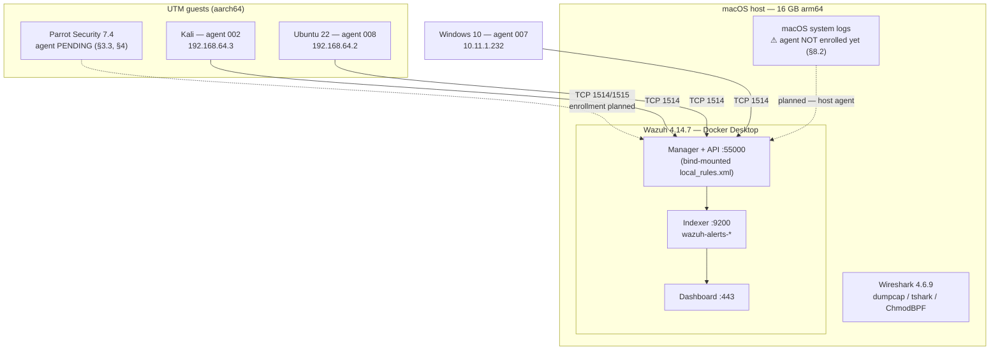
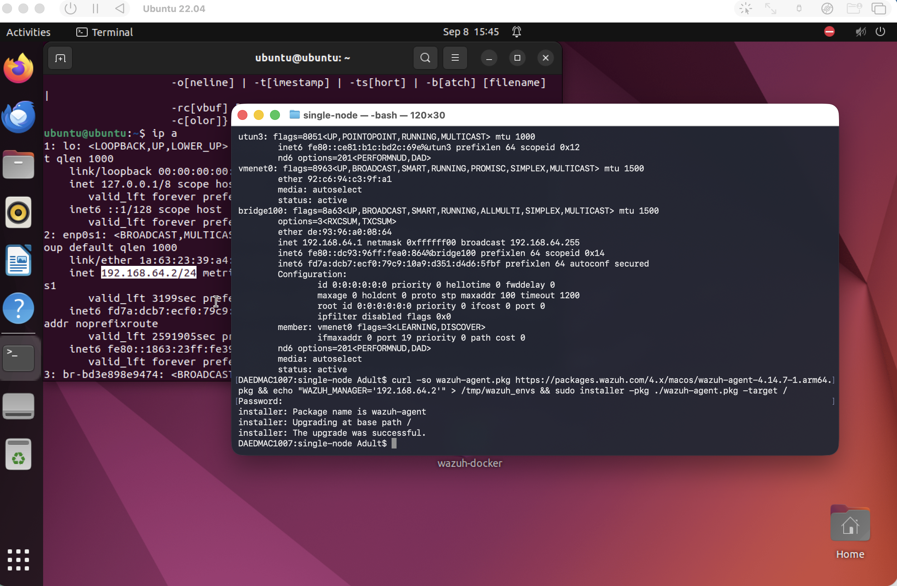
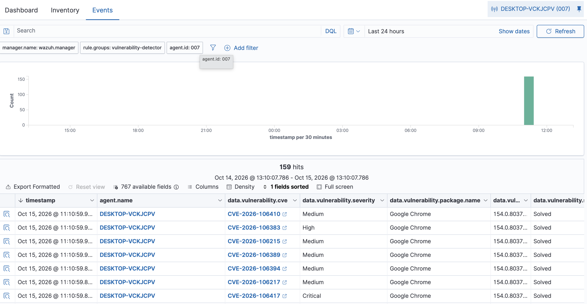
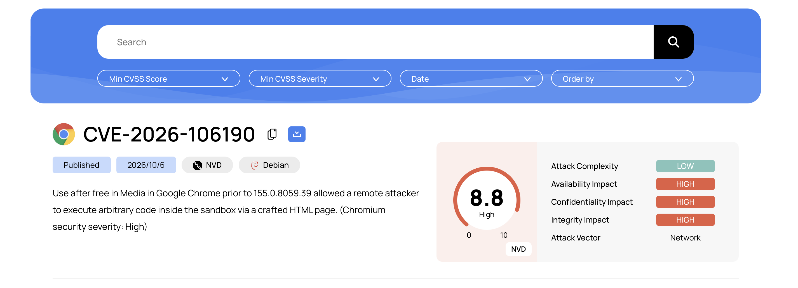
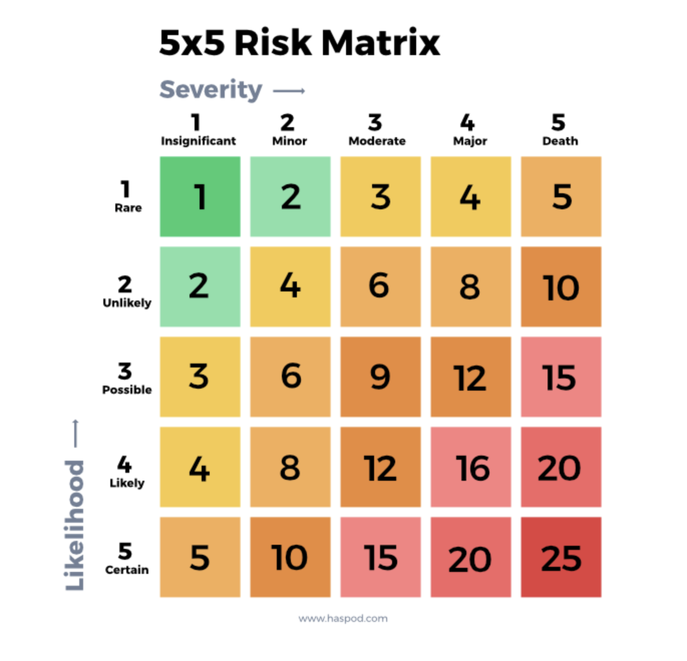

# IR Environment Setup

**Project:** AI-Agentic SOC Triage & Investigation Engine
**Author:** Kyrell Green
**Module:** Incident Response (`incident_response_1/`)
**Source rubric:** *IR Environment Setup* (pasted from the assessment brief)
**Evidence basis:** live lab state recorded in the project journal + repo after the 2026-10-13/19 pull
(`.opencode/memory/PROJECT.md`); screenshots in `incident_response_1/` and sibling module folders.

---

## Rubric Coverage & Status

> **Deviation statement (important for the reviewer):** the brief names *Parrot OS on VirtualBox*
> and a *macOS* host as the SIEM host. This lab's environment is a **16 GB Apple-Silicon (arm64)
> Mac**. On that hardware **VirtualBox cannot host aarch64 guests**, so the hypervisor is **UTM
> (QEMU)** — the same stack that already runs the rest of the lab. Rather than installing the SIEM
> *inside* one VM, **Wazuh 4.14.7 runs centrally on the macOS host (Docker)** — which is Wazuh's
> intended architecture — and **Parrot OS is enrolled as a monitored agent endpoint**. Every
> capability the rubric tests (agent deployment, Parrot log collection, custom rules, Wireshark
> capture filters, Volatility, multi-OS log ingestion into the Wazuh dashboard) is preserved; the
> platform placement differs. Each rubric line below shows exactly what is **done** vs. **pending**.

| # | Rubric requirement | Status | Where |
|---|---|---|---|
| 1 | Wazuh SIEM installed & configured (brief: *on Parrot OS / VirtualBox*) | ✅ Wazuh 4.14.7 on macOS host (Docker); Parrot 7.4 staged in UTM — deviation documented | §1–§2 |
| 2 | Evidence of **basic agent deployment** | ✅ 3-OS fleet live (`002` Kali, `007` Windows, `008` Ubuntu); Parrot staged | §3 |
| 3 | **Log collection configuration from Parrot OS** | ⏳ pending Parrot first boot — config + commands ready | §4 |
| 4 | **3 custom alert rules** for security events | ✅ deployed & API-verified (`100030`/`100031`/`100032`); ⏳ live end-to-end firing to demonstrate | §5 |
| 5 | **Wireshark** configured with proper **capture filters** | 🔄 verified on macOS host (stopgap) + Kali analysis; ⏳ copy on Parrot | §6 |
| 6 | **Volatility framework** with memory-analysis configuration | ⏳ pending (queued after Parrot boot) | §7 |
| 7 | System logging collecting **Parrot OS and macOS** logs with ingestion evidence into Wazuh dashboard | 🔄 Parrot + macOS agents pending; existing cross-OS ingestion evidence for Kali/Windows/Ubuntu | §8 |
| 8 | All configurations **documented** with **evidence of functionality** | 🔄 this document + screenshots; evidence checklist per pending item | §9–§10 |

---

## 1. Environment Overview & Deviations

### 1.1 Rubric vs. actual environment

| Brief says | Actual lab | Why it differs |
|---|---|---|
| Wazuh SIEM **on Parrot OS (VirtualBox)** | **Wazuh 4.14.7 single-node Docker on the macOS host**; **Parrot Security 7.4 (arm64)** imported to **UTM**, ready to boot, to be enrolled as a *monitored agent* | arm64 Mac: VirtualBox does not run aarch64 guests; UTM/QEMU is the lab's existing hypervisor. A central manager + endpoint agent is Wazuh's designed deployment and still exercises agent deployment + Parrot log collection |
| Wireshark **on Parrot OS** | **Wireshark 4.6.9 on the macOS host** (verified working) + Wireshark 4.4.x capture analysis on Kali (report exists) | stopgap while Parrot is staged; identical capture-filter capability; Parrot install steps in §6.3 |
| Volatility **in Parrot OS** | not yet installed — **planned with the Parrot boot** | queued next in the build order (§7) |
| Collect **Parrot OS + macOS** logs | Parrot agent ⏳ pending; **macOS host has no agent yet** (⚠ gap, §8.2); Kali/Windows/Ubuntu logs ingested ✅ | macOS host currently runs the SIEM but is not itself monitored |

### 1.2 Lab architecture (components & data flow)



### 1.3 Inventory (what is running, where)

| Layer | Component | Address / port | Status |
|---|---|---|---|
| SIEM | Wazuh Manager + API | `localhost:55000` (published `0.0.0.0` 1514-1515/55000) | ✅ running |
| SIEM | Wazuh Indexer | `localhost:9200` | ✅ running |
| SIEM | Wazuh Dashboard | `localhost:443` | ✅ running |
| Agents | `002` Kali / `007` Windows / `008` Ubuntu | `192.168.64.3` / `10.11.1.232` / `192.168.64.2` | ✅ active |
| Agent (staged) | Parrot 7.4 | `192.168.64.x` (UTM shared net) | ⏳ VM ready, agent not installed |
| Tools | Wireshark 4.6.9 | macOS host | ✅ verified |
| Tools | Volatility | Parrot (planned) | ⏳ pending |
| Sensor | Suricata 8.0 + EveBox | `localhost:5636` | 🔄 offline pcap replay (not Wazuh-integrated) |
| Case mgmt | TheHive 5.2.16 | `localhost:9000` | ✅ running |

---

## 2. Wazuh SIEM Installation & Configuration (Evidence)

Single-node Docker stack (manager / indexer / dashboard) on the macOS host — the platform the
brief's "successful installation and configuration" requirement refers to.

| Evidence | Detail |
|---|---|
| Version | Wazuh **4.14.7** (manager, indexer, dashboard, API) |
| Ports | agents `1514` (events) / `1515` (enrollment), API `55000` (JWT), indexer `9200`, dashboard `443` — published on `0.0.0.0` |
| Config | `config/wazuh_cluster/wazuh.manager.conf` bind-mounted as `/var/ossec/etc/ossec.conf` (persistent); custom rules bind-mounted read-only (§5.1) |
| Credentials | `.env` / Docker compose only — never committed |
| Verification | `scripts/test_wazuh_connection.py` exercises JWT API auth + agents + indexer reachability; API `/agents`, `/rules`, `/manager/status` respond |

**Screenshots:**


*Manager/dashboard access configuration.*


*The macOS host running the Wazuh stack.*

---

## 3. Agent Deployment (Evidence)

### 3.1 Live fleet — the deployed-and-verified evidence

| Agent | Host | OS | Address | Verified via |
|---|---|---|---|---|
| `002` | `kali-lab-02` | Kali Linux (arm64) | `192.168.64.3` | API `/agents` — active; produced the full `5760→5763→40112` alert chain |
| `007` | `DESKTOP-VCKJCPV` | Windows 10 x86_64 | `10.11.1.232` | API `/agents` — active; **728 alerts** across 3 active days |
| `008` | `ubuntu` | Ubuntu 22.04 (arm64) | `192.168.64.2` | API `/agents` — active (enrolled 2026-10-06) |


*Agent enrollment — an endpoint connecting to the manager over the Wazuh agent protocol.*


*Agent fleet view — enrolled endpoints shown Active/Connected.*


*ICMP reachability to a monitored endpoint — network prerequisite for log streaming.*

### 3.2 Deployment gotchas (documented, so a reproduction works)

- **Never `<address>0.0.0.0</address>`.** The Windows agent `007` crashed on startup
  (`(4112) Invalid server address`) because the MSI reconfiguration never applied the manager
  address; fixed by editing `ossec.conf` to `10.11.3.185` (backup kept as `ossec.conf.bak`) and
  restarting `WazuhSvc`.
- **Match the architecture.** The arm64 hosts (Kali, Ubuntu, Parrot) need
  `wazuh-agent_4.14.7-1_arm64.deb` — the amd64 `.deb` fails with *"package architecture does not
  match system"*. The correct package is **in the repo root**: `wazuh-agent_4.14.7-1_arm64.deb`.
- **Manager address for UTM guests** = `192.168.64.1` (bridge gateway); enrollment is
  **passwordless** (manager allows it); agent version must be **4.14.7** to match the manager.

### 3.3 Parrot OS agent — staged, pending first boot

Parrot Security **7.4 (arm64)** is already imported into UTM's library (bundle extracted,
right-sized to **4 GB RAM / 4 CPUs** — stock 8 GB would thrash the 16 GB host alongside Docker-Wazuh),
network `Shared`, and UTM was relaunched non-translocated so the VM can boot. Commands to run on
first boot (same pattern as agent `008`):

```bash
# 1. install the arm64 agent (copy wazuh-agent_4.14.7-1_arm64.deb from the repo root into the VM)
sudo dpkg -i wazuh-agent_4.14.7-1_arm64.deb        # falls back: sudo apt install -y ./wazuh-agent_4.14.7-1_arm64.deb

# 2. point the agent at the manager — NEVER 0.0.0.0
sudo sed -i 's#<address>.*</address>#<address>192.168.64.1</address>#' /var/ossec/etc/ossec.conf

# 3. start (enrollment is passwordless)
sudo systemctl enable wazuh-agent && sudo systemctl start wazuh-agent
```

**Evidence to capture:** Wazuh dashboard → *Agents* showing the Parrot agent `Active/Connected`,
plus `GET /agents` output from the API.

---

## 4. Log Collection Configuration from Parrot OS

⏳ **Status: configuration prepared — apply after Parrot first boot (§3.3).** Parrot is
Debian-based, so collection uses the same `logcollector` + `syscheck` pattern already proven on
agent `002` (which produced `/var/log/auth.log` records such as `Failed password …` → rules
`5760`/`5763`).

Add to the agent's `/var/ossec/etc/ossec.conf`:

```xml
<!-- authentication records: SSH/PAM success+failure, sudo -->
<localfile>
  <log_format>syslog</log_format>
  <location>/var/log/auth.log</location>
</localfile>

<!-- system records -->
<localfile>
  <log_format>syslog</log_format>
  <location>/var/log/syslog</location>
</localfile>

<!-- file integrity on the security-critical paths (feeds custom rule 100032, §5) -->
<syscheck>
  <frequency>3600</frequency>
  <directories>/etc,/etc/ssh</directories>
  <directories>/var/ossec/etc</directories>
</syscheck>
```

> **Verify on the live VM:** if Parrot's logging is journald-only (no rsyslog files), switch the
> `log_format` accordingly (`journald`) or collect via `journalctl` as a `command` source — confirm
> by tailing `/var/ossec/logs/ossec.log` on the agent for `logcollector: file` confirmations.

**Evidence of functionality to capture:** Security Events view filtered to the Parrot agent
showing a real auth record (e.g. `sudo` or a failed SSH attempt), plus the syscheck first-scan
entry under *Configuration assessment → Inventory → Data collection*.

---

## 5. Three Custom Alert Rules (Implemented)

✅ **Deployed 2026-10-13 and verified loaded via the Wazuh API.** This closes the long-standing
gap `G6` ("no custom detection rule deployed") recorded in earlier docs.

### 5.1 Deployment mechanism

| Item | Detail |
|---|---|
| File (source of truth) | `config/wazuh_cluster/rules/local_rules.xml` on the Docker host |
| Bind-mount | `config/wazuh_cluster/rules/local_rules.xml` → `/var/ossec/etc/rules/local_rules.xml:ro` (added to `docker-compose.yml`) |
| Lives in git? | **No** — Docker config sits outside the workspace/repo; a copy should be added to the repo (§10, action A5) |
| ID range | `100030`–`100032` — **renumbered from the originally planned `100010`–`100020`** because the shipped `threatescalation.xml` already uses `100001`–`100021` (collision → `wazuh-logtest` "duplicated" warning). Older documents citing rule `100010` are superseded by this deployment |
| Verification | all 3 confirmed present via the Wazuh API (`GET /rules`) and via `docker exec … grep -o '<rule id="[0-9]*"' /var/ossec/etc/rules/local_rules.xml` |

### 5.2 The three rules

| Rule ID | Level | Type | Logic (as deployed) | MITRE ATT&CK | Security scenario |
|---|---|---|---|---|---|
| **`100030`** | **13** | composite / state | `if_sid 5715` (SSH **Accepted** — success tag) **+** `if_matched_sid 5760` (`Failed password`) — failures followed by a success from the same source | `T1110`, `T1078` | **SSH brute-force success** — confirmed credential compromise |
| **`100031`** | 10 | frequency | `frequency 6` within `timeframe 300` with **`different_user`** | `T1110.003` | **SSH password spraying** — one source, many accounts |
| **`100032`** | 10 | FIM | critical-file change on `/etc/passwd`, `/etc/shadow`, `/etc/gshadow`, `/etc/sudoers`, `/etc/ssh/*` | `T1098.004`, `T1565.001`, `T1070.004` | **Critical file tampering / persistence** |

**Design note (a real gotcha, found while authoring):** stock rule `5760`'s group is
`authentication_failed` (**singular**) — the plural `authentication_failures` only tags rule `5733`
("Invalid credentials"). Stock composite `40112` uses `if_matched_group>authentication_failures`,
so it **rarely matches a normal `Failed password` brute force**. Rule `100030` therefore keys on
**`if_matched_sid 5760` directly**, which makes it reliable. (This also explains why `40112` fired
in the 2026-10-01 case — worth remembering when tuning.)

### 5.3 Verification status — what is proven vs. still to prove

| Step | State |
|---|---|
| Rules written + bind-mounted + manager restarted | ✅ done |
| Rules **loaded** in the running manager (API `/rules` + ruleset grep) | ✅ done |
| `wazuh-logtest` decode check (sshd line → `5760`) | ✅ done — but note `logtest` is **stateless**: it cannot exercise `if_matched`/frequency correlation rules |
| Pre-existing ruleset warning left as-is | `threatescalation.xml` rule `100021` references missing list `etc/lists/malicious-domains` → ignored (not ours) |
| ⏳ **Live end-to-end firing** with events generated from a booted Linux agent (e.g. Hydra run from Kali against a test account → expect `100030`/`100031`; `sudo chattr`/edit → `100032`) | **pending — this is the evidence of functionality the rubric wants** |

**Evidence to capture:** Wazuh *Security Events* filtered to `rule.id` `100030`/`100031`/`100032`
after the live test, and the *Rules* page showing the three rules with their levels.

---

## 6. Wireshark Configuration — Capture Filters

### 6.1 Implemented on the macOS host (verified)

| Item | Detail |
|---|---|
| Version | **Wireshark 4.6.9** (Homebrew cask `wireshark-app`) |
| GUI | `/Applications/Wireshark.app` |
| CLI suite | `tshark`, `dumpcap`, `capinfos`, `editcap`, `mergecap`, `text2pcap` |
| Non-root capture | `ChmodBPF` helper installed — user in group `access_bpf`, `/dev/bpf0` = `root:access_bpf` |
| **Verified end-to-end** | capture filter `dumpcap -i lo0 -f "icmp"` → **8 packets**; display filter `tshark -Y "icmp"` → same 8 |
| Gotcha | the cask installer needs an **admin password** for the BPF helper — a non-interactive shell cannot supply it (worked around with an `osascript` `SUDO_ASKPASS` prompt) |

### 6.2 Capture filter vs. display filter (the distinction the rubric is testing)

| | **Capture filter** | **Display filter** |
|---|---|---|
| Language / syntax | **BPF** (libpcap) — `host`, `net`, `port`, `tcp`, `udp`, `icmp`, `and`/`or`/`not` | **Wireshark** — `ip.addr == …`, `tcp.port == …`, `ssh`, `frame.len > 100` |
| Where applied | at **capture time**, in the kernel (packets never hit disk) | at **analysis time**, on an already-recorded file |
| Command flag | `dumpcap -f "<filter>"` (or `-i` in GUI's capture filter box) | `tshark -Y "<filter>"` (or the GUI display-filter bar) |
| Lab examples | `tcp port 22` · `icmp` (✅ verified) · `host 192.168.64.3 and not arp` · `not broadcast and not multicast` | `tcp.port == 22 && ssh` · `ip.addr == 192.168.64.3 && tcp.flags.syn == 1` · `icmp` (✅ verified) |

Reproduce the verified pair:

```bash
dumpcap -i lo0 -f "icmp" -w icmp-loopback.pcapng     # capture filter (BPF), kernel-side
tshark -r icmp-loopback.pcapng -Y "icmp"            # display filter (Wireshark), post-capture
tshark -D                                            # list capture interfaces
```

### 6.3 Parrot OS copy — ⏳ pending first boot

```bash
sudo apt update && sudo apt install -y wireshark
sudo dpkg-reconfigure wireshark-common        # allow non-superusers to capture
sudo usermod -aG wireshark <parrot-user> && newgrp wireshark
# then repeat the §6.2 verification inside the VM, capturing SSH traffic:
sudo tcpdump/ dumpcap -i <iface> -f "tcp port 22" -w ssh-bruteforce.pcapng
```

### 6.4 Existing capture evidence

A Wireshark capture with full analysis (protocol hierarchy, frame-level inspection of an SSH
brute-force replay) already exists in
`network_security_1/Network_Security_Tools_Report.md` §1 (Wireshark 4.4.x on Kali) — reference
that as the analysis-methodology evidence; the macOS loopback run above is the
configuration/functionality evidence for this assignment.

---

## 7. Volatility Framework — Memory Analysis Configuration

⏳ **Status: planned — queued immediately after the Parrot first boot (build order: Parrot agent →
Wireshark → Volatility). Nothing is installed yet, and no memory analysis has been performed.**
This is stated plainly so the documentation matches deployed capability.

**Planned configuration (to execute on Parrot):**

```bash
# 1. install Volatility 3
sudo apt update && sudo apt install -y python3-pip git
git clone https://github.com/volatilityfoundation/volatility3.git
cd volatility3 && python3 -m pip install -r requirements.txt
python3 vol.py -h                      # verify the CLI runs

# 2. memory acquisition (lab options — pick one, document which)
sudo dd if=/proc/kcore of=kcore.raw bs=1M status=progress     # kernel core (Volatility: linux.* plugins)
#   or a dedicated acquisition tool (e.g. AVML for Linux) if a raw RAM image is preferred

# 3. analysis configuration — verify available linux plugins/profiles
python3 vol.py -f kcore.raw --info | head -50
python3 vol.py -f kcore.raw linux.pslist.PsList      # process list — baseline check
python3 vol.py -f kcore.raw linux.ifconfig           # network state
```

**Evidence of functionality to capture:** `vol.py -h` output (installed), `--info` plugin list,
and one real plugin run (e.g. `linux.pslist`) with interpreted output. On an **arm64** guest, note
explicitly which plugin/profile worked — that is the "proper memory analysis configuration"
confirmation.

---

## 8. System Logging — Parrot OS + macOS into the Wazuh Dashboard

### 8.1 Current ingestion evidence (what the dashboard already proves)

| Source OS | Agent | Ingestion evidence (live indexer/dashboard) |
|---|---|---|
| **Linux (Kali)** | `002` | Full auth chain ingested & alerted: **61 `5760` failures** (`firedtimes` 614), `5763` L10, **`40112` L12 at `2026-10-01T17:50:09.931Z`**, `5501`/`5502` session pair, `5402` sudo records, `550` FIM on `/etc/shadow` |
| **Windows** | `007` | **728 alerts**: Windows event channel **270** (incl. `60110`×8 event 4738, `61138`×4 event 7045, `67022`×16 event 4624), FIM/rootcheck `510`×12, vulnerability detector `23504` **7 CVEs**, CIS SCA **425 checks** |
| **Linux (Ubuntu)** | `008` | enrolled & `active` via API `/agents` (threat-simulation evidence pending) |
| **Parrot OS** | — | ⏳ pending §3.3/§4 |
| **macOS** | — | ⏳ **gap — host has no agent** (§8.2) |


*Security Events view — Linux auth telemetry ingested from agent 002, rule matched with MITRE ATT&CK T1110.*


*The `40112` level-12 event — proof that Linux auth logs are collected end-to-end into the Wazuh dashboard.*

### 8.2 macOS logs — ⏳ gap and the plan to close it

The macOS host runs the SIEM but is **not itself monitored** — no agent is enrolled on it, so
**macOS system logs do not currently reach the Wazuh dashboard.** Closing it:

```bash
# 1. install the macOS agent on the host (manager publishes 1514/1515 on 0.0.0.0, so localhost works)
curl -O https://packages.wazuh.com/4.x/macos/wazuh-agent-4.14.7-1.pkg
sudo installer -pkg wazuh-agent-4.14.7-1.pkg -target /

# 2. point it at the manager on this same machine — NEVER 0.0.0.0
sudo /Library/Ossec/bin/wazuh-control?   # (agent config path: /Library/Ossec/etc/ossec.conf)
#    set <address>127.0.0.1</address>, enrollment passwordless

# 3. enable log collection in ossec.conf (macOS system log + command source for the unified log)
#    <localfile><log_format>syslog</log_format><location>/var/log/system.log</location></localfile>
#    <localfile><log_format>command</log_format><command>log show --last 5m --style syslog</command></localfile>
sudo /Library/Ossec/bin/wazuh-control start
```

**Evidence to capture:** the macOS host agent `Active` in *Agents*, and Security Events rows whose
`agent.id` is the macOS host (e.g. `sudo` or login records) in the dashboard.

> ⚠ The command/source block above is the **plan**, not yet a verified configuration — confirm the
> paths and available unified-log output on the live Mac when executing, and record the result in
> this section rather than assuming it worked.

### 8.3 Parrot ingestion — ⏳ pending

Combine §3.3 + §4; then prove it with a generated auth event (e.g. `sudo -k su - nonexistent`)
appearing under the Parrot agent in *Security Events*.

---

## 9. Documentation & Evidence Index

### 9.1 Screenshots in this module (`incident_response_1/`)

| File | Filename indicates | Note |
|---|---|---|
| `Windows_vulnerability_detection.png` | Wazuh vulnerability detection for the Windows agent `007` | evidence of Windows data ingestion (§8.1) |
| `Wazuh_CVE-2026-106190.png` | Wazuh alerting on CVE-2026-106190 | verify caption against the image before submission |
| `5x5_risk_matrix_reference.png` | 5×5 risk matrix reference | supporting reference material |

> *Captions above are derived from filenames; confirm each against the image before submission.*


*Wazuh vulnerability-detection telemetry ingested from the Windows endpoint (agent 007).*


*Wazuh vulnerability alert (CVE-2026-106190) as shown in the dashboard.*


*5×5 risk-matrix reference used for severity/risk assessment in this module.*

### 9.2 Shared evidence (sibling folders)

| Evidence | Path |
|---|---|
| Agent deployment / fleet / ping / host / credentials | `../ai-agentic-soc/screenshots/` |
| Detection screenshots (MITRE T1110, `40112`, brute-force runs) | `../security_operations_center_1/*.png/.jpg` |
| Windows host anomaly scan | `../cyber_threats_and_vulnerabilities_1/Malware analysis sample scan.png` |
| Wireshark capture analysis (Kali) | `../network_security_1/Network_Security_Tools_Report.md` §1 |
| SIEM architecture & data flow | `../security_operations_center_1/SIEM_Implementation.md` §1 |
| Monitoring deliverables | `../Security_Monitoring_1/` (3 documents) |

---

## 10. Limitations & Action List

### 10.1 Honest limitations

| # | Limitation |
|---|---|
| L1 | Rubric's *VirtualBox* hypervisor not used — UTM on arm64 (§1.1); Parrot not yet booted |
| L2 | Custom rules `100030`–`100032` are **loaded and API-verified but not yet fired end-to-end** with live traffic (§5.3) |
| L3 | Wireshark verified on macOS, **not yet on Parrot** (§6.3) |
| L4 | **Volatility not installed** (§7) |
| L5 | **No macOS agent** — macOS system logs not ingested yet (§8.2) |
| L6 | Suricata is offline pcap replay with **no Wazuh integration** (`0475-suricata_rules.xml` disabled) — corroboration only |
| L7 | Email notification off; the **indexer/dashboard is the only working alert-delivery path** |
| L8 | Custom rules live **outside the repo** (Docker config) — not visible to a git reviewer (action A5) |
| L9 | 16 GB host RAM: **cannot run Docker-Wazuh + Parrot + Kali + Ubuntu simultaneously** — run at most one or two guests |

### 10.2 Remaining actions, in build order

| ID | Action | Rubric line closed |
|---|---|---|
| A1 | Boot Parrot in UTM; install `wazuh-agent_4.14.7-1_arm64.deb` (repo root); `<address>192.168.64.1`; start | 1, 2 |
| A2 | Apply Parrot `localfile` + `syscheck` config; generate an auth event; capture dashboard evidence | 3, 7 |
| A3 | Live rule-firing test from a Linux agent (Hydra run → `100030`/`100031`; critical-file edit → `100032`); screenshot | 4 |
| A4 | Install Wireshark on Parrot; repeat the §6.2 capture-filter verification; capture screenshot | 5 |
| A5 | Copy `local_rules.xml` into the repo (e.g. `incident_response_1/rules/local_rules.xml`) so the deployed rules are reviewable in git | 4, 8 |
| A6 | Install + verify Volatility on Parrot; run one plugin; capture output | 6 |
| A7 | Enroll the macOS host as an agent; enable system-log collection; capture ingestion evidence | 7 |
| A8 | Update this document's ⏳ markers as each action completes | 8 |

---

## Companion Documents

| Document | Relevance |
|---|---|
| `Security_Monitoring_1/Monitoring Environment Setup.md` | Wazuh install/network config, 2 source types, 3 alert scenarios, notification workflow |
| `Security_Monitoring_1/Monitoring Implementation.md` | Architecture diagram, ≥3 integrated data sources, collection evidence |
| `Security_Monitoring_1/Security Event Analysis.md` | Log interpretation, cross-source correlation, incident scenario, triage |
| `security_operations_center_1/SIEM_Implementation.md` | SIEM components & data flow, correlation rule, log sources |
| `security_operations_center_1/Incident_Response_Methodology.md` | Full case `SOC-CASE-2026-0142`, decision points, corrections |
| `network_security_1/Network_Security_Tools_Report.md` | Wireshark capture & analysis, Nmap/Hydra evidence |
| `.opencode/memory/PROJECT.md` | Live lab journal — agent enrollment, custom-rule deployment, gotchas |

*Prepared from the live lab evidence in this repository.*
