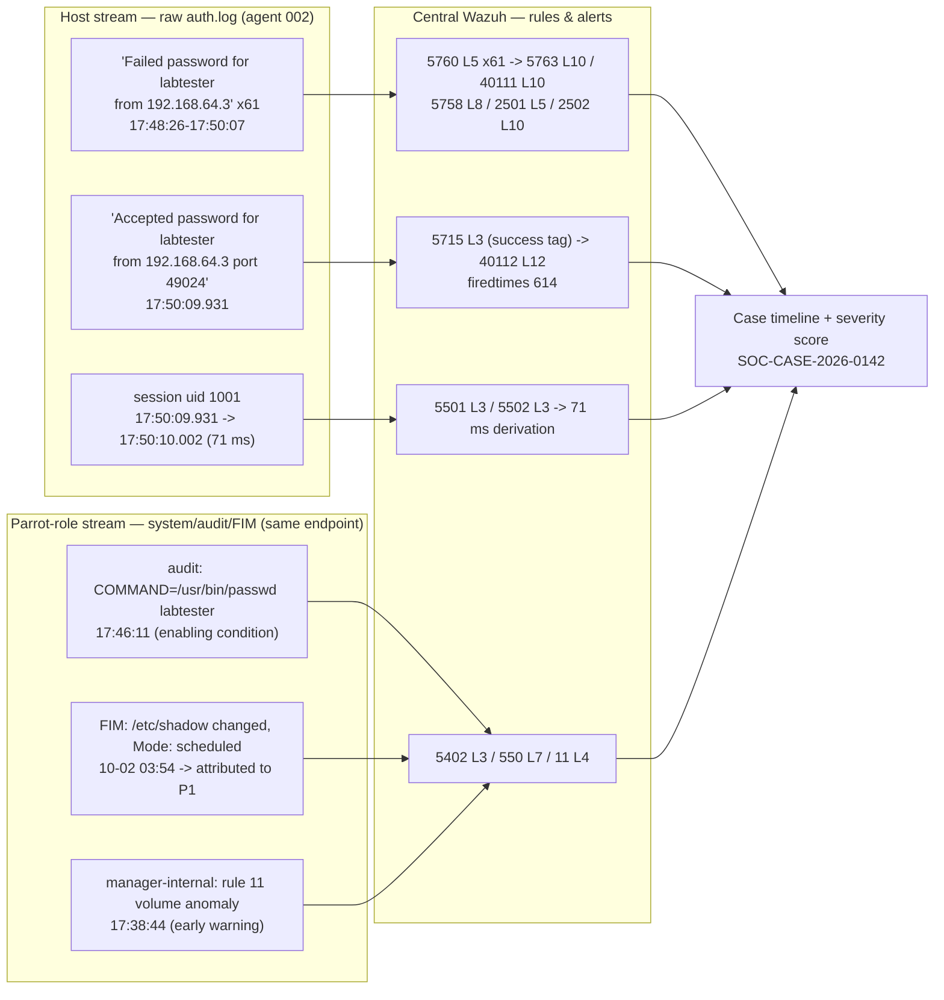

# Incident Detection and Analysis

**Project:** AI-Agentic SOC Triage & Investigation Engine
**Author:** Kyrell Green
**Module:** Incident Response (`incident_response_1/`)
**Source rubric:** *Incident Detection and Analysis* (assessment brief)
**Case reference:** `SOC-CASE-2026-0142` (TheHive `#142`)
**Evidence basis:** live indexer/manager queries run 2026-10-05 and recorded in
`security_operations_center_1/Threat_Detection_Principles.md` §5/§5.9 (reproduction appendix) and
`.opencode/memory/PROJECT.md`; deployment state as of the 2026-10-13/19 pull.

---

## Rubric Coverage & Status

> **Interpretation note (read first).** The brief asks for *"log correlation between host and
> Parrot OS"*. In the original brief Parrot OS is the log-analysis platform; in this lab (see
> `IR Environment Setup.md` §1.1) the analysis platform is Wazuh on the macOS host, and the
> **Parrot-OS log role is played by agent `002` (Kali)** — the endpoint that carries the lab's real
> suspicious-login evidence. Correlation below therefore spans **three real streams**: (a) raw
> **host** authentication records, (b) the **Parrot-role** system/audit/FIM records from the
> stand-in endpoint, and (c) the **central Wazuh** rule/alert stream — plus the honest finding that
> in this case (a) and (b) sit on **one machine**, because the attack was self-generated
> (`srcip` = the agent's own IP, caveat `A.11a`). Genuine two-machine host↔Parrot correlation is
> pending the Parrot first boot (action **A1/A2**). macOS log analysis is documented as methodology
> with **zero findings so far** — the macOS host has no Wazuh agent yet (action **A7**).

| # | Rubric requirement | Status | Where |
|---|---|---|---|
| 1 | Analysis of **Parrot OS logs** using Wazuh, with methodology + findings | 🔄 methodology ✅, findings ✅ from stand-in (agent `002`); true Parrot rows pending A1/A2 | §2.2 |
| 2 | Analysis of **macOS logs** using Wazuh, with methodology + findings | ⏳ methodology ✅ documented; **findings: none — no macOS agent enrolled** (gap L1) | §2.3 |
| 3 | Detailed investigation of **1 suspicious login attempt**: host↔Parrot log correlation, event timeline, alert validation process | ✅ worked case `SOC-CASE-2026-0142` (interpretation note above) | §3 |
| 4 | Classification of **3 distinct security incidents** using the taught severity matrix | ✅ three incidents, three types, matrix arithmetic shown (High / Medium / Low) | §4 |
| 5 | Clear documentation of **methodologies** used and **potential security implications** of findings | ✅ taught 7-phase method + evidence rules; implications register | §2.1, §5 |

---

## 1. Scope, Method Context, and Deviations

### 1.1 What was analysed, and on which log sources

| Brief says | This lab analysed | Deviation handling |
|---|---|---|
| Parrot OS logs in Wazuh | **Agent `002` (Kali Linux, `192.168.64.3`) logs in Wazuh** — auth, FIM, audit/sudo | stand-in, declared (see rubric note above); Parrot enrolled rows pending |
| macOS logs in Wazuh | **Nothing yet** — macOS host has no agent; Wazuh itself runs there (Docker) | methodology + queries documented (§2.3), findings honestly empty; closes with A7 |
| Host↔Parrot correlation | Three-stream correlation (host ↔ Parrot-role ↔ central Wazuh) on real case data; both endpoint roles are the same machine in this case | stated as finding F7, not hidden; true cross-machine correlation pending A1/A2 |

### 1.2 The taught analysis method (this is the "methodology" the rubric asks to document)

The method used throughout §2–§4 is the programme's seven-phase method, defined in
`security_operations_center_1/Threat_Detection_Principles.md` §4 — itself an explicit merge of four
published guidelines (naming sources makes the method auditable, not personal habit):

| Guideline | Contributes |
|---|---|
| **NIST SP 800-61** (Incident Handling Guide) | Lifecycle spine: Preparation → Detection & Analysis → Containment/Eradication/Recovery → Post-Activity |
| **MITRE ATT&CK** | Adversary-behaviour vocabulary — technique-level conclusions, not IoC lists |
| **Diamond Model of Intrusion Analysis** | Four-element judgement: Adversary, Capability, Infrastructure, Victim |
| Lab operational standard (`SOC_Operations.md`, `Incident_Response_Methodology.md`) | Decision points `D1`–`D7`, severity scoring, escalation tiers, approval gate |

Applied to this case:

| Phase | Goal | How it was applied here |
|---|---|---|
| **0 — Prepare** | Make the next phase possible | Detection coverage confirmed first (reproduction appendix query #1: the rules the investigation depends on are loaded); baseline known (§5 of Threat_Detection) |
| **1 — Validate** | Is the alert genuine & in scope? (`D1`, `D2`) | Read every alert field (`agent`, `location`, `decoder`, `rule`, `level`, MITRE); confirmed real rule firings, not decode artefacts; `D1` in scope & unique, `D2` genuine |
| **2 — Extract & enrich** | Turn the alert into indicators | Extracted `srcip 192.168.64.3`, account `labtester`, `sshd[2446058]`/port `49024`, `uid 1001`, rule IDs, UTC timestamps; normalised; observables registered on the case |
| **3 — Scope & reconstruct** | Pivot time/host/account/technique; build the timeline | Timeline (§3.3); pivots before **and** after the event (5-day post-window); ATT&CK on the alerts: **`T1110` Brute Force, `T1078` Valid Accounts**; Diamond read for this lab: Adversary = lab test tooling (self), Capability = password-list guessing against a valid account, Infrastructure = `192.168.64.3` (**self-referential** — the host is its own source), Victim = agent `002` / `labtester` |
| **4 — Assess** | Outcome, impact, severity (`D3`, `D4`, `D5`) | `D3` = **YES** (authentication succeeded); severity scored with the taught matrix (§3.5); `D5` = NO → capped |
| **5 — Decide & act** | Disposition, escalation, approval gate | Tier 2 mandatory on `D3` (case file); containment decision recorded with reason; human approval gate preserved (§6.3 of the IR Methodology) |
| **6 — Document & learn** | Case file, findings, rule feedback | Findings register (§5), reproduction queries (§6.2), and the **Phase 6 → Phase 0 loop closed in this project**: gap `G6` (no custom rule) became rules `100030`–`100032`, deployed 2026-10-13 (`IR Environment Setup.md` §5) |

**Reasoning discipline** (Threat_Detection §4.3), used throughout §3:

- **Hypothesis-driven:** `H1` this is a brute-force attempt · `H2` it succeeded · `H3`
  post-access activity followed. Queries were written to test these, not to wander.
- **Disprove-first:** the query that *found* the compromise was a **disproof attempt** — searching
  the whole 5-day window specifically to refute `H2`, expecting zero `Accepted` records.
- **Observation ≠ inference:** "61 `Failed password` records from `192.168.64.3`" (observation) vs
  "credential guessing, high confidence" (inference) are written separately.
- **Evidence rules** (Threat_Detection §4.4): preserve original alerts unaltered; record
  provenance (`rule` + `full_log` + `@timestamp` + `agent.id` + index) for every artefact; never
  infer absence from a query you did not write; cite, don't paraphrase.

**Stop conditions** (§4.5): the investigation stopped when the outcome was known (`40112`),
scope was bounded to one host/account/source, and every timeline entry was explained or explicitly
marked unexplained — further querying could not have changed the disposition.

---

## 2. Log Analysis — Methodology and Findings

### 2.1 Analysis methodology (how the logs were read)

1. **Collection view first:** confirm *how* each stream reaches the SIEM (agent → manager TCP
   `1514` → indexer `wazuh-alerts-*` → dashboard) before reading any alert — a gap in collection
   silently produces "no findings" that look like "no activity".
2. **Log types interpreted** (full type-by-type guidance in
   `Security_Monitoring_1/Security Event Analysis.md` §1):
   Linux authentication (`sshd`/`pam`) — raw line → decoder → rule chain; FIM/syscheck — attribute
   before escalating; audit/`sudo` records — authorisation baseline; Windows event channel —
   `data.win.*` fields (never `full_log`); manager-internal stats — volume anomalies.
3. **Query discipline:** every positive claim and every negative claim carries a reproducible
   query with a stated scope (§6.2). Volume claims use `rule.firedtimes`, not the indexed hit
   count, with the window stated (§3.4, V2).
4. **Validation before interpretation:** decode/rule-chain check (`wazuh-logtest`), source check,
   and attribution precede severity scoring (order demonstrated in §4.3).
5. **Cross-source rule:** no conclusion rests on one stream; findings below each name ≥2 streams.

### 2.2 Parrot OS log analysis (stand-in: agent `002`, Kali) — methodology + findings

**Method used on this stream:** collected via Wazuh `logcollector`
(`/var/log/auth.log`, `/var/log/syslog`) + `syscheck` FIM + audit/`sudo` records; analysed with
indexer queries over `wazuh-alerts-*` (window `2026-09-30` → `2026-10-05`, `agent.id: 002`);
rule chains verified with `wazuh-logtest` (valid-user path `5700 → 5716 → 5760`; invalid-user path
`5710 → 5712`, which **never reaches `5760`** — why the attacker's target account must exist on
the box).

**Findings (all evidence-cited; detail in §3):**

| ID | Finding | Evidence |
|---|---|---|
| F1 | Sustained SSH credential guessing against a **valid** account | 61 indexed `5760` failures, `17:48:26→17:50:07`; cumulative `firedtimes` **614**; `5763` firedtimes **92**; bursts shaped as 3 batches × 4 parallel connections (12 distinct srcports) |
| F2 | **The attack succeeded** — valid-account authentication after brute force | `40112` level **12** at `2026-10-01T17:50:09.931Z`; `full_log`: `Accepted password for labtester from 192.168.64.3 port 49024 ssh2` |
| F3 | Session was **automated credential validation**, not human use | `5501` open `17:50:09.931` (`uid 1001`, non-privileged) → `5502` close `17:50:10.002` = **71 ms** |
| F4 | **Enabling condition:** credential changed just before the attack | `5402` `COMMAND=/usr/bin/passwd labtester` at `17:46:11` — **2 m 15 s** before success (also `16:22:17`, `17:03:06`) |
| F5 | Credential-file FIM change is **authorised, not tampering** | `550` on `/etc/shadow` `2026-10-02 03:54`, `Mode: scheduled` → attributed to the `5402` passwd records (register entry FP3) |
| F6 | **Unactioned early warning** preceded the compromise | internal rule **`11`** (L4, volume anomaly) fired `17:38:44` — **9 m 42 s** before the first failure; same rule fired `09-18 22:57:44` and `09-30 16:18:16` (message: *"average… is 572. We reached 1823"*) |
| F7 | Prior wave exists → this is a **campaign**, not a single event (`D6` = YES) | Run 1 `2026-09-30 18:35:30→18:42:39`: `5760`×123, `5763`×5, `5758`×8, `40111`×2, `5551`×2 — **zero successes** (blocked); Run 2 (10-01) had *half* the failure volume and succeeded — only `40112` separates the two runs |
| F8 | Scope caveat: **no post-access activity found — within log scope only** | post-window (`17:50:14 → 10-05`) = 8 documents, all benign (`504`×4 agent disconnects, `550`×1 the FIM above, `5501`×3 lightdm greeter `18:00:45`); telemetry is **journald-only — no process/user/port inventory** (syscollector zero), so the claim is scope-bounded |

**Pending rows:** the same methodology re-run against genuine **Parrot** logs once the VM is
booted and the agent enrolled (actions A1/A2) — the query set in §6.2 is ready to point at the new
`agent.id`.

### 2.3 macOS log analysis — methodology documented, findings empty

**Status: the macOS host (the machine running Wazuh) is not itself monitored — no agent is
enrolled, so zero macOS system logs reach the Wazuh dashboard.** This is gap **L1** and action
**A7** in `IR Environment Setup.md`. Recording "no findings" as a *collection state*, not as an
analysis result, is deliberate: an empty result from an uncollected source is not evidence of
clean systems.

**Collection methodology (ready to execute with A7):**

```bash
# macOS host agent (packages.wazuh.com/4.x/macos), <address>127.0.0.1 — manager publishes 1514/1515
# ossec.conf localfile plan:
#   <localfile><log_format>syslog</log_format><location>/var/log/system.log</location></localfile>
#   <localfile><log_format>command</log_format><command>log show --last 5m --style syslog</command></localfile>
```

**Analysis methodology to run once collected (then re-issue §2.2's table with macOS rows):**

| Question | Query / view | Expected signal |
|---|---|---|
| Host login activity? | Security Events → `agent.id:<mac-host>` + `rule.id:(5501 OR 5502 OR 5402 OR 5760 OR 5715)` | session open/close, sudo, auth outcomes |
| FIM on macOS critical paths? | syscheck inventory for `/etc/sudoers`, `/Library/LaunchDaemons`, shell rc files | persistence/tampering attempts |
| Manager-side health while host is unmonitored? | `docker logs` / `ossec.log` on the manager; agents API | confirms which streams *are* arriving (current: 002/007/008 only) |
| Account changes? | macOS `log` entries for `DirectoryService`/`authorizationdb` changes | local privilege changes |

**Findings: none (0 events analysed) — pending A7.** The cross-OS ingestion evidence that
*does* exist today is Kali/Windows/Ubuntu (see `IR Environment Setup.md` §8.1).

---

## 3. Detailed Investigation — `SOC-CASE-2026-0142` (Suspicious Login Attempt)

### 3.1 Case identification

| Field | Value |
|---|---|
| Case | `SOC-CASE-2026-0142` / TheHive `#142` |
| Alert under investigation | `40112` — *"Multiple authentication failures followed by a success"*, level 12, `0280-attack_rules.xml` |
| Detection chain | `if_group=authentication_success` + `if_matched_group=authentication_failures` + `same_source_ip`, `timeframe 240`; MITRE `T1078` + `T1110` |
| Host | agent `002` (`Kali`, `192.168.64.3`) — plays both endpoint roles (see interpretation note) |
| Account | `labtester` — **valid** local account, `uid 1001` (non-privileged) |
| Hypotheses | `H1` brute force in progress · `H2` it succeeded · `H3` post-access activity followed |

### 3.2 Log correlation — host ↔ Parrot-role ↔ central Wazuh

Correlation keys used: **same source IP** (`same_source_ip`), **same process/port**
(`sshd[2446058]` / `49024` links attempts 1–4 on one connection), **same account**
(`labtester` ↔ `uid 1001` ↔ `passwd` command), **time windows** (240 s composite window, 160/120 s
frequency rules), **state attribution** (FIM diff ↔ audit command).



**Cross-source correlation table (each row = ≥2 streams agreeing):**

| Time (UTC, 2026-10-01) | Host stream (raw) | Parrot-role stream (system/audit) | Central Wazuh stream | What the correlation proves |
|---|---|---|---|---|
| 17:38:44 | — | manager-internal volume anomaly | `11` L4 | Unactioned early warning 9 m 42 s pre-attack (temporal correlation) |
| 17:46:11 | — | audit: `sudo /usr/bin/passwd labtester` | `5402` L3 | Credential rotated **2 m 15 s** before success — enabling condition |
| 17:48:26→17:50:07 | `Failed password … from 192.168.64.3` ×61 | — | `5760` L5 ×61 → `5763`/`40111`/`5758` | Same source, same account, windowed frequency rules corroborate raw lines |
| 17:50:02/05/07 | attempts 1–3 fail, `sshd[2446058]` port `49024` | — | `5760` L5 | Same PID+srcport links the burst to one connection |
| 17:50:09.931 | `Accepted password … port 49024 ssh2` | — | `5715` L3 tag → **`40112` L12** | Composite rule's success/failure conditions both met from one source |
| 17:50:09.931→10.002 | session open/close (uid 1001) | — | `5501`/`5502` L3 | **71 ms** session — automated validation, not human use |
| 17:50:11–13 | (other 3 connections still failing) | — | `5760`×3, `2502`×3 | One connection won while the others kept spraying — parallel-batch structure |
| 10-02 03:54 | — | FIM diff: `/etc/shadow`, `Mode: scheduled` | `550` L7 | State change **attributed** to `5402` → authorised, not tampering (FP3) |
| 09-30 18:35–18:42 | prior wave, raw failures | — | `5760`×123, `5763`×5, **no `40112`** | Prior related wave (`D6` = YES) → campaign scoping; only `40112` distinguishes the runs |

> **Declared limitation:** in this lab the host stream and the Parrot-role stream are the **same
> machine** — `data.srcip` equals the agent's own `agent.ip` (self-generated lab attack, caveat
> `A.11a`; the old draft's `203.0.113.77` is a documentation-range artefact of a Suricata pcap
> replay and is **not** an external attacker). True two-machine host↔Parrot correlation is
> pending A1/A2.

### 3.3 Event timeline

All times UTC. Sources: `wazuh-alerts-*` (indexed), reproduction appendix §5.9 queries.

| # | Time | Source | Event | Rule / level |
|---|---|---|---|---|
| T0 | 09-30 18:35:30→18:42:39 | host + SIEM | **Prior wave (Run 1):** `5760`×123, `5763`×5 (`firedtimes` 1,3,6,9,14), `5758`×8, `40111`×2, `5551`×2 — **blocked, zero successes** | freq rules (`D6` context) |
| T1 | 10-01 16:22:17 | audit + SIEM | `COMMAND=/usr/bin/passwd labtester` | `5402` L3 |
| T2 | 10-01 17:03:06 | audit + SIEM | `COMMAND=/usr/bin/passwd labtester` | `5402` L3 |
| T3 | 10-01 **17:38:44** | manager internal | **Volume anomaly — unactioned**, 9 m 42 s before the first failure (same rule fired 09-18, 09-30) | **`11` L4** |
| T4 | 10-01 **17:46:11** | audit + SIEM | `COMMAND=/usr/bin/passwd labtester` — password changed **2 m 15 s** before the successful login (enabling condition) | `5402` L3 |
| T5 | 10-01 **17:48:26** | host `auth.log` | first `Failed password for labtester from 192.168.64.3` | `5760` L5 |
| T6 | 17:48:26→17:50:07 | host + SIEM | **Burst:** 61 indexed `5760`; 3 batches × 4 parallel connections (12 distinct srcports); plus `5503`×11, `2501`×8 (`Disconnecting authenticating user … Too many authentication failures [preauth]`), `2502`×9 (`PAM N more authentication failures`), `5758`×8, `40111`×2, `5763`×2, `5551`×1 — **106 alerts in 17:48–17:51** | frequency/composite set |
| T7 | 17:50:02, :05, :07 | host | attempts 1–3 fail on `sshd[2446058]`, port `49024` | `5760` L5 |
| T8 | **17:50:09.931** | host + SIEM | attempt 4 **succeeds**: `Accepted password for labtester from 192.168.64.3 port 49024 ssh2` → success tag set → composite fires (`firedtimes` **614**) | `5715` L3 → **`40112` L12** |
| T9 | 17:50:09.931 | SIEM | session opened, `uid 1001` (non-privileged) | `5501` L3 |
| T10 | 17:50:10.002 | SIEM | session closed → **duration 71 ms** | `5502` L3 |
| T11 | 17:50:11–13 | SIEM | attack **continues on the other three connections**: `5760`×3, `2502`×3 | freq rules |
| T12 | 17:50:14 | SIEM | last event for agent `002` before the quiet window | — |
| T13 | 18:00:45 | SIEM | `5501`×3, lightdm greeter `uid 125` — **benign** | `5501` L3 |
| T14 | 10-02 03:54 | FIM + SIEM | `/etc/shadow` modified, `Mode: scheduled` → **attributed** to the `5402` passwd commands → authorised (FP3) | `550` L7 |
| T15 | 10-01 17:50:14 → 10-05 | SIEM | **Post-access window = 8 documents, ALL benign:** `504`×4 (agent disconnect / VM shutdowns), `550`×1 (T14), `5501`×3 (T13). **No `5402` by `labtester`, no `5715`, no persistence rule** | negative search, scope-bounded (F8) |

**Timeline reading (analysis, separate from observation):** `H1` confirmed (structured multi-
connection guessing); `H2` confirmed (the success at T8); `H3` **refuted within log scope** — the
71 ms session at T9–T10 shows automated credential *validation*, and nothing attributable to
`labtester` follows; per Diamond Model the Infrastructure element is self-referential (the host is
its own attacker), consistent with lab test tooling rather than an external breach.

### 3.4 Alert validation process

Validation ran **before** interpretation and scoring — in this order:

| # | Validation step | Method | Result |
|---|---|---|---|
| V1 | **Decode & rule-chain integrity** | `wazuh-logtest` on representative lines | valid-user line → `5700 → 5716 → 5760` ✅; invalid-user line → `5710 → 5712` (never `5760`) — explains why the target account must exist; logtest is **stateless** and cannot exercise `if_matched` correlation rules (so composites are validated via the index, not logtest) |
| V2 | **Volume integrity — the counting trap** | compare `rule.firedtimes` vs indexed hits | `5760`: 61 indexed in the burst, alert `firedtimes` reads **614** (cumulative; `ignore=60` + alert compression mean raw events ≠ indexed alerts); `5763`: 2 indexed in burst, `firedtimes` **92**. Rule: **quote `firedtimes` for volume claims, with the window stated** (Template `B.9`) |
| V3 | **Success — disproof attempt** | deliberate query across the **full 5-day window** for `Accepted password` / session-open records, expecting zero, to refute `H2` | query returned `40112` → **`H2` confirmed**; the disproof attempt was the query that found the compromise |
| V4 | **Source integrity** | compare `data.srcip` with `agent.ip` | both `192.168.64.3` → **self-generated** attack (caveat `A.11a`); rejected the old draft's `203.0.113.77` (Suricata pcap-replay documentation range, synthetic 2002 timestamps — never used as time-correlated evidence) |
| V5 | **Session semantics** | `5501`/`5502` pair arithmetic | 71 ms ⇒ automated credential validation, not human use — prevents over-rating impact (no data access inferred from a session that barely existed) |
| V6 | **FIM attribution** | diff the `550` attributes against `5402` audit records | `/etc/shadow` change explained by `passwd labtester` → **authorised**, closed with written rationale (FP3) — validation *precedes* scoring (see §4.3) |
| V7 | **Corroboration ≥2 streams** | temporal cross-check | rule `11` anomaly at 17:38:44 + credential change at 17:46:11 corroborate the 17:48–17:50 attack window from independent streams |
| V8 | **Negative search with stated scope** | post-window query (T15) | 8 documents, all explained; absence claimed **only within journald telemetry** (no process inventory — F8) |
| V9 | **Control case** | compare Run 1 (09-30) vs Run 2 (10-01) | identical attack pattern; Run 1 blocked (zero success), Run 2 succeeded with **half** the failure volume — no volume metric separates them; **only `40112` does** → justifies composite rules over threshold-tuning |
| V10 | **Classification validation** | re-score after each new fact | initial naive read (credential-file tampering possible → Impact 3) collapsed to Impact 1 after V6 attribution — scoring after validation, never before |

Reproduction: every step above maps to a numbered query in `Threat_Detection_Principles.md`
§5.9 (appendix items #1–#11).

### 3.5 Severity score (the taught matrix, worked)

Scored with the factor matrix in `Incident_Response_Template.md` §A.9 — three factors 1–4,
**severity = the highest factor (not the sum)**, then overrides/caps. This is the score recorded in
the case file, consistent with `Incident_Response_Methodology.md` §4.1:

| Factor | Score | Template anchor applied | Justification from the evidence |
|---|---|---|---|
| **Impact** | **2** (Medium) | *"Access gained to a non-privileged account, no data loss"* | `labtester` `uid 1001`; session 71 ms; no data access, no privilege escalation, no destruction |
| **Scope** | **1** (Low) | *"1 host, 1 account"* | one host (agent `002`), one account, one source IP |
| **Urgency** | **2** (Medium) | *"Single wave, ended"* | the wave ended at 17:50:10; not spreading |
| **Base** | **Medium** | highest factor wins | `Impact 2 / Scope 1 / Urgency 2 → base Medium` |
| **Override** | **+1 → High** | `D3` = YES (confirmed valid-account authentication after brute force) | forces severity raise **and mandatory Tier 2 within 15 min** |
| **Cap** | **not Critical** | `D5` = NO — no persistence, no C2, no lateral movement | *"the cap is as important as the raise: over-rating trains people to ignore Critical"* |
| **Final** | **High** | | Campaign handling also engaged: `D6` = YES (prior 09-30 wave) → re-scope/merge as a campaign |

---

## 4. Classification of Three Distinct Security Incidents (Severity Matrix)

### 4.1 The taught matrix, restated

`Incident_Response_Template.md` §A.9 — score 1–4 on each factor; **severity = highest factor**;
apply overrides and caps; record the arithmetic:

| Factor | 1 | 2 | 3 | 4 |
|---|---|---|---|---|
| **Impact** (what is true now) | Attempted only; no access | Access gained to a non-privileged account, no data loss | Privileged access, credential theft, or data loss | Encryption/destruction, or confirmed C2 with exfiltration |
| **Scope** (breadth) | 1 host, 1 account | 1 host, few accounts | Multiple hosts or multiple accounts | Fleet/subnet or multi-site |
| **Urgency** (rate/direction) | Historic, over | Single wave, ended | Ongoing or recurring | Active, spreading, or destructive |

Overrides/caps: `D3` = YES → **+1 and Tier 2 (mandatory)**; `D5` = YES → Critical, Tier 3 +
Management; `D5` = NO → **cap at High**. Arithmetic format (Template line example):
`Impact 2 / Scope 1 / Urgency 2 → base Medium; override … → High`.


*Severity/risk matrix reference used in this module.*

### 4.2 The three incidents

**INC-1 — SSH brute-force credential compromise (agent `002`, 2026-10-01)** — type: *active
credential attack* → the worked case in §3 (`SOC-CASE-2026-0142`).

`Impact 2 / Scope 1 / Urgency 2 → base Medium; override +1 (D3=YES) → High; cap (D5=NO) → not Critical`
→ **FINAL: High** → Tier 2 mandatory; campaign handling via `D6` (prior wave 09-30).

**INC-2 — Windows endpoint exposure: 7 active CVEs + failing hardening baseline (agent `007`,
discovered 2026-10-05)** — type: *vulnerability/hardening exposure — no attack observed*.

Evidence: rule `23504` L7 — **7 CVEs, all GIMP 3.2.40.0 x86_64, all Medium, all `status: Active`**
(CVSS 6.1 ×5, 5.5, 4.4; all `AV:L/PR:N/UI:R`, `integrity_impact: NONE` — DoS/disclosure class, not
RCE), all in one 70 ms scan burst `15:36:57.109–178Z`. Rule `19007` L7 / `19005` L9 — **CIS SCA:
425 checks = 304 failed / 116 passed / 5 n/a; score 27%** (`116/420`), summary alert fired
`09-23 18:07:32`, `09-23 18:07:48`, `10-05 15:34:28` — **identical score across 12 days**;
failure clusters include LAN Manager auth not limited to NTLMv2, Spooler enabled, anonymous SAM
enumeration allowed, firewall profiles at default logging.

| Factor | Score | Anchor | Justification |
|---|---|---|---|
| **Impact** | **1** (Low) | *Attempted only; no access* | no exploitation, no access gained; local-only, DoS/disclosure-class CVEs; integrity impact NONE |
| **Scope** | **2** (Medium) | *1 host, few accounts* | one host, but machine-wide control failures affect **all** local accounts, not a single account |
| **Urgency** | **2** (Medium) | *Single wave, ended* | point-in-time scan findings, static exposure, **no active or recurring attack activity** — the 12-day unremediated duration is carried as response finding `I.2` (§5), not double-counted here |
| **Base** | **Medium** | highest factor = 2 | `Impact 1 / Scope 2 / Urgency 2 → base Medium` |
| **Override/Cap** | none | `D3` n/a (no authentication event), `D5` n/a | no override path fires on an exposure with no compromise |
| **FINAL** | **Medium** | | Disposition: Tier 1 owns; **remediation ticket to the system owner** (Advisory tier — SOC cannot patch outside its authority); re-scan to verify closure |

> Challenging note (recorded so the score can be audited): scoring `Urgency 3` ("ongoing") because
> the exposure is unremediated would raise the base to **High**. Scored 2 because the template
> anchors urgency on the incident's activity direction, and there is no attack activity; the
> unremediated duration is tracked as finding `I.2` instead.

**INC-3 — Credential-store file change (`/etc/shadow`, agent `002`, 2026-10-02 03:54)** — type:
*integrity alert, investigated → authorised activity*.

Evidence: `550` L7 FIM alert on `/etc/shadow`, `Mode: scheduled`, attributes diffed
(`inode,mtime,md5,sha1,sha256`); attributed against `5402` records
(`COMMAND=/usr/bin/passwd labtester` at 16:22:17, 17:03:06, 17:46:11 on 10-01) → the change is the
**authorised credential maintenance** behind those commands (register entry FP3).

| Factor | Score | Anchor | Justification |
|---|---|---|---|
| **Impact** | **1** (Low) | *Attempted only; no access* | after attribution: authorised change, no malicious access, no data loss |
| **Scope** | **1** (Low) | *1 host, 1 account* | one host, one account's credential entry |
| **Urgency** | **1** (Low) | *Historic, over* | completed event, explained, no recurrence |
| **Base** | **Low** | highest factor = 1 | `Impact 1 / Scope 1 / Urgency 1 → base Low` |
| **Override/Cap** | none | `D3` n/a | no authentication success involved |
| **FINAL** | **Low** | | Disposition: **closed with written rationale**, tagged "authorised admin action" (FP3) |

**Classification contrast (why validation must precede scoring):** scoring INC-3 *before* the V6
attribution — reading "shadow file modified" naively — lands on Impact **3**
(*"credential theft"* anchor) → base **High**, Tier 2 escalation for a routine password change.
The same evidence, validated first, classifies **Low**. Validation-before-scoring is what keeps
the severity queue credible (and prevents the cry-wolf effect that makes analysts ignore the next
`550`).

### 4.3 Summary

| ID | Incident | Type | Host | I/S/U | Base | Override / cap | **Final** | Disposition |
|---|---|---|---|---|---|---|---|---|
| **INC-1** | SSH brute force succeeded (`40112`) | Active credential attack | `002` | 2 / 1 / 2 | Medium | `D3` +1; `D5` cap | **High** | Tier 2 mandatory; campaign (`D6`); case `SOC-CASE-2026-0142` |
| **INC-2** | 7 CVEs + CIS SCA 27% | Vulnerability / hardening exposure | `007` | 1 / 2 / 2 | Medium | none | **Medium** | Tier 1 + remediation ticket to system owner; re-scan |
| **INC-3** | `/etc/shadow` FIM change | Integrity alert → authorised | `002` | 1 / 1 / 1 | Low | none | **Low** | Closed with written FP rationale (FP3) |

Three distinct incident types (attack / exposure / integrity), three different matrix outcomes,
each with the arithmetic in the record — per the taught principle: *severity is scored and capped,
not felt*.


*INC-2 source evidence: vulnerability-detection telemetry from agent `007`.*

---

## 5. Security Implications of the Findings

| ID | Finding (from §2–§4) | Potential security implication | Recommended control / status |
|---|---|---|---|
| **I.1** | Valid credential (`labtester`) was in attacking hands and **returned** on a second wave (09-30 blocked → 10-01 succeeded) | Reuse risk persists after the case closes; without rotation the attacker's one success remains a reusable key; `D6` means treat as campaign, not event | Credential rotation on `D3` (Tier 2 mandate); campaign merge recorded; custom rule **`100030`** (L13, success-after-failures) now detects this pattern faster — deployed 2026-10-13, live firing pending |
| **I.2** | Windows host: 7 active local CVEs + **27%** hardening score **unchanged for 12 days** (weak NTLM, Spooler, anonymous SAM, default firewall logging) | If any foothold is gained there, these failures widen it: credential relay/relay-adjacent paths, remote attack surface (Spooler), and poor firewall logging blind the next investigation | Remediation ticket to system owner (INC-2 disposition); re-scan to verify; the SCA score is the lab's best prioritised to-do list |
| **I.3** | Post-access activity **cannot be fully ruled out** — telemetry is journald-only, zero syscollector/process inventory | "Nothing happened after 17:50:14" is scope-bounded; a process-level implant would be invisible in this data set | State the scope in every claim (done: F8); extend endpoint telemetry before any "clean" assertion |
| **I.4** | Early-warning rule `11` fired 3×, incl. **9 m 42 s before** the compromise, and was **unactioned** | Volume anomalies are the cheapest lead a SOC gets; dropping low-severity signals because higher-severity work is open is a repeatable miss | Triage rule: never drop a low-severity signal without a written disposition (FP6); feed into Phase 6 tuning |
| **I.5** | Detection latency & delivery: the compromise was found at triage **days later**; email notification **off**, Active Response **disabled** — indexer is the only alert path | A high-severity success can sit unseen; no automated containment exists, so dwell time depends entirely on someone opening the dashboard | Alert-delivery gap `G1` (open); `100030` raises this class to L13 for queue priority; notification/AR decisions remain open |
| **I.6** | macOS host is the **SIEM host** and is itself unmonitored (no agent) | Compromise of the monitoring platform = blind spot with full visibility loss (and credential exposure on the box that holds `.env`/creds) | Close **A7** (macOS agent) — highest-value coverage gap after Parrot enrolment |
| **I.7** | FIM on credential files proved high-value (INC-3 discrimination) *and* historically noisy | Without attribution, either false escalation or — worse — dismissal of the next, real tamper as "the FP we saw before" | Attribute every FIM alert before escalating; custom rule **`100032`** (critical-path FIM, L10) now gives tampering proper weight — pending live test |
| **I.8** | Password spraying was historically undetectable (all stock rules `same_source_ip`); attacker used **one source, many parallel connections** | The next attacker will vary source hosts; current detection would fragment | Rule **`100031`** (`different_user`, freq 6/300s) addresses exactly this — deployed 2026-10-13, live firing pending |

---

## 6. Evidence, Reproducibility & Documentation

### 6.1 Screenshots (this module + shared)

| Evidence | Path | Note |
|---|---|---|
| Detection of the brute force (MITRE-mapped alert) | `../security_operations_center_1/Wazuh%20Mitre%20Att%26ck%20BF%20detection.png` | real `40112`-family view |
| The success event ("attack access") | `../security_operations_center_1/Kali%20Brute%20Force%20Attack%20Access.png` | INC-1 primary evidence |
| Attack run / threat detection views | `../security_operations_center_1/Kali%20Brute%20Force%20test.jpg`, `../security_operations_center_1/Brute%20Force%20Threat%20detection.jpg` | run context |
| INC-2 vulnerability evidence | `./Windows_vulnerability_detection.png`, `./Wazuh_CVE-2026-106190.png` | captions filename-derived — **verify against the images before submission** |
| Severity matrix reference | `./5x5_risk_matrix_reference.png` | §4.1 |
| Agent fleet (coverage scope) | `../ai-agentic-soc/screenshots/agent%20deployed.png` | which agents produced the analysed streams |

### 6.2 Reproduction queries (the validation backbone)

All numbered queries used above live in
`security_operations_center_1/Threat_Detection_Principles.md` **§5.9** (detection-coverage check,
the `40112` alert readout, the 61-failure burst count, the pid/port sequence, the `5501/5502`
71 ms pair, the 5-day disproof search, the post-access negative search, the `5402` baseline, the
106-alert rule mix, the Run-1 control case, the rule-11 early warning). Key API/CLI validations:

```bash
# decode/rule-chain check (V1) — stateless; cannot exercise if_matched composites
echo "Failed password for labtester from 192.168.64.3 port 49024 ssh2" | /var/ossec/bin/wazuh-logtest
# → 5700 → 5716 → 5760   (valid-user path; invalid-user path 5710 → 5712 never reaches 5760)

# volume integrity (V2) — quote firedtimes with the window, never the hit count alone
#   rule 5760 firedtimes → 614 (cumulative); 61 indexed in the burst window
#   rule 5763 firedtimes → 92  (cumulative); 2 indexed in the burst window

# source integrity (V4) — self-generated caveat A.11a
#   data.srcip == agent.ip == 192.168.64.3
```

### 6.3 Documentation trail (what each document owns)

| Document | Owns |
|---|---|
| **This document** | analysis methodology + per-OS findings, the worked investigation with timeline & validation, 3-incident classification, implications |
| `security_operations_center_1/Threat_Detection_Principles.md` | 7-phase method definition, full worked investigation detail, reproduction appendix |
| `security_operations_center_1/Incident_Response_Methodology.md` | severity model + escalation tiers, completed case file (Sections A–J) |
| `Security_Monitoring_1/Security Event Analysis.md` | log-type interpretation, FP register (FP1–FP7), triage workflow |
| `incident_response_1/IR Environment Setup.md` | environment, agents, custom rules `100030`–`100032`, Wireshark/Volatility status |
| `.opencode/memory/PROJECT.md` | live lab journal (facts, gotchas, change log) |

---

## 7. Limitations & Status

### 7.1 Limitations (honest register)

| # | Limitation |
|---|---|
| L1 | **No macOS log analysis performed** — macOS host has no Wazuh agent (0 events; methodology §2.3 ready, closes with action A7) |
| L2 | **Parrot logs not yet analysed** — Kali agent `002` used as the declared stand-in; genuine Parrot rows pending A1/A2 |
| L3 | Host↔Parrot correlation collapses to **one machine** (self-generated attack, `A.11a`) — cross-machine correlation pending A1/A2 |
| L4 | Post-access claims are **scope-bounded**: journald-only telemetry, zero process/user/port inventory |
| L5 | Suricata pcap replay carries **synthetic 2002 timestamps** — excluded from time-correlated evidence (used only as signature-corroboration context) |
| L6 | Authoring box cannot reach the live Wazuh API/indexer — all figures are from the verified 2026-10-05 query run; **re-run §6.2 after any lab change** |
| L7 | Custom rules `100030`–`100032` are loaded but **not yet fired live** — none of the three classified incidents includes their output |
| L8 | Screenshot captions for `Windows_vulnerability_detection.png` / `Wazuh_CVE-2026-106190.png` are filename-derived — verify before submission; evidence-capture list below still open |

### 7.2 Remaining actions

| ID | Action | Rubric line closed |
|---|---|---|
| A1/A2 | Boot Parrot, enroll agent, apply §4 log-collection config → re-run §2.2 queries against genuine Parrot `agent.id`; add rows to the findings table | 1 (full) |
| A7 | Enroll macOS host agent → re-run §2.3 queries; fill the macOS findings table | 2 (full) |
| A-new | After A1/A2: repeat §3's correlation with **two distinct machines** (target host ↔ Parrot) to replace limitation L3 | 3 (full) |
| A-new | Live-fire rules `100030`/`100031`/`100032` and, if fired, classify their alerts as INC-4+ with the matrix | 4, 7 (L7) |
| A-new | Capture/verify screenshots per §6.1 | 5, 8 (L8) |

---

## Companion Documents

| Document | Relevance |
|---|---|
| `incident_response_1/IR Environment Setup.md` | environment, deviation statement, agents, custom rules |
| `security_operations_center_1/Threat_Detection_Principles.md` | the 7-phase method + full worked investigation + queries |
| `security_operations_center_1/Incident_Response_Methodology.md` | severity model, escalation tiers, completed case file |
| `Security_Monitoring_1/Security Event Analysis.md` | log interpretation, correlation, FP register, triage |
| `Security_Monitoring_1/Monitoring Implementation.md` | data-source integration evidence |

*Prepared from the live lab evidence in this repository.*
