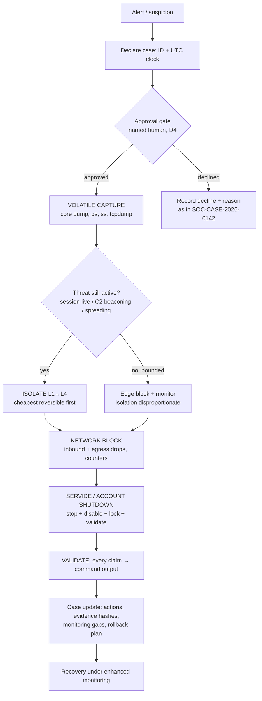

# Incident Response and Containment

**Project:** AI-Agentic SOC Triage & Investigation Engine
**Author:** Kyrell Green
**Module:** Incident Response (`incident_response_1/`)
**Source rubric:** *Incident Response and Containment* (pasted from the assessment brief)
**Evidence basis:** live demonstration run 2026-10-20 on the lab's Debian-family Linux guest (Kali,
agent `002` — this module's documented Parrot-OS stand-in) driven non-interactively through the
UTM/QEMU guest agent, plus host/hypervisor state read from the running Mac. Full raw transcript:
`IR_Containment_Live_Demo_Transcript_2026-10-20.txt` (same folder).

---

## Rubric Coverage & Status

> **Deviation statement (read first):** the brief names *Parrot OS on VirtualBox*. This lab runs on a
> **16 GB Apple-Silicon (arm64) Mac**. The Parrot Security 7.4 (arm64) VM is imported into **UTM
> (QEMU)** — the hypervisor that already runs the lab fleet — and VirtualBox, although installed on
> this host (7.2.16), holds **zero VMs** (verified `VBoxManage list vms` → empty). *(Correction to
> `IR Environment Setup.md` §1.1: VirtualBox ≥ 7.1 on Apple Silicon CAN run aarch64 guests — the
> accurate reason for not using it here is that the Parrot asset is a UTM/qcow2 bundle with no
> VirtualBox disk, no arm64 Parrot ISO is staged, and the whole fleet + snapshots already live in
> UTM.)* Every capability the rubric tests is preserved by mapping each VirtualBox networking
> concept to its UTM equivalent (§1.2) and by performing the procedures inside the guest, where
> the toolchain (`ip`, `iptables`, `tcpdump`, core dumps, `usermod`) is identical under either
> hypervisor. **Parrot itself is staged but not yet re-booted for this assignment; the procedures
> were therefore executed live on the Kali guest — the same Debian toolchain — as this module's
> established Parrot stand-in** (same strategy as `Incident Detection and Analysis.md` §1.2).
> Each rubric line shows exactly what is **done** vs **pending**.

| # | Rubric requirement | Status | Where |
|---|---|---|---|
| 1 | **Network interface configuration** (network isolation in Parrot OS) | ✅ live demo (stand-in) — link down/up isolation verified with connectivity tests; Parrot commands identical, pending its boot | §2.1 |
| 2 | **Basic firewall rules implementation** | ✅ live demo (stand-in) — DROP rule added, hit counter observed, traffic blocked, rule removed, baseline restored | §2.2 |
| 3 | **Network segmentation using VirtualBox networking** | 🔄 hypervisor-level segmentation evidence captured live (network modes, host bridge, isolation flags); VirtualBox↔UTM mode map documented; multi-guest segmentation drill ⏳ pending Parrot boot | §1.2, §2.3 |
| 4 | **File system artifacts** (evidence preservation, Parrot forensic tools) | ✅ live demo — hash → copy → `cmp` verify → metadata recorded; journal export hashed | §3.2 |
| 5 | **Network traffic captures** | ✅ live demo — `tcpdump` with BPF capture filter, 10 packets captured/verified/hashed; Wireshark toolchain already verified on the macOS host | §3.3 |
| 6 | **Basic memory dumps** | ✅ live demo — kernel core dump of a live process (400 KB ELF aarch64), hashed; full-RAM acquisition (AVML/LiME) + Volatility3 analysis ⏳ queued with Parrot boot | §3.4 |
| 7 | **Containment playbook — host isolation steps in VirtualBox** | ✅ written with both VirtualBox and UTM execution paths (4 levels, decision table); ⏳ hypervisor-level stop/snapshot drill pending | §4.2 |
| 8 | **Containment playbook — network traffic blocking** | ✅ playbook + live guest-firewall demo (item 2); host-layer (macOS pf) documented | §4.3 |
| 9 | **Containment playbook — service shutdown procedures** | ✅ playbook (identify → stop → disable → validate); ✅ account containment live-verified (lock → verify → restore); service stop drill on Parrot ⏳ | §4.4 |
| 10 | **Documentation & evidence of functionality** | ✅ this document + full raw transcript + evidence inventory with SHA-256 hashes; screenshots listed per item | §5 |

---

## 1. Environment, Deviations & Network Topology

### 1.1 Rubric vs. actual environment

| Brief says | Actual lab | Why it differs |
|---|---|---|
| Parrot OS on **VirtualBox** | **Parrot Security 7.4 (arm64) in UTM** (staged, right-sized 4 GB/4 CPUs, `Mode=Shared`); procedures demonstrated on the **Kali** Debian guest via `utmctl exec` (root, non-interactive) | arm64 Mac; VirtualBox installed (7.2.16) but empty; Parrot asset is a UTM bundle; guest-internal tooling identical |
| Network segmentation "using VirtualBox networking" | Segmentation achieved with **UTM network modes + guest-internal firewalls**; each VirtualBox mode mapped to its UTM equivalent (§1.2) | UTM exposes fewer network object types than VirtualBox; the compensating control is the guest firewall, demonstrated live |
| Parrot forensic tools | Same Debian forensic toolchain executed on the stand-in guest (`tcpdump`, `sha256sum`, `cmp`, kernel core dumps); Volatility 3 + sleuthkit planned inside Parrot at next boot | Parrot not re-booted yet this module (RAM budget — see §6) |

### 1.2 VirtualBox ↔ UTM networking map (the segmentation vocabulary, translated)

| VirtualBox concept | UTM / QEMU equivalent | Present in this lab |
|---|---|---|
| **NAT** (guest→internet, host reachable, guests isolated from each other by default) | **Shared Network** — `vmnet-shared`, subnet `192.168.64.0/24`, host = `192.168.64.1` | ✅ Parrot + Kali + Ubuntu all `Mode=Shared` (verified in each VM's `config.plist`; Kali's live QEMU command line shows `-netdev vmnet-shared,id=net0`) |
| **NAT "restrict to guest" / no-host-access option** | **`IsolateFromHost` flag** on the VM's network device (config.plist, offline-editable) | Flag exists and is `false` on Parrot — flipping it to `true` is the UTM-level "cut guest↔host" switch (segmentation lever, §2.3) |
| **NAT Network** (shared NAT, guests can see each other) | Several VMs on Shared mode share the same `192.168.64.0/24` subnet | ✅ de-facto — Kali `192.168.64.3`, Ubuntu `192.168.64.2` can reach each other today |
| **Bridged** (guest on the physical LAN) | **Bridged Network** mode (vmnet-bridged) — selectable per VM | not used (lab stays on the private NAT segment) |
| **Host-Only** (host↔guest, no external) | no first-class equivalent on UTM/macOS — approximate with **Shared + `IsolateFromHost=true`** (host↔guest path only, no upstream) | documented, not yet applied |
| **Internal Network** (`intnet`, guest↔guest only, fully air-gapped) | no named internal-net object — approximate with **guest-internal firewalls** isolating a VM from the gateway/upstream while leaving peer links | this is exactly the guest-level isolation demonstrated in §2.1–§2.2 |
| **Promiscuous-mode policy on intnet/host-only** (allow/allow-all/none) | controlled inside the guest by `iptables` policy (§2.2) | ✅ demonstrated |
| Runtime NIC detach (GUI "cable connected" checkbox / `VBoxManage controlvm <vm> nic1 none`) | `ip link set <iface> down` inside the guest; or VM **Pause/Stop** in UTM (`utmctl stop` / `utmctl suspend`) | guest-level demonstrated (§2.1); hypervisor-level documented (§4.2) |

> **Host-side proof of the current segmentation boundary** (captured 2026-10-20, macOS host):
> the UTM shared network terminates on host interface `bridge100` = **`192.168.64.1/24`**, and the
> routing/ARP table shows the running Kali guest at `192.168.64.3` on that bridge. All VM traffic
> to the outside world NATs through this address — it is the lab's single "edge", which is why the
> case record's containment action was an **edge block** (`SOC-CASE-2026-0142`, T+20).

```text
[host]$ ifconfig bridge100   # excerpt
bridge100: ...
        inet 192.168.64.1 netmask 0xffffff00 broadcast 192.168.64.255
[host]$ netstat -rn | grep 192.168.64
192.168.64     link#20            UC              bridge100      !
192.168.64.3   ea.f0.2f.0.11.3a   UHLWIi          bridge100   1161   ← Kali (agent 002)
```

### 1.3 Inventory (verified 2026-10-20)

| Layer | Component | Address / detail | State |
|---|---|---|---|
| Hypervisor | UTM (`utmctl list`) | 3 VMs: `ParrotOS 7.4 security Edition` (**stopped**), `Kali Linux 2023` (**started**), `Ubuntu 22.04` (stopped) | ✅ |
| Guest (stand-in) | Kali, kernel `6.3.0-kali1-arm64`, Kali GNU/Linux Rolling | `eth0` = `192.168.64.3/24`, iface name `eth0` | ✅ running |
| Guest (target) | Parrot 7.4 arm64: `virtio-net-pci`, `Mode=Shared`, `IsolateFromHost=false`, MAC `52:54:00:7E:78:3C`, UEFI, 4 vCPU, 4096 MB | booted ≥ once (disk writes + UEFI NVRAM + UTM screenshot dated 2026-10-13) | ⏳ stopped |
| Host network | `bridge100` = `192.168.64.1/24` | the NAT "edge" for every guest | ✅ verified |
| SIEM exposure | Docker publishes **`0.0.0.0`**: 1514/1515 (agents), 55000 (API), 9200 (indexer), 443 (dashboard), 9000 (TheHive), 5636 (EveBox) | ⚠ every listening socket is reachable from **all** host interfaces, not just loopback — live finding, §2.3 | ⚠ |
| Hypervisor (alt) | VirtualBox 7.2.16 (arm64) | **zero VMs** — cannot be the segmentation platform in practice | ✅ verified |
| Non-interactive guest access | UTM guest agent (`utmctl exec … --cmd`, runs as **root**) | works on Kali — this is how every live demo below was driven, and the planned execution path for Parrot once `qemu-guest-agent` is installed | ✅ verified |

---

## 2. Network Isolation Procedures — Parrot OS

All commands in §2 were **executed live** on 2026-10-20 on the stand-in guest (root shell) and are
byte-for-byte applicable to Parrot (same `iproute2` + `iptables`-nft toolchain). Transcript refs in
square brackets.

### 2.1 Network interface configuration (isolation level 1 — cut the wire logically)

Discover the interface first (name differs per guest: `eth0` on this Kali, typically `enp1s0` on
Parrot's virtio NIC — always check):

```bash
ip -br a                      # short: name, state, addresses    [S1]
ip link show
```

Isolate and restore (L1 = fastest, most reversible isolation — no packages, no rules to unwind):

```bash
sudo ip link set eth0 down            # interface DOWN: no IP, no traffic in or out
ip -br a eth0                         # verify: state DOWN / no address
sudo ip link set eth0 up              # restore; DHCP (NetworkManager) re-acquires the address
```

**Live evidence [S3]:** with `eth0` down, host→guest ping = **2 packets transmitted, 0 received,
100.0 % packet loss**; after `up`, = **2/2 received, 0.0 % loss**, address re-acquired.
On NetworkManager-managed guests (Parrot's default) the NM-equivalent is:

```bash
nmcli device status
nmcli device disconnect eth0          # NM-aware isolation (survives NM state)
nmcli device connect eth0             # restore
```

> **Side effect to record in the case file whenever you isolate a monitored host:** taking the NIC
> down severs the Wazuh agent's connection to the manager — the SIEM loses visibility of that host
> (manager logs *agent disconnected* once the keepalive expires). Isolation protects the network
> but blinds the sensor; the playbook (§4.2) therefore orders **volatile evidence capture before
> isolation**.

### 2.2 Basic firewall rules implementation (isolation level 2 — selective blocking)

Baseline on the lab guest was stock (`-P INPUT ACCEPT`, no rules) [S1b]. The containment pattern
implemented and verified live:

```bash
# 1. view the baseline (always record it before changing anything)
sudo iptables -S
sudo iptables -L INPUT -v -n --line-numbers

# 2. block the attacker source (lab edge/host IP used as the test source)
sudo iptables -I INPUT 1 -s 192.168.64.1 -p icmp --icmp-type echo-request -j DROP

# 3. verify: the rule AND its hit counter
sudo iptables -L INPUT -v -n --line-numbers
#   num pkts bytes target prot ... source            destination
#   1   1    84    DROP  icmp ... 192.168.64.1       0.0.0.0/0   icmptype 8     ← counter moved
```

**Live evidence [S2]:** after installing the rule, host→guest ping = **100.0 % packet loss**; the
rule's counter showed **1 packet / 84 bytes dropped** (proof of function, not just configuration).
After `sudo iptables -D INPUT 1`, ping returned to **0.0 % loss** and
`iptables -S` matched the baseline exactly [S8] — the demo ended with the guest exactly as found.

The fuller containment rule-set (prepared for Parrot; same syntax) — default-deny inbound, SSH
only from the management host, attacker drop, logged remainder, with persistence:

```bash
sudo iptables -P INPUT DROP                                   # default deny inbound
sudo iptables -A INPUT -i lo -j ACCEPT                        # loopback
sudo iptables -A INPUT -m conntrack --ctstate ESTABLISHED,RELATED -j ACCEPT
sudo iptables -A INPUT -p tcp --dport 22 -s 192.168.64.1 -j ACCEPT   # SSH from mgmt host only
sudo iptables -I INPUT 1 -s <attacker-ip> -j DROP             # explicit attacker block
sudo iptables -A INPUT -j LOG --log-prefix "[IR-DROP] " --log-level 4
# (implicit DROP via policy; counters on every rule)

sudo apt install -y iptables-persistent     # once; answers "save current rules?"
sudo netfilter-persistent save              # on later changes → /etc/iptables/rules.v4
```

Verification & cross-checks (teaching points this lab makes explicit):

```bash
sudo iptables -L -v -n --line-numbers      # hit counters = evidence the rule fires
sudo nft list ruleset | head -40           # Parrot/Debian use the iptables-nft backend:
                                           # the same rules are visible in the nftables ruleset
```

> **Honest scope notes:** (a) rules above are IPv4 — real containment must also set the IPv6
> policy (`ip6tables` / `nft` `inet` family); this lab's UTM shared network also hands guests
> IPv6 addresses (Kali holds a `fd7a:…/64` and a link-local), so an IPv6 drop policy is part of
> action **C3**. (b) The example attacker address is RFC-5737 documentation space; in this lab
> `203.0.113.77` appears **only** inside Suricata pcap replays, and the real `SOC-CASE-2026-0142`
> source was the lab's own Kali guest (`192.168.64.3`, self-generated — caveat A.11a in the sibling
> docs). Never present it as a live external attacker.

### 2.3 Network segmentation (the VirtualBox-portfolio requirement, implemented)

Segmentation in this lab is the combination of **hypervisor network mode** (which logical segment a
VM joins) + **guest firewall policy** (what crosses the segment boundary). Both layers, plus the
live findings:

| Segment (designed) | Members | Boundary control | Status |
|---|---|---|---|
| **Management / SIEM segment** `192.168.64.0/24` | host `bridge100` (.1), Ubuntu (.2), Kali (.3), Parrot (.x) | UTM `Mode=Shared`; host firewall + published Docker ports | ✅ exists today |
| **Forensic / capture segment** | Parrot (evidence workstation) | planned: Parrot `IsolateFromHost=true` (host↔guest only, no upstream) — the UTM "host-only" approximation | ⏳ action C1 |
| **Quarantine segment** (compromised host pulled out of monitoring but kept analyzable) | any contained guest | guest-internal default-deny + explicit allow of forensic pull only (§2.2 rules) | ✅ method demoed, ✅ live drill pending Parrot |
| **Edge (host ↔ internet)** | macOS host | NAT via `bridge100`; macOS `pf` allow-list layer (documented §4.3) | 🔄 documented |

**Live segmentation findings worth acting on (2026-10-20):**

1. ⚠ **The SIEM control plane is exposed on every host interface.** `lsof -nP -iTCP -sTCP:LISTEN`
   shows Docker publishing **`*:1514`, `*:1515`, `*:55000`, `*:9200`, `*:443`, `*:9000`, `*:5636`**
   (i.e. `0.0.0.0`). Anything that can reach the Mac — including devices on the LAN if the Mac is
   bridged elsewhere — can reach the agent port and the API/indexer. Segmentation remediation:
   bind the compose ports to `127.0.0.1` (agents on the VM subnet need 1514/1515 reachable via
   the bridge address — publish those two on the bridge IP only) and leave 9200/55000/443/9000
   loopback-only. → action **C4**.
2. **Peer guests can talk to each other** on the shared subnet (Kali ↔ Ubuntu ↔ Parrot). That is
   correct for a lab but means a compromised guest can move laterally inside the segment; the
   compensating control is exactly the guest default-deny policy of §2.2, with per-peer allows.
3. **UTM-level isolation switch exists and is off:** Parrot's `config.plist` has
   `IsolateFromHost => false`. For the forensic segment, set it `true` (VM powered off) — the
   guest keeps a host-facing NIC for evidence pull but loses upstream/peer paths.

**Planned validation matrix (to run when Parrot is booted — action C2):**

| From → To | Expected (segmented) | Expected (baseline) |
|---|---|---|
| Parrot → internet (`ping 1.1.1.1`) | ✗ blocked (or allowed only on mgmt segment) | ✓ |
| Parrot → host `192.168.64.1:1514` (Wazuh) | ✓ allowed (monitoring continuity) | ✓ |
| Kali → Parrot | ✗ blocked by Parrot default-deny | ✓ |
| Host → Parrot ICMP | ✗ (unless mgmt host explicitly allowed) | ✓ |
| Parrot → host `9200/55000` | ✗ loopback-only after C4 | ✓ today (⚠ finding 1) |

---

## 3. Evidence Preservation (Parrot OS forensic tooling)

### 3.1 Principles this lab follows

- **Order of volatility** — capture in this order: RAM → running processes/network state → logs →
  disk. The playbook (§4.2) hard-codes *capture before containment*, because isolation kills remote
  collection and shutdown destroys RAM — the same rule the case record used
  (*"capture → rotate → harden, never the reverse"*, `Incident_Response_Methodology.md`).
- **Never work on the original** — hash, then copy with metadata preserved, then verify the copy
  against the original; analyse only the copy.
- **Chain of custody from minute one** — every action logged with UTC time, operator, case ID and
  SHA-256. Worked example below uses case `SOC-CASE-2026-0142`.
- **Evidence lives off the suspect host** — written here to `/home/kali/evidence/<case>/` on the
  guest, which is itself a lab VM; for a real case the destination is the SOC workstation or an
  external write-blocked medium.

Case workspace created live [S4]:

```bash
mkdir -p /home/kali/evidence/SOC-CASE-2026-0142/{fs,net,mem}
```

### 3.2 File system artifacts — ✅ demonstrated live

Integrity-critical file (`/etc/passwd`) — hash, copy, verify, record metadata [S4]:

```bash
cd .../fs
sha256sum /etc/passwd | tee passwd.orig.sha256
cp -a --preserve=all /etc/passwd ./passwd
sha256sum ./passwd | tee passwd.copy.sha256
cmp /var/../etc/passwd ./passwd && echo "CMP: IDENTICAL"
stat -c "%n | %s bytes | mtime %y" /etc/passwd ./passwd
```

**Live result:** original and copy both
`d66440fcd129fd6f4261f64a933fdfdd59230b66d555c961ee7cd818ad7642be`, `3209 bytes`, `cmp`
identical, mtimes preserved. A journal export (this Kali is **journald-only** — there is no
`/var/log/auth.log`, a fact already recorded in the journal and re-confirmed live) was preserved as:

```bash
journalctl --no-pager -n 60 > .../fs/journal_tail_60.txt     # 60 lines, 8639 bytes
sha256sum journal_tail_60.txt   # aee9b020259722f8cd3f41a788883db0ee66e66d9799b23140976c081bcd155c
```

Prepared for Parrot (same commands, richer toolset — package set documented, execution pending its
boot — action C5):

```bash
sudo apt install -y sleuthkit hashdeep testdisk dcfldd
# whole-disk image (write to EXTERNAL/other-VM storage, never onto the source disk):
sudo dcfldd if=/dev/vda of=/mnt/evidence/case.img bs=4M status=progress
sha256sum /mnt/evidence/case.img | tee /mnt/evidence/case.img.sha256
# file-manipulation timeline without mounting the image:
mmls case.img                                  # partition table + offsets
fls -r -o <offset> case.img | head            # files, incl. deleted (marked with d)
istat case.img <inode>                        # metadata for one file
fls -r -m / -o <offset> case.img > bodyfile; mactime -b bodyfile -d > timeline.txt
# whole-tree hash manifest (proves nothing in the evidence set changed):
md5deep -r /home/parrot/evidence > manifest.txt
```

> **VM-level preservation (virtualization-native):** with the suspect VM *powered off*, a
> forensically defensible image of the whole machine is a hashed copy of its disk file plus
> config — e.g. `sha256sum Parrot-security-7.4_arm64.qcow2` (13.8 GB in this lab) taken before
> any remediation, alongside the VM's `config.plist`. UTM snapshots (right-click VM → snapshot)
> serve the same "point-in-time, reversible" purpose before containment drills — action **C6**.

### 3.3 Network traffic captures — ✅ demonstrated live

Capture filter (BPF, applied in the kernel at capture time) vs display filter (Wireshark syntax,
applied at analysis time) — the distinction `IR Environment Setup.md` §6.2 already established for
Wireshark; here it is executed with `tcpdump` on the guest [S5]:

```bash
sudo tcpdump -i eth0 -s 0 -c 20 -w demo_icmp.pcap "icmp" &   # capture filter: icmp
ping -c 5 192.168.64.3                                        # generate traffic (from host)
# close cleanly (SIGINT flushes the pcap buffer — a still-open tcpdump holds packets in RAM):
sudo pkill -INT tcpdump
tcpdump -r demo_icmp.pcap -nn | head                         # 10 frames: 5 requests + 5 replies
capinfos demo_icmp.pcap                                       # 10 packets, 1164 bytes, Ethernet
sha256sum demo_icmp.pcap
```

**Live result:** 10 packets captured (`192.168.64.1 → .3` echo request / `.3 → .1` reply pairs),
file 1164 bytes, SHA-256
`7a14870d0fc7c489dced468a8c69366aad29d44afff59592413e77387e0a69a1`. Two gotchas recorded from
the run: (a) `tcpdump -c N` that has not yet seen N packets will **hold captured frames in its
buffer** — the `.pcap` stays 0 bytes until SIGINT/SIGTERM closes it (this bit the first attempt);
(b) `tcpdump` drops to user `tcpdump` after opening the file, so the capture is owned by that user
— expected, not tampering.

Wireshark's full toolchain (GUI + `tshark`/`dumpcap`/`capinfos`) is already installed **and
verified** on the macOS host (loopback ICMP capture + display filter — `IR Environment Setup.md`
§6.1), and a frame-level Wireshark analysis of an SSH brute-force replay exists in
`network_security_1/Network_Security_Tools_Report.md` §1. On Parrot: `apt install wireshark`
(steps in `IR Environment Setup.md` §6.3 — action C5).

### 3.4 Basic memory dumps — ✅ demonstrated live (process core); full-RAM acquisition pending

**Method A — kernel core dump of a live process (works on any Linux, no extra packages) —
executed and verified [S6]:**

```bash
mkdir -p .../mem && cd .../mem
ulimit -c unlimited                 # allow core files in this shell
nohup sleep 600 &  PID=$!           # stand-in for the suspect process
kill -ABRT $PID                     # abort → kernel writes the core (core_pattern = "core")
ls -lh core; file core; sha256sum core
```

**Live result:** `core` = **ELF 64-bit LSB core file, ARM aarch64, SVR4-style, from 'sleep 600',
real uid 0**, 400 960 bytes, SHA-256
`045460872fe3bec6233bb943012252660515dd05973200745538c73ac299e930`. (Check
`cat /proc/sys/kernel/core_pattern` first — on systems where it is a `|…apport…` pipe, redirect
it to a file path or use Method B.)

**Method B — attach-and-dump without killing the target (`gcore`)** — prepared; `gdb` is not
installed on the stand-in guest (`command -v gdb` → missing), so this is documented rather than
demonstrated; install with `sudo apt install -y gdb`, then:

```bash
pgrep -a sshd                        # or whatever the suspect process is
gcore -o .../mem/sshd_$(date +%Y%m%dT%H%M%S) <pid>
```

**Method C — full physical RAM image (for Volatility)** — pending Parrot boot (queued behind
`IR Environment Setup.md` §7 which already owns the Volatility 3 install): LiME kernel module
(`linux-headers-$(uname -r) build-essential` → `make` → `insmod lime.ko "path=ram.lime format=lime"`)
or Microsoft **AVML** (static aarch64 release binary — full RAM in one file). Analysis then runs
in Parrot: `python3 vol.py -f ram.lime linux.pslist.PsList`, `linux.bash.Bash`, `linux.ifconfig`
— the "memory-analysis configuration" evidence for the sibling assignment.

> **Hypervisor-level RAM capture (documented, not attempted):** QEMU can dump guest RAM
> (`pmemsave`) via its QMP monitor; on this host UTM tunnels QMP through a SPICE port
> (`org.qemu.monitor.qmp.0` — visible in the live QEMU command line), so a plain socket client
> speaks SPICE, not QMP. Recorded as a known limitation (L6), not a working method.

### 3.5 Evidence inventory (this run — the chain-of-custody record, filled in)

| # | Artifact | Source | Size | SHA-256 (first 16…) | Provenance |
|---|---|---|---|---|---|
| E-1 | `fs/passwd` | copy of `/etc/passwd` | 3 209 B | `d66440fcd129fd6f` | [S4] `cp -a --preserve=all`, `cmp` identical to source |
| E-2 | `fs/passwd.orig.sha256` | hash of original | 78 B | — (sidecar) | [S4] taken **before** copy |
| E-3 | `fs/journal_tail_60.txt` | `journalctl -n 60` export | 8 639 B | `aee9b020259722f8` | [S4] journald is this host's log store |
| E-4 | `net/demo_icmp.pcap` | `tcpdump -i eth0 … icmp` | 1 164 B, 10 pkts | `7a14870d0fc7c489` | [S5] BPF capture filter; SIGINT flush |
| E-5 | `mem/core` | kernel core of PID (sleep 600) | 400 960 B | `045460872fe3bec6` | [S6] `ulimit -c unlimited` + `SIGABRT` |
| E-6 | transcript file (repo) | this demonstration, warts included | — | see git | `IR_Containment_Live_Demo_Transcript_2026-10-20.txt` |

Artifacts E-1…E-5 live on the guest under `/home/kali/evidence/SOC-CASE-2026-0142/`; their hashes
are re-listed at the end of the transcript so a reviewer can re-verify at any time
(`sha256sum /home/kali/evidence/SOC-CASE-2026-0142/*/*`).

---

## 4. Containment Playbook

### 4.1 Rules of engagement

1. **Human approval gate.** No containment action executes without a named approver — the same
   hard gate the capstone engine enforces; case `SOC-CASE-2026-0142` ran isolation through decision
   point **D4** and recorded the (declined) decision exactly like an executed one.
2. **Capture volatile evidence first** (§3.1) — memory, process list, open connections, a network
   capture — *then* isolate. Isolation cuts collection channels; shutdown destroys RAM.
3. **Isolate, don't power off** (ransomware annex rule 1). Power-off is last resort.
4. **Cheapest reversible action first** (firewall rule before NIC down before VM stop).
5. **Record everything as it happens** — case ID on every action, UTC timestamps, verification
   output. An action without evidence is not an action.
6. **Mind the monitoring trade-off** (§2.1) — isolating a monitored host silences its telemetry;
   compensate with host-level capture before the cut.

### 4.2 Host isolation — four levels (VirtualBox and UTM execution paths)

| L | Action | Inside guest (any hypervisor) | VirtualBox path | UTM path | Speed | Reversible | Evidence impact |
|---|---|---|---|---|---|---|---|
| **L1** | Logical cut, selective | `iptables -P INPUT DROP` + OUTPUT allow-list (§2.2) | same (guest) | same (guest) | seconds | trivially | none — host telemetry via agent may continue on OUTPUT |
| **L2** | Full link down | `ip link set eth0 down` / `nmcli device disconnect` (§2.1) | GUI: un-tick *Cable Connected*; `VBoxManage controlvm <vm> nic1 none` | guest command; network mode change requires VM off | seconds | trivial | severs agent→SIEM (record it) |
| **L3** | Freeze (preserve RAM) | *(n/a)* | `VBoxManage controlvm <vm> pause` / GUI *Pause* | `utmctl suspend` / UTM *Pause* — suspends **to memory** | seconds | trivial | **best option when volatile evidence is still needed**: RAM preserved exactly |
| **L4** | Stop the VM | *(n/a)* | `VBoxManage controlvm <vm> acpipowerbutton` → then `poweroff` if needed | `utmctl stop "<VM name>"` / UTM *Stop* | seconds | reboot = state loss | **destroys RAM — only after Method A–C capture (§3.4)** |

**Lab-specific safety notes (learned the hard way — journal gotchas):**

- **Never quit UTM to isolate one guest.** Cmd+Q UTM shuts down **all** its VMs (Kali, Ubuntu,
  Parrot at once). Stop the single VM from its own window or `utmctl stop "<name>"`.
- **Snapshot before any drill** (UTM right-click → snapshot; the Ubuntu VM already carries one) so
  the environment can be rolled back after containment practice.
- Take the snapshot/`sha256sum` of the VM disk (§3.2 note) **before** remediation, not after.
- `utmctl suspend` is suspend-to-memory: the host still holds the RAM — on a 16 GB machine that is
  4 GB of pinned host memory (see L9); resume or stop promptly.

### 4.3 Network traffic blocking

Layered blocking options, in the order this lab applies them:

| Layer | Mechanism | Status |
|---|---|---|
| 1. Suspect host, inbound | `iptables -I INPUT 1 -s <attacker> -j DROP` + counters | ✅ **live-verified** (§2.2, [S2]) |
| 2. Suspect host, egress (C2 cut) | `iptables -I OUTPUT 1 -d <c2-net> -j DROP` (keeps Wazuh/management flows allowed) | playbook; syntax same as L1 |
| 3. Segment edge (other guests' view) | same DROP applied on the peer hosts / on the UTM shared-network host (`bridge100`) | playbook |
| 4. Hypervisor host (macOS `pf`) | anchor file, e.g. `block drop quick from 192.168.64.3 to any` → `sudo pfctl -ef /etc/pf.anchors/ir-block` | documented; ⏳ requires interactive sudo (L7) |
| 5. SIEM active-response | Wazuh can push firewall commands to agents | **disabled in this lab** — the manager's `<active-response>` block is commented out (recorded gap, `SIEM_Implementation` review) — do not claim it |

Verify blocking with evidence, not assertion: rule counters moving (layer 1–3), `ping`/`curl`
failing from the attacker's vantage point, and a `tcpdump` on the blocked path showing request
frames with **no replies**.

### 4.4 Service shutdown & account containment

Ordered procedure (guest-internal — identical under any hypervisor; evidence-first per §4.1):

```bash
# 1. IDENTIFY (record before touching anything)
ss -tulpn | grep ':22\|:80\|:443'        # listening services → candidate targets
ps aux --sort=-%mem | head               # suspect/high-resource processes
systemctl list-units --type=service --state=running

# 2. FREEZE BEFORE DUMP (if the process itself is evidence)
kill -STOP <pid>                         # pause, do not kill
gcore <pid>                              # or Method A core (§3.4) — now or never

# 3. STOP + DISABLE (stop = now; disable = across reboot — the persistence kill)
sudo systemctl stop ssh sshd apache2 nginx      # whatever the finding named
sudo systemctl disable --now <service>

# 4. ACCOUNT CONTAINMENT — ✅ live-verified on the test account [S7]
sudo usermod -L labtester                # lock password (shadow field gains '!')
passwd -S labtester                      # evidence: state letter changes P → L
sudo gpasswd -d labtester sudo           # remove privilege group membership
# SSH persistence: comment the attacker's key in ~/.ssh/authorized_keys (hash it first)

# 5. VALIDATE (capture this output into the case)
systemctl is-active ssh                  # → inactive
systemctl is-enabled ssh                 # → disabled
passwd -S labtester                      # → L (locked)
```

**Live evidence [S7]:** `usermod -L labtester` → `passwd -S labtester` returned
**`labtester L 2026-10-01 …`** (locked); after `usermod -U` it returned to
**`labtester P …`** (restored) — demonstrating both the containment step and its documented
reversal for lab hygiene. *(Side finding recorded honestly: this host's `passwd -S` prints the
state letter immediately after the date — read `L`/`P` as the first field after the username.)*

### 4.5 Playbook at a glance



Timed checklist (adapted from the 60-minute runbook's Block 3, `Incident_Response_Methodology.md`):

| T+ | Step | Evidence to file |
|---|---|---|
| 0 | Case declared, approval requested | case ID, request + approver name |
| ≤10 | Volatile capture | core dump hash, `ps`/`ss` output, pcap hash (§3.5) |
| ≤20 | First containment (edge block or L1/L2 isolation) | rule/`ip link` state, ping/curl proof, counters |
| ≤30 | Service/account shutdown | `systemctl`/`passwd -S` before→after |
| ≤45 | Validation pass (§4.4 step 5) + monitoring-gap note | combined output block |
| ≤60 | Case update: everything above with hashes; recovery/rollback plan | case timeline entry |

### 4.6 Worked example + repeatable drill

**What the real case actually did** (`SOC-CASE-2026-0142`, 2026-10-01): source blocked at the lab
edge at **T+20**; endpoint isolation **considered and declined** through **D4** with a written
reason (session already closed at 71 ms, no post-access activity in a bounded 4-day window,
source identified) — credential rotation instead of isolation. The playbook above is the
generalisation of that decision pattern: it produces the same call for the same facts, and it
makes the *declined* branch a first-class, recorded path.

**Repeatable lab drill (action C2 — uses this module's own custom rules):**

1. On Parrot (target): create the test user, apply the §2.2 default-deny with SSH allowed only
   from Kali, start `tcpdump` evidence capture (§3.3), snapshot the VM.
2. From Kali: `hydra -l <testuser> -P <wordlist> ssh://<parrot-ip>` → expect Wazuh `5760` →
   custom `100030` (brute-force success) — the live-firing test also owed to
   `IR Environment Setup.md` §5.3.
3. Execute the playbook against the alert: volatile capture (core of `sshd`) → L2 isolation
   (link down; verify ping fails; verify the Wazuh agent goes quiet) → attacker-IP DROP with
   counters → `systemctl stop/disable ssh` → `usermod -L` → validation outputs.
4. Restore: snapshot rollback (or `ip link up`, rule removal, `usermod -U`, service re-enable).

---

## 5. Documentation & Evidence of Functionality

### 5.1 What was demonstrated live, and where it is recorded

| Demo | Result | Transcript section |
|---|---|---|
| Interface isolation (down/up + connectivity proof) | 100 % loss → 0 % loss | S3 |
| Firewall DROP rule + hit counter + removal + baseline restore | counter `1 pkt / 84 B`; ping 100 % → 0 % | S2, S8 |
| File artifact hash/copy/verify + journal export | hashes in §3.5 | S4, 2b |
| Network capture (BPF filter) + capinfos + hash | 10 packets, 1164 B | S5, Part 2 |
| Memory dump (kernel core, aarch64 ELF) + hash | 400 960 B | S6, Part 2c |
| Account lock/verify/restore | `P → L → P` | S7, Part 2g |
| Host-side topology, VirtualBox state, port exposure | §1.2–§1.3 | host notes in transcript header |

The raw transcript is deliberately **warts-and-all** (including the guest-agent's intermittent
lost-output behaviour, L8) — evidence of a real session, not a cleaned-up script.

### 5.2 Screenshots in this module

| File | What it shows | Note |
|---|---|---|
| `Parrot_7.4_UTM_last_running_state.png` | UTM's last captured display state of the Parrot VM (saved 2026-10-13, the VM's first recorded boot — disk writes + UEFI NVRAM activity confirm it booted that day) | verify caption against the image before submission |
| `Windows_vulnerability_detection.png`, `Wazuh_CVE-2026-106190.png`, `5x5_risk_matrix_reference.png` | shared module evidence (see `IR Environment Setup.md` §9.1) | as previously documented |

### 5.3 Evidence still to capture (per rubric line)

| Evidence | Captures rubric # | How |
|---|---|---|
| Parrot boot → guest agent installed → same §2/§3 commands executed on Parrot itself | 1, 2, 4, 5, 6 | action C2/C5 |
| Segmentation validation matrix (§2.3) with Parrot on the forensic segment | 3 | action C2 |
| Hypervisor-level isolation drill (UTM stop/snapshot-rollback) | 7 | action C6 |
| Wireshark-on-Parrot capture-filter screenshot | 5 | `IR Environment Setup.md` A4 |
| Volatility3 plugin run over a Parrot RAM image | 6 | `IR Environment Setup.md` A6 |
| macOS `pf` block rule applied + verified | 8 | action C4 (interactive sudo) |

---

## 6. Limitations & Actions

### 6.1 Honest limitations

| # | Limitation |
|---|---|
| L1 | Parrot OS itself was **not re-booted** for this assignment — every guest-side procedure ran on the established Kali stand-in (same Debian toolchain); Parrot commands are byte-identical but ⏳ unexecuted there |
| L2 | Segmentation **between VMs** (multi-guest validation matrix) not yet drilled — single-guest isolation was what could be demonstrated live |
| L3 | Full-RAM acquisition (AVML/LiME) and Volatility 3 analysis still pending (owned by `IR Environment Setup.md` §7) |
| L4 | `gcore`/`gdb` path not demonstrated (gdb absent on the stand-in) — kernel-core method used instead |
| L5 | macOS `pf` host-layer blocking documented but not applied (needs interactive sudo) |
| L6 | QEMU/QMP `pmemsave` RAM capture not accessible — UTM tunnels QMP through SPICE |
| L7 | SIEM active-response (automated host blocking) is **disabled** in this lab's Wazuh config — the playbook is manual by design here |
| L8 | The UTM guest agent (`utmctl exec`) intermittently returns **empty results while sometimes still executing the command** — every state-changing demo was therefore re-verified with an independent read (`passwd -S`, `iptables -S`, ping); keep this in mind when reproducing |
| L9 | 16 GB host RAM (swap 4.0/5.1 GB in use during this session) — at most one or two guests + Docker; a Parrot boot for C2 needs Kali stopped first |
| L10 | Correction: an earlier statement in `IR Environment Setup.md` §1.1 ("VirtualBox cannot host aarch64 guests") is inaccurate for VirtualBox ≥ 7.1 — superseded by §1.1 above |

### 6.2 Actions (continuing the build order of `IR Environment Setup.md` A1–A8)

| ID | Action | Rubric line closed |
|---|---|---|
| C1 | Boot Parrot; install `qemu-guest-agent` (enables non-interactive `utmctl exec` — the path proven on Kali); set forensic-segment flag (`IsolateFromHost=true`) in `config.plist` while off | 1, 3 |
| C2 | Re-run the §2.1–§2.3 + §3 procedures on Parrot; execute the segmentation validation matrix and the §4.6 drill end-to-end; capture screenshots | 1–9 |
| C3 | Add IPv6 (`ip6tables`/`nft inet`) drop policy alongside the IPv4 rules | 2, 8 |
| C4 | Rebind Docker publishes from `0.0.0.0` to loopback/bridge IP; apply + verify macOS `pf` anchor | 3, 8 |
| C5 | Install sleuthkit/hashdeep/dcfldd + Wireshark on Parrot (package steps §3.2/§3.3) | 4, 5 |
| C6 | Hypervisor drill: snapshot → UTM `stop`/`suspend` isolation → rollback; `sha256sum` of VM disk as pre-remediation image | 7 |
| C7 | Install Volatility 3 on Parrot + one plugin run over a LiME/AVML image (ties to `IR Environment Setup.md` A6) | 6 |
| C8 | Capture the screenshot set in §5.3; update ⏳ markers as each action completes | 10 |

---

## Companion Documents

| Document | Relevance |
|---|---|
| `IR Environment Setup.md` | Wazuh/Parrot environment, Wireshark capture filters, Volatility plan (A1–A8 actions continue here as C1–C8) |
| `Incident Detection and Analysis.md` | the detection side of `SOC-CASE-2026-0142` this playbook contains |
| `security_operations_center_1/Incident_Response_Methodology.md` | runbook blocks, D1–D7, capture-before-contain rule |
| `security_operations_center_1/Incident Response Documentation_ Case Management, Escalation, and Ransomware Report.md` | isolation-decision record (T+20 edge block), isolate-vs-shutdown annex |
| `network_security_1/Network_Security_Tools_Report.md` | Wireshark capture analysis methodology |
| `IR_Containment_Live_Demo_Transcript_2026-10-20.txt` | full raw evidence transcript for every ✅ in this document |
| `.opencode/memory/PROJECT.md` | live lab journal — environment, gotchas, history |

*Prepared from a live demonstration on 2026-10-20 and the running lab state in this repository.*
